# Product Similarity Search

Find similar products by mixing three kinds of features: what the title says, what the picture looks like, and the product's attributes. It runs on the Amazon Fashion 2020 dataset (30,000 products). The mix is weighted, and the weights are tuned against ratings I made myself.

The project is built for the SAP technical exercise. The original task description is in the [assignment repository](https://github.com/punitmishra/sap-cxii-tech-ex-01).

## Contents

- [What it does](#what-it-does)
- [Architecture](#architecture)
- [Tech stack](#tech-stack)
- [How this answers the brief (code)](#how-this-answers-the-brief-code)
- [Results at a glance](#results-at-a-glance)
- [Data exploration (EDA)](#data-exploration-eda)
- [Preprocessing (cleaning the data)](#preprocessing-cleaning-the-data)
- [Features in detail](#features-in-detail)
- [How the results were evaluated](#how-the-results-were-evaluated)
- [What I tried, and what I kept](#what-i-tried-and-what-i-kept)
- [Notebooks and results](#notebooks-and-results)
- [The service and Docker](#the-service-and-docker)
- [Example](#example)
- [The page](#the-page)
- [Kubernetes](#kubernetes)
- [Monitoring](#monitoring)
- [Tests and CI/CD](#tests-and-cicd)
- [Getting started](#getting-started)
- [Limits and improvements](#limits-and-improvements)
- [Project layout](#project-layout)
- [License](#license)

## What it does

Give it a product ID and it returns the most similar products (you choose how many). The details endpoint also returns each product's title, price and score.

Each candidate gets one score from 10 parts: the title words (TF-IDF), the title meaning (sentence vectors), the picture (CLIP), and seven attributes (category, brand, audience, price, colour, weight and rating). The parts are mixed with tuned weights into a weighted average, and a part that is missing for a product is skipped. The exact mode compares your product with every product. The fast mode first picks about 100 close products with an HNSW index and then ranks them with the same score. A search takes a few milliseconds, and the service runs as a FastAPI app, in Docker and in Kubernetes, with a page at `/`.

## Architecture

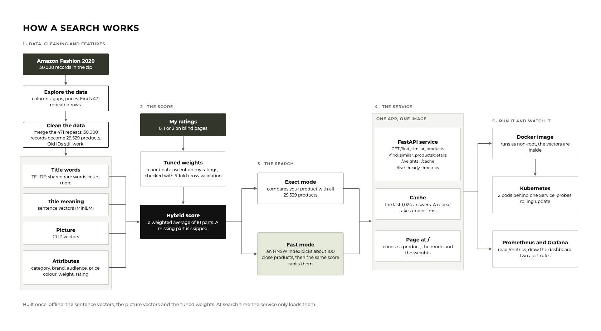

*From the zip to a running service. The vectors and the tuned weights are built once, offline, and the service only loads them.*

I started by exploring the data ([notebook 01, section 11 Conclusion](notebooks/01_data_exploration.ipynb)) and cleaning it ([02, section 1 Repeated products](notebooks/02_preprocessing.ipynb)): 471 repeated rows were merged, so the 30,000 records became 29,529 products.

Then I turned every product into features:

- **Title words (TF-IDF):** two titles are similar when they share rare words, and common words count less ([03, section 2 Why each product is similar](notebooks/03_baseline_examples.ipynb)).
- **Title meaning (sentence vectors):** titles with a similar meaning get close numbers, even with different words ([07, section 1 The model](notebooks/07_sentence_vectors_on_titles.ipynb)).
- **Picture (CLIP vectors):** pictures that look alike get close numbers ([05, section 2 Turning pictures into vectors](notebooks/05_image_similarity.ipynb), [06, section 3 Turning all pictures into vectors](notebooks/06_clip_whole_catalogue.ipynb)).
- **Attributes:** category, brand, audience, price, colour, weight and rating, each compared in its own way ([03, section 2 Why each product is similar](notebooks/03_baseline_examples.ipynb)).

Each feature gives a similarity score, and a weightage says how much that feature counts in the final score.

There is no answer key, so I rated results myself on blind pages ([04, section 1 The ratings](notebooks/04_evaluation_baseline.ipynb)). I tuned the weightage on those ratings, one weight at a time, and checked it with 5-fold cross-validation. I shuffled my 30 development products with a fixed seed into 5 groups, tuned on 4 groups, and scored the group left out, five times. So the scores come from products the weights had not seen ([08, section 2 Choosing the weights](notebooks/08_hybrid_search.ipynb)). The 20 locked products were kept aside for the final test ([14, section 1 How the test was done](notebooks/14_final_test.ipynb)).

A search runs in one of two modes. Exact compares with every product. Fast uses an HNSW index to pick about 100 close products first ([09, section 3 The fast methods](notebooks/09_fast_vector_search.ipynb), [10, section 2 Results: every method, with and without PCA](notebooks/10_shorter_vectors_pca.ipynb), [11, section 1 How I did it](notebooks/11_tsne_picture_vectors.ipynb), [12, section 1 How the final search works](notebooks/12_final_search.ipynb)). Repeated questions are answered from a cache ([13, section 1 How my cache works](notebooks/13_caching.ipynb)). The service is a FastAPI app with the cache and a page ([15, sections 1 to 5](notebooks/15_stronger_api.ipynb)), packaged as a Docker image and run on Kubernetes with 2 pods. Prometheus and Grafana show how it behaves.

## Tech stack

The Architecture picture shows the flow, and this table names the tool behind each box. The versions are the ones pinned in [`requirements.txt`](requirements.txt) and [`pyproject.toml`](pyproject.toml), and the Prometheus and Grafana versions are pinned in the files in [`monitoring/`](monitoring/).

| Area | Tool | Used for |
|---|---|---|
| Language | Python 3.10 (3.9 or newer works) | everything |
| Data and maths | numpy 2.0.2, scipy 1.13.1, scikit-learn 1.6.1 | loading, scoring, TF-IDF, PCA and t-SNE |
| Title features | TF-IDF (scikit-learn); the `all-MiniLM-L6-v2` sentence model from Hugging Face, through `sentence-transformers` | title words and title meaning |
| Picture features | CLIP (`openai/clip-vit-base-patch32`, through `transformers` and PyTorch); ResNet-50 (through `torchvision`) as the comparison | picture vectors |
| Vector search | FAISS 1.13.0 (Flat, HNSW and IVF); Annoy 1.17.1 for the benchmark | the fast mode and the speed tests |
| **Experiment tracking** | **MLflow** (2.16 or newer) | every experiment run is recorded with its settings, the weights, the data fingerprint and its scores (nDCG@10, Precision@10 and time), so runs can be compared side by side. The screenshots in this README come from it. The MLflow databases stay on my computer and are not in Git, and the service never uses MLflow. |
| Service | FastAPI 0.128.8 and uvicorn 0.39.0 | the endpoint and the page |
| Packaging and deployment | Docker (`python:3.10-slim`) and Kubernetes | the image, 2 pods, a Service, probes and a rolling update |
| Automation | GitHub Actions | tests, Docker and Kubernetes checks and the security scans, on every push |
| Monitoring | Prometheus 2.55 and Grafana 11.3 in the cluster files (on my laptop I ran the newer Homebrew versions for the screenshot), with `prometheus-client` 0.21.1 in the service | the numbers on `/metrics`, the dashboard and the alert rules |
| Quality | pytest, ruff, pip-audit and Trivy | tests, code style and security scans |

**What is in the Docker image, and what is not.** The image holds only what the service needs: FastAPI, uvicorn, numpy, scipy, scikit-learn, FAISS, `prometheus-client`, and the half-size vector files. PyTorch, `transformers`, `sentence-transformers`, MLflow, Annoy and the notebooks are used offline, to build the vectors and run the experiments, and they are not in the image.

## How this answers the brief (code)

The assignment has three parts. This section shows the code for each, with a link to the full file. I do not use the sample's pandas `df`: the brief says to find an alternative, so my loader reads the zip in place with `zipfile` ([`data.py`](src/product_similarity/data.py)).

| The brief asks for | Done | Where |
|---|---|---|
| **Part 1.** `find_similar_products(product_id, num_similar)` returning a list of IDs, using brand, colour, price, image, sales price, weight and rating | Yes, and I also use the title, category and audience | [`service.py`](src/product_similarity/service.py), [`scoring.py`](src/product_similarity/scoring.py) |
| **Part 2.** `GET /find_similar_products` with FastAPI | Yes, with clear error codes instead of the sample's `raise e` | [`api.py`](src/product_similarity/api.py), [`app.py`](app.py) |
| **Part 2.** An image that can be deployed on Kubernetes, from the sample Dockerfile | Yes | [`Dockerfile`](Dockerfile) |
| **Part 2, optional.** A local cluster | Yes, deployed and tested in a temporary cluster in CI | [`k8s/`](k8s/), see [Kubernetes](#kubernetes) |
| **Part 3, bonus.** Vector search, with the paper and why I chose it | Yes: HNSW | [`hybrid.py`](src/product_similarity/hybrid.py), [notebook 09](notebooks/09_fast_vector_search.ipynb) |
| **Suggested approaches.** PCA, t-SNE, caching | Yes | [PCA](#5-shorter-vectors-pca), [t-SNE](#6-drawing-the-vectors-t-sne), [Caching](#8-the-cache) |

### Part 1: the function

```python
# src/product_similarity/service.py
def find_similar_products(product_id: str, num_similar: int) -> list[str]:
    return default_engine().find_similar(product_id, num_similar)
```

`list[str]` is the same as `List[str]` in the sample. The function follows the five steps of the brief:

1. **Retrieve the product.** `resolve(product_id)` finds the product's row. An old ID of a repeated product maps to the product I kept.
2. **Compare it with all the others.** `attribute_similarities(i)` compares the product with every other product on each attribute at once, with numpy.
3. **Calculate a similarity score.** Each attribute has its own measure (same or different, closeness on a log scale, closeness in stars, overlap of colours), and the vectors use cosine similarity. `combine` mixes them into one weighted average (shortened here):

```python
# src/product_similarity/scoring.py, combine()
for name, sim in sims.items():
    known = ~np.isnan(sim)                              # skip a part a product does not have
    total += np.where(known, weight * np.nan_to_num(sim), 0.0)
    weight_sum += np.where(known, weight, 0.0)
return total / weight_sum                               # weighted average of the known parts
```

4. **Sort in descending order, with a tie-break.** Equal scores are ordered by product ID, and a product is never its own match:

```python
# src/product_similarity/ranking.py, rank_indices()
rounded = np.round(scores.astype(float), 6)     # tiny rounding errors cannot decide the order
order = np.lexsort((id_rank, -rounded))         # best score first, ties by product ID
return order[order != exclude]
```

5. **Return the first `num_similar` IDs.**

- **Used in the final search:** yes. This is the function behind the endpoint and the page.
- **How each feature is compared** is in the next sections, and the weights are in [Hybrid search](#3-the-mix-hybrid-search).

*Notebooks: [03 Baseline examples, sections 1, 2 and 6](notebooks/03_baseline_examples.ipynb) (five real queries, why each product is similar, correctness checks on the real data), and [08 Hybrid search, section 2, Choosing the weights](notebooks/08_hybrid_search.ipynb).*

### Part 2: the microservice

The endpoint is `GET /find_similar_products` with the two required parameters. The extra parameters `mode` and `weights` are optional (shortened here):

```python
# src/product_similarity/api.py
@app.get("/find_similar_products", response_model=list[str])
def find_similar_products(
    request: Request, response: Response,
    product_id: str = Query(..., pattern=ID_PATTERN),      # 32 lowercase hex characters
    num_similar: int = Query(..., ge=1, le=max_results),   # 1 to 1,000
    mode: Optional[str] = Query(None),                     # optional: exact or fast
    weights: Optional[str] = Query(None),                  # optional: my own weights
) -> list[str]:
    ...
    except ProductNotFoundError:
        raise ApiError(404, "product_not_found", f"no product has the ID {product_id}")
    return [uid for uid, _ in ranked]
```

`app.py` has the same `if __name__ == "__main__"` block as the sample. The errors have one clear shape (`{"error": "<code>", "message": "<a sentence>"}`): 422 for wrong input, 404 for an unknown product, 503 while the data loads, and 500 for anything unexpected. The full list is in [The service and Docker](#the-service-and-docker).

- **Used:** yes, this is the endpoint the page and the checks call. `mode` and `weights` let a caller choose the search mode and the weights for one search.
- **Tested:** by the unit tests, and on every push by CI, which starts the service and calls the endpoint (see [Tests and CI/CD](#tests-and-cicd)).

*Notebook: [15 A stronger API, sections 1 to 5](notebooks/15_stronger_api.ipynb) (the parameters, the errors, the `mode` option, the `weights` option and the cache question).*

The **Dockerfile** keeps the sample's base image, port, `ENV NAME` and `uvicorn` command, and adds what a real service needs:

```dockerfile
FROM python:3.10-slim
WORKDIR /app
COPY requirements.txt .
RUN pip install --no-cache-dir -r requirements.txt   # pinned packages first, so this layer is cached
COPY src ./src                                       # only what the service needs, not the notebooks
COPY app.py .
COPY data/archive.zip ./data/archive.zip
COPY artifacts/vectors ./artifacts/vectors           # the half-size picture and sentence vectors
RUN useradd --create-home --uid 10001 appuser
USER appuser                                         # does not run as root
EXPOSE 8000
CMD ["uvicorn", "app:app", "--host", "0.0.0.0", "--port", "8000"]
```

The Kubernetes files are in [`k8s/`](k8s/), explained in [Kubernetes](#kubernetes).

- **Deployed:** the image is built and run in CI on every push, and the Kubernetes files (2 pods behind one Service) are deployed and tested in a temporary cluster in CI. I did not deploy to a real cluster. There is no notebook for this part, because CI is the proof.

### Part 3: vector search (bonus)

The slow part of a search is comparing the picture and sentence vectors with every product. I replaced that with an **HNSW index** from FAISS (Y. A. Malkov and D. A. Yashunin, "[Efficient and Robust Approximate Nearest Neighbor Search Using Hierarchical Navigable Small World Graphs](https://doi.org/10.1109/TPAMI.2018.2889473)," *IEEE Transactions on Pattern Analysis and Machine Intelligence*, vol. 42, no. 4, pp. 824-836, 1 April 2020; library: J. Johnson, M. Douze and H. Jégou, "[Billion-Scale Similarity Search with GPUs](https://doi.org/10.1109/TBDATA.2019.2921572)," *IEEE Transactions on Big Data*, vol. 7, no. 3, pp. 535-547, 1 July 2021). There is one index for the sentence vectors and one for the picture vectors (shortened here):

```python
# src/product_similarity/hybrid.py, _build_indexes_now()
index = faiss.IndexHNSWFlat(data.shape[1], 16, faiss.METRIC_INNER_PRODUCT)
index.hnsw.efConstruction = 200
index.hnsw.efSearch = self.ef_search
index.add(data)

# candidate_rows(): about 100 nearest products by sentence vector and by picture vector
hits = index.search(matrix[i : i + 1].astype(np.float32), count + 1)[1][0]
rows = np.unique(np.concatenate(found))
```

Only those candidates are then scored with the same 10-part score, so the answer keeps the same quality.

**Why HNSW:** I compared it with FAISS Flat (exact), IVF and Annoy on the same vectors. HNSW was about 60 times faster than the exact search and still found 97% of the exact top 10, so it gave the best speed for the recall. I also tested shorter vectors with PCA and dropped them, because they lost too much recall. The measured results are in [Fast vector search](#4-fast-search) and [notebook 09, section 3, The fast methods](notebooks/09_fast_vector_search.ipynb), and the final comparison is in [Results at a glance](#results-at-a-glance).

- **Used in the final search:** yes, as the **fast mode**. The exact mode stays the default, and the fast mode gives nearly the same quality about 15 to 17 times faster.

*Notebooks: [09 Fast vector search, sections 1 to 4](notebooks/09_fast_vector_search.ipynb) (how I measured, the exact baseline, the fast methods, the fast index inside the hybrid), [10 Shorter vectors with PCA](notebooks/10_shorter_vectors_pca.ipynb), [11 t-SNE](notebooks/11_tsne_picture_vectors.ipynb) and [12 The final search, section 1](notebooks/12_final_search.ipynb).*

## Results at a glance

I scored every method against my own ratings (0, 1 or 2) on the 30 development products, then ran a final test on 20 products I had locked away from the start. I rated each result on a blind page: a card with the picture and 0, 1 and 2 buttons, with no method names shown. How the ratings work is in [notebook 04, section 1 The ratings](notebooks/04_evaluation_baseline.ipynb).


**Which products?** I picked 50 products with a fixed seed, so anyone gets the same 50. They come from seven groups, so they are not all alike:

| Group | How a product qualifies | Taken |
|---|---|---|
| Common category | its category has 500 or more products | 12 |
| Rare category | its category has fewer than 50 products | 6 |
| Sparse data | 4 or fewer of its attributes are known | 8 |
| Complete data | 7 or more of its attributes are known | 8 |
| Repeated title | the same title appears 3 or more times | 8 |
| Low price | price under 300 INR | 4 |
| High price | price over 2,000 INR | 4 |

30 of them are the **development products**, which I used to compare the methods and tune the weights. The other 20 are **locked**: I never used them for tuning or for choosing a method until the final test. The full list is in [`evaluation/queries.json`](evaluation/queries.json), and the details are in [How the results were evaluated](#how-the-results-were-evaluated).

Two scores are used. **Precision@10** is how many of the 10 results I returned were relevant (rated 1 or 2). The rest are noise (rated 0). A precision of 0.87 means about 8.7 relevant results in 10. **nDCG@10** also rewards putting the best results first. Higher is better for both. Compare rows inside one table only, because each table was rated on its own pool of results.

**1. Which features matter** (30 development products)

| Method | nDCG@10 | Precision@10 |
|---|---|---|
| **Hybrid, 4 weights (final)** | **0.806** | **0.87** |
| Hybrid, 10 weights | 0.764 | 0.82 |
| Picture only (CLIP) | 0.750 | 0.85 |
| Title meaning only (sentence vectors) | 0.659 | 0.76 |
| First baseline (title words and attributes) | 0.637 | 0.74 |
| Title words only (TF-IDF) | 0.498 | 0.55 |
| Attributes only | 0.420 | 0.62 |

The hybrid is my approach of combining everything into one score. **4 weights** means four features: title words, title meaning, picture and attributes (the seven attributes counted together). **10 weights** means ten features: title words, title meaning, picture, and each of the seven attributes (category, brand, audience, price, colour, weight and rating) on its own. The hybrid scores come from products the weights had not seen (5-fold cross-validation). Combining everything beats every single feature, and four weights beat ten.

Notebook: [08 Hybrid search, section 8 Scoreboard](notebooks/08_hybrid_search.ipynb). Numbers: [`dev_hybrid_scoreboard.csv`](results/dev_hybrid_scoreboard.csv).

**2. Exact against fast** (30 development products)

| Mode | How it works | nDCG@10 | Precision@10 | Time per search |
|---|---|---|---|---|
| Exact | compares your product with all 29,529 products (the 30,000 records after merging the 471 repeats) | 0.8105 | 0.877 | 8.5 ms |
| Fast | uses the HNSW approach: an index picks about 100 close products first | 0.8095 | 0.877 | 0.58 ms |

Nearly the same quality, about 15 times faster.

Notebook: [12 Final search, section 3 The comparison: exact mode against fast mode, and section 5 Time](notebooks/12_final_search.ipynb). Numbers: [`fast_vs_exact_check.json`](results/fast_vs_exact_check.json).

**3. The final test** (20 locked products, rated once)

| Mode | nDCG@10 | Precision@10 | Time per search |
|---|---|---|---|
| Exact | 0.9659 | 0.87 | 7.0 ms |
| Fast (HNSW) | 0.9657 | 0.87 | 0.42 ms |

Of the 200 results I rated, 174 were relevant (rated 1 or 2) and 26 were noise (rated 0), which is a precision of 0.87, the same as on the development products. The fast mode is about 17 times faster with the same precision.

The nDCG is near 1 here for a simple reason. nDCG asks how close my top 10 is to the best top 10 I could build from all the results I rated. In the earlier tables the rated results came from many methods, some good and some bad. In this test I only rated results from the final system, so there was nothing better to compare against, and the score comes out high. So in this table, trust Precision@10.

Notebook: [14 Final test, section 2 Product by product, and section 3 How to read the nDCG@10 here](notebooks/14_final_test.ipynb). Numbers: [`final_test_scores.json`](results/final_test_scores.json).

**4. The cache**

| | Time |
|---|---|
| A new search | 9.6 ms |
| The same search again (cache hit) | 0.77 ms |

About 12 times faster.

The cache is **in-process**: each running copy of the service keeps the last 1,024 answers in its own memory. A question is the product, the number of results, the mode and the weights. Answers for more than 100 results are never kept. The cache is lost when the service restarts, and each Kubernetes pod has its own. A shared cache such as Redis would fix that, and I describe it as the upgrade but did not build it. More in [Caching](#8-the-cache).

Notebook: [13 Caching, section 2 One request: a miss against a hit](notebooks/13_caching.ipynb). Numbers: [`cache_benchmark.json`](results/cache_benchmark.json).

## Data exploration (EDA)

Before building anything, I wanted to know how much I can trust each attribute. I loaded SAP's data straight from the zip (it is read in place and never extracted) and checked that it is exactly the file SAP supplied. A few fields that are stored as text but are really numbers (price, rating, review counts) are converted while reading, and everything else is left as it came. Then I plotted the main attributes.

I had also written down 24 facts from a first quick look at the data, such as "30,000 rows", "471 repeated rows", "median price 590" and "6,611 products have a rating but no reviews". The notebook recalculates each of those 24 numbers directly from the zip and compares it with what I had written, and it stops with an error if any of them differ. All 24 matched, so the facts in this README are not typed in by hand. Everything is in [notebook 01](notebooks/01_data_exploration.ipynb).

**1. Name, category and image are almost always there.** Name 100%, image 99.99% and category 99.67%. Every comparison has something solid to work with, so these are the main features.

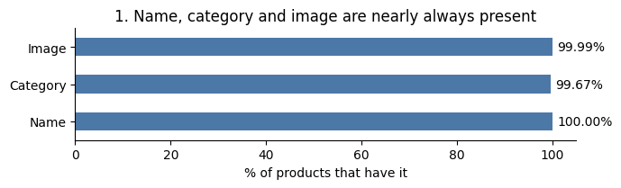

*Notebook: [01 Data exploration, section 3, Missing values](notebooks/01_data_exploration.ipynb).*

**2. Brand and price have gaps.** 27.1% of products have no brand and 9.6% have no price. I compare two products only on what they both have, and I never fill a gap with a made-up value.

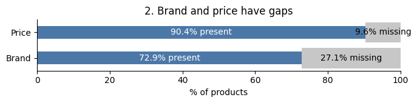

*Notebook: [01 Data exploration, section 3, Missing values](notebooks/01_data_exploration.ipynb).*

**3. Price is skewed.** The median is 590 INR (the mean is 862), but a few products cost nearly 10,000 and would dominate the comparison. So I compare prices by ratio, on a log scale: 300 against 600 counts the same as 3,000 against 6,000.

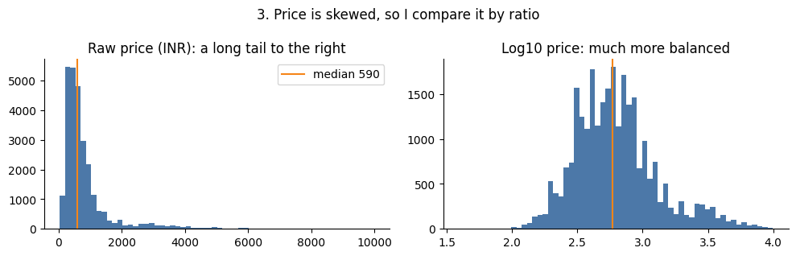

*Notebook: [01 Data exploration, section 4, Price](notebooks/01_data_exploration.ipynb).*

**4. Weight is mostly missing.** Only about 21% of products have a real weight. The rest hold the placeholder `999999999`, and the real weights are mostly round defaults like 200 g. So the placeholder counts as missing, and weight gets very little influence.

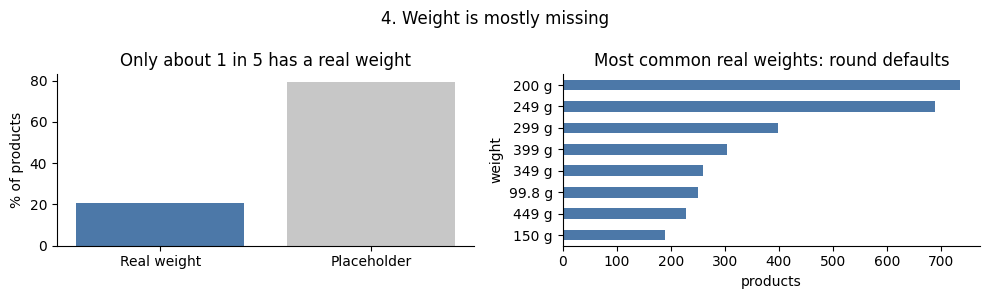

*Notebook: [01 Data exploration, section 6, Weight](notebooks/01_data_exploration.ipynb).*

**5. Colour is a list of options, not the product's colour.** The data has a colour field for only about 20% of products, and it holds a list of everything the product comes in, for example "Black, Blue, Grey". It is not the colour of the item you see in the photo, so from that field alone I cannot tell which colour this particular product is. What I do instead is read the colour from the title, using a fixed list of colour words (for example "Navy Blue Kurta" gives navy blue). The listed colours are kept only as weak evidence.

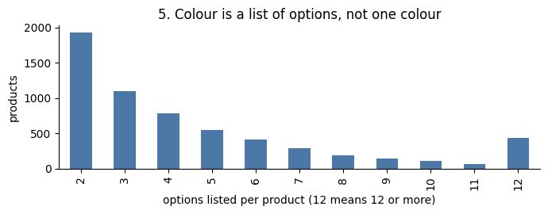

*Notebook: [01 Data exploration, section 11, Conclusion (the fifth finding)](notebooks/01_data_exploration.ipynb).*

**6. Rating is unreliable.** A product with one review is a perfect 5.0 half of the time, while products with 100 or more reviews never are. And 6,611 products show a rating but have no reviews. So rating gets a small influence.

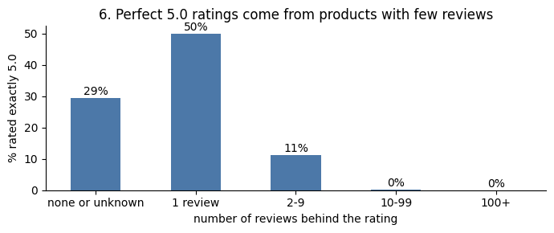

*Notebook: [01 Data exploration, section 5, Rating and review volume](notebooks/01_data_exploration.ipynb).*

**7. The same product appears more than once.** 471 rows are re-collected copies, so the 30,000 records are 29,529 distinct products. I keep one record per product, every old ID still works, and a product is never returned as its own match.

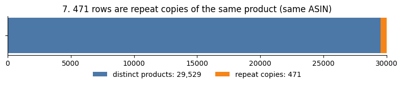

*Notebook: [01 Data exploration, section 7, Repeated titles and ASINs](notebooks/01_data_exploration.ipynb).*

**8. Many products share a title.** 10,147 products (34%) share an exact title with another product, so titles alone would give ties. I combine the title with the picture and the attributes. If two products still get the same score, the one with the smaller product ID goes first. Scores are rounded to 6 decimals first, so tiny computer rounding errors cannot change the order. The same question always gives the same list.

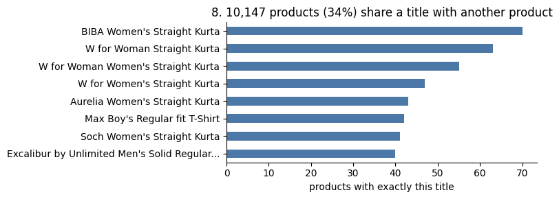

*Notebook: [01 Data exploration, section 7, Repeated titles and ASINs](notebooks/01_data_exploration.ipynb).*

**9. Many categories are tiny.** 144 of the 218 categories have fewer than 20 products, so a strict category filter would leave too few results. Category is a strong hint, not a hard filter.

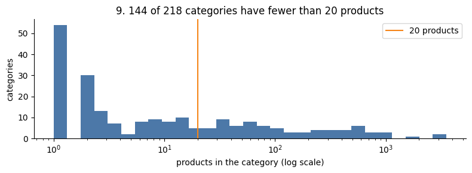

*Notebook: [01 Data exploration, section 8, Categories](notebooks/01_data_exploration.ipynb).*

**10. Nearly every product has pictures.** 29,998 products have image links, most have about four, and about 99% of a 300-link sample worked. I checked the pictures themselves later (see [Image sample check](#1-pictures)).

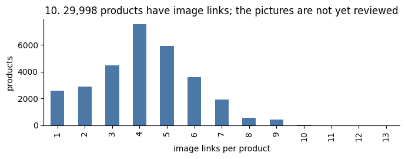

*Notebook: [01 Data exploration, section 9, Images](notebooks/01_data_exploration.ipynb).*

**Overall.** The data is complete enough to build similarity around the title, the category and the picture, with brand and price as support. Weight, colour and rating are too incomplete or unreliable to lead, so they carry little influence. Repeated products, repeated titles and missing values are the main risks, and each has a fix, which the next section covers. The data tells me how much to trust each attribute, but not which products shoppers consider similar, so I measured that with my own ratings (see [Results at a glance](#results-at-a-glance)).

Notebook: [01 Data exploration](notebooks/01_data_exploration.ipynb), the findings in its conclusion.

## Preprocessing (cleaning the data)

The raw file is never changed. It is read in place, and each step below turns the raw rows into cleaned product records, with before-and-after charts in [notebook 02](notebooks/02_preprocessing.ipynb). The logic lives in the package (`data.py` and `preprocessing.py`), and the notebook only runs it and plots the results. A few numbers differ slightly from the exploration section, because here they are counted on the 29,529 products left after the repeats are removed.

**Goal:** clean the raw data so products can be compared fairly, without changing SAP's original file.

**1. Repeated products**
- **What I did:** the same product shows up in several rows because it was collected more than once. I keep the newest row (and the one with the lowest ID if they tie), and every old ID points to it, so all 30,000 IDs still work. 471 rows (1.6%) were repeat copies.
- **Example:** a Captain America T-shirt appears 3 times. I keep the newest one.
- **Why:** so the same product can't show up twice in the results, and a product can never match itself.

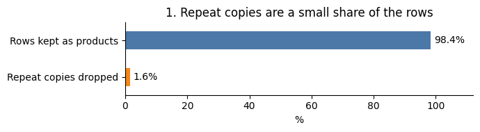

*Notebook: [02 Preprocessing, section 1, Repeated products](notebooks/02_preprocessing.ipynb).*

**2. Weight**
- **What I did:** treated the fake number `999999999` as "unknown" and converted units to grams. The weight code rejects any value under 1 g or over 5 kg, and the notebook prints a table of every rejected value (9 products). I printed every weight the code rejected and read through them.
- **Example:** stockings listed as "136 Kilograms" are removed. That table is where I saw them. "1.4 Kg" becomes 1,400 g.
- **Why:** only about 1 in 5 products (20.9%) has a real weight, so it will matter very little.

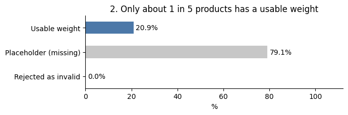

*Notebook: [02 Preprocessing, section 2, Weight](notebooks/02_preprocessing.ipynb).*

**3. Brand**
- **What I did:** merged different spellings of the same brand and treated "Unknown" as missing. The distinct brand names dropped from 6,458 to 6,294. Nothing is guessed.
- **Example:** "Print Mafias", "Print mafias" and "print mafias" become one brand.
- **Why:** so products from the same brand count as matching.

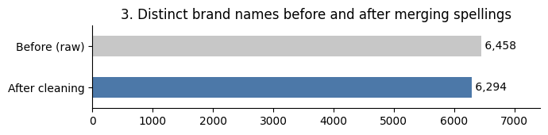

*Notebook: [02 Preprocessing, section 3, Brand](notebooks/02_preprocessing.ipynb).*

**4. Category**
- **What I did:** when a category was missing, I copied the most common category of the products on the same Amazon shelf. The shelf is the section of the Amazon store a product is listed in, and products on the same shelf are usually the same kind of item.
- **Example:** "Pepe Jeans Boy's T-Shirt" had no category, so it got `BoysT_Shirts` from its shelf.
- **Why:** category is our strongest signal, and now 98.8% of products have one.

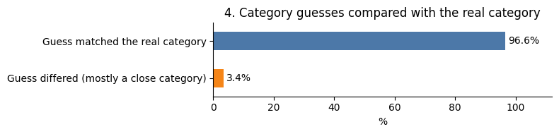

*Notebook: [02 Preprocessing, section 4, Category](notebooks/02_preprocessing.ipynb).*

**5. Colour**
- **What I did:** the colour column lists every option, so I also read colour words from the title. Coverage rose from 19% to 44%. On the 529 products that have both, the title colour is among the listed options 83.4% of the time.
- **Example:** a saree's title says "Blue Sari", so the colour from the title is blue. But its colour column lists orange, pink and red, with no blue in it. The two sources disagree, and I cannot tell which one is right.
- **Why:** colour is only a weak hint, so it has one of the lowest weights. A hint raises the score a little, and it never throws a product out, as a filter would.
- **Used in the final search:** yes. For each product I gather the colours from the title and from the column into one set, and two products are compared by how many colours they share. A product with no colour is skipped for this part.

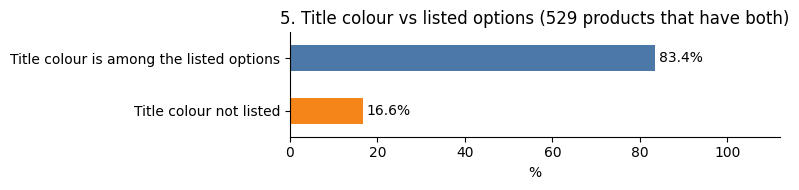

*Notebook: [02 Preprocessing, section 5, Colour](notebooks/02_preprocessing.ipynb).*

**6. Audience (men, women, boys, girls, baby)**
- **What I did:**
  1. The data has no audience column at all, meaning who the product is for: men, women, boys, girls or baby. So I worked it out myself.
  2. I read it from the category first (a category like "Boys T-shirts" tells it), and from the title as a second source (for example "Women's Cotton Kurta").
  3. Then I compared the two against each other. On the 23,670 products where both give an answer, they agree 89.4% of the time.
  4. I looked at the other 10.6%. Most are different levels of detail (the category says "girls" while the title says "baby girls") or a title that names several groups. A few are wrong category labels.
  5. So I use the category first and the title when the category says nothing. In the end 99.1% of products have an audience, and about 1% have none.
- **Example:** a boys' bow tie is filed under men's, so the label is wrong.
- **Why:** shoppers do not treat a men's shirt and a girl's dress as similar, so it helps to know who a product is for.
- **Used in the final search:** yes. Audience is one of the seven attributes, and two products are compared as same or different. It counts with its own weight (0.10 by default).
- **A hint, not a filter:** a filter is a hard rule that throws products out (for example "only show the same audience"). A hint only raises the score a little. So two products for the same audience score higher, but a product for another audience can still appear if it matches well on the other features.

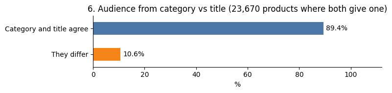

*Notebook: [02 Preprocessing, section 6, Audience](notebooks/02_preprocessing.ipynb).*

**7. Guessing a missing brand from the title (built, tested, but not used)**
- **What I did:** built a way to fill a missing brand from the first words of the title, and tested it on products that already have a brand. It was right 98.2% of the time.
- **Example:** "Puma Unisex T-Shirt" has no brand, so the guess is Puma. But a Florsheim belt with "Stacy Adams" in its title would get the wrong brand.
- **Why I don't use it:** products with no brand may be different from the ones I tested on, and I haven't checked it on them. So missing brands stay missing.

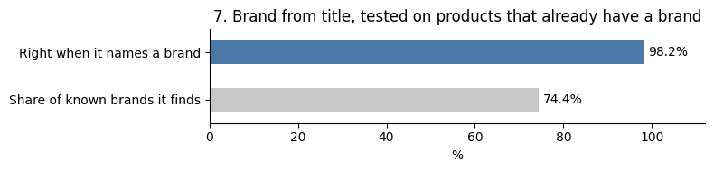

*Notebook: [02 Preprocessing, section 9, Brand recovery from titles (switched off)](notebooks/02_preprocessing.ipynb).*

**8. Rating and price**
- **What I did:** kept the rating together with the review count, so I can tell a rating that real reviews back from one that nothing backs. I kept the price in two forms, the raw price and its log (see [Data exploration](#data-exploration-eda), finding 3).
- **Example:** a vest has a rating of 1.0, but its page says "Be the first to review this item", so nobody has reviewed it. 6,571 products are like this.
- **Why:** a rating with no reviews behind it cannot be trusted, so the rating only gets a small influence on the score (the weights are tuned later, see [Hybrid search](#3-the-mix-hybrid-search)).
- **Used in the final search:** yes, both, each with a small weight. **Price** is compared by closeness on a log scale (a 10 times difference scores 0). Its default weight among the attributes is 0.10, which is about 3.5% of the final score. **Rating** is compared by closeness in stars (4 stars apart scores 0). Its default weight is 0.05, which is about 1.8% of the final score.

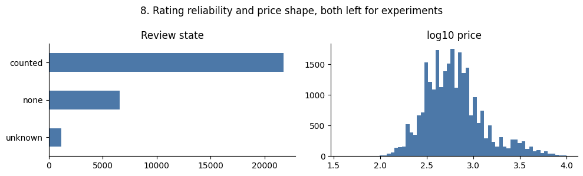

*Notebook: [02 Preprocessing, sections 7 and 8, Reviews and rating, Price](notebooks/02_preprocessing.ipynb).*

**What I added and what I only cleaned.** A cleaned record has 17 fields. Seven of them did not exist in the raw data as such, and I created them:

| Field I created | How |
|---|---|
| Audience | worked out from the category, then the title |
| Title colour | colour words read from the title (kept next to the listed colours) |
| Log price | the log of the price, so a few very expensive items don't dominate |
| Category source | records where the category came from (the category field, or filled from the shelf) |
| Review state | "counted", "none" or "unknown", from the rating and the review count |
| Page rating | the rating read from the product page, kept next to the raw rating |
| Review count | the number of reviews, read from the page |

Three fields were cleaned, not created: the **brand** (spellings merged), the **weight** (the fake `999999999` removed and the units changed to grams) and the **category** (filled in when it was missing).

**What the cleaned records contain.** The chart below shows the final result, measured once after all the cleaning steps: the share of the 29,529 products that have a usable value for each field. These are the fields I carry into the next step, where they become the features of the search. The data is strong on name, image, category, audience and price, and weak on weight, colour and rating. So the first group leads. Missing information stays missing, and two products are compared only on what both have.

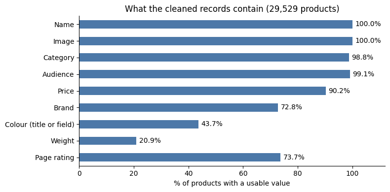

*Notebook: [02 Preprocessing, section 10, Coverage after cleaning](notebooks/02_preprocessing.ipynb).*

## Features in detail

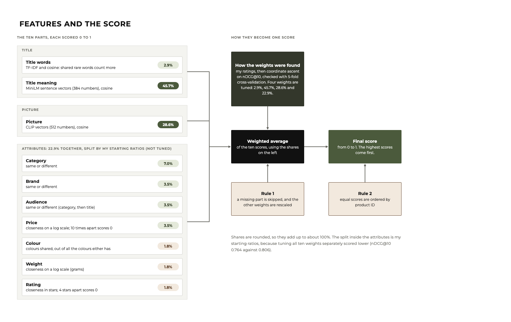

*The ten parts, how each one is compared, and how they become one score.*

A search compares your product with every other product on ten parts. Each part gives a score from 0 (nothing alike) to 1 (the same), and the final score is a weighted average of the ten. A part that a product does not have is skipped (see the two rules at the end). The last column shows how much each part counts in the final, tuned mix (rounded, so it adds up to about 100%).

| Part | Where it comes from | Counts for |
|---|---|---|
| Title words | the title, as words (TF-IDF) | 2.9% |
| Title meaning | the title, as meaning (sentence vectors) | 45.7% |
| Picture | the first picture (CLIP vectors) | 28.6% |
| Category | the category field, or the shelf | 7.0% |
| Brand | the brand, cleaned | 3.5% |
| Audience | worked out from the category and the title | 3.5% |
| Price | `sales_price` | 3.5% |
| Colour | the title and the colour column | 1.8% |
| Weight | the weight, in grams | 1.8% |
| Rating | the rating | 1.8% |

### How much each part counts

These shares are not set by hand. I found them by tuning against my own ratings:

1. I tuned the four main weights (title words, title meaning, picture, and the seven attributes together). The method is **coordinate ascent**: change one weight at a time, keep the value that gives the best **nDCG@10** on my ratings, and repeat until nothing improves.
2. I checked the result with **5-fold cross-validation**: the weights were tuned on some products and scored on products they had not seen. (Notebook 08, [section 3, First try](notebooks/08_hybrid_search.ipynb) and [section 5, Tuning again](notebooks/08_hybrid_search.ipynb).)
3. The result: title words 2.9%, title meaning 45.7%, picture 28.6%, attributes 22.9%.

**How coordinate ascent works, in four steps**

1. Start with some weights, for example title words 0.30, title meaning 0.30, picture 0.30, attributes 0.10, and score them: nDCG@10 on my ratings.
2. Take the **first weight only**. Try each value on the grid while the others stay as they are, and keep the one that gives the highest nDCG@10.
3. Do the same for the second weight, then the third and the fourth. That is one round.
4. Repeat the rounds. **Stop when a whole round changes nothing.** I did this from five different starting points and kept the best result, so that one bad starting point does not decide the result.

The weights then count only in proportion (they are divided by their sum), which is how they become the shares in the table above. For example, the best weights I found were 0.025, 0.4, 0.25 and 0.2, which add up to 0.875:

| Weight | Tuned value | Divided by 0.875 | Share |
|---|---|---|---|
| Title words | 0.025 | 0.0286 | 2.9% |
| Title meaning | 0.4 | 0.4571 | 45.7% |
| Picture | 0.25 | 0.2857 | 28.6% |
| Attributes | 0.2 | 0.2286 | 22.9% |

*Notebook: [08 Hybrid search, sections 2 and 5, and the conclusion](notebooks/08_hybrid_search.ipynb) (choosing the weights, the five starting points and the 5-fold cross-validation). Code: [`tuning.py`](src/product_similarity/tuning.py). Numbers: [`hybrid_tuning.json`](results/hybrid_tuning.json) and [`coordinate_ascent_trace.json`](results/coordinate_ascent_trace.json), made by [`trace_coordinate_ascent.py`](experiments/trace_coordinate_ascent.py).*

Inside the attributes group, the split between the seven attributes (category 7.0%, brand, audience and price 3.5% each, colour, weight and rating 1.8% each) uses my own starting ratios, and it is **not tuned**. I tried tuning all ten weights separately, and it scored lower (nDCG@10 0.764 against 0.806 for the four-weight version), so I kept the four tuned weights. Details: [Hybrid search](#3-the-mix-hybrid-search), and [notebook 08, sections 2, 5, 6 and 7](notebooks/08_hybrid_search.ipynb).

**How good is each part on its own** (the same 30 development products and the same rating pool):

| Method | nDCG@10 | Precision@10 |
|---|---|---|
| Title words only | 0.498 | 0.55 |
| Title meaning only | 0.659 | 0.76 |
| Picture only | 0.750 | 0.85 |
| Attributes only | 0.420 | 0.62 |
| **All combined (the hybrid)** | **0.806** | **0.87** |

### The title

**1. Title words (TF-IDF)**
- **What I did:** turned every title into a list of word counts, where a word that appears in few titles counts more than a common one, and compared two titles with cosine similarity.
- **Example:** "Kalamkari" appears in few titles, so two titles that both have it are very alike. "Women's" appears in thousands of titles, so sharing it says little.
- **Why:** it is simple, fast and catches exact shared words. Its weakness is that it cannot see that two different words mean the same.
- **Used in the final search:** yes, but it counts for only 2.9%, because the other features turned out to be better. On its own it is the weakest title feature.

*Reference: K. Spärck Jones, "[A statistical interpretation of term specificity and its application in retrieval](https://doi.org/10.1108/eb026526)," Journal of Documentation, 1972. Notebooks: [03 Baseline examples, section 2](notebooks/03_baseline_examples.ipynb) and [08 Hybrid search, section 8, Scoreboard](notebooks/08_hybrid_search.ipynb).*

**2. Title meaning (sentence vectors)**
- **What I did:** turned every title into 384 numbers with a ready-made sentence model (`all-MiniLM-L6-v2` from Hugging Face), so that titles with a similar meaning get numbers that are close together. Two titles are compared with cosine similarity, shifted so that two unrelated products score about 0.
- **Example:** "kurta" and "kurti" are different words for the same garment, and TF-IDF treats them as different. The sentence model puts them close.
- **Why:** it understands meaning, not just words.
- **Used in the final search:** yes, and it is the largest part, 45.7%. On its own it is clearly better than title words (see the table above).

*References: N. Reimers and I. Gurevych, "[Sentence-BERT: Sentence Embeddings using Siamese BERT-Networks](https://doi.org/10.18653/v1/D19-1410)," EMNLP-IJCNLP 2019; W. Wang et al., "[MiniLM: Deep Self-Attention Distillation for Task-Agnostic Compression of Pre-Trained Transformers](https://papers.nips.cc/paper/2020/hash/3f5ee243547dee91fbd053c1c4a845aa-Abstract.html)," NeurIPS 2020; model: [`all-MiniLM-L6-v2`](https://huggingface.co/sentence-transformers/all-MiniLM-L6-v2). Notebook: [07 Sentence vectors on titles, sections 1, 2 and 4](notebooks/07_sentence_vectors_on_titles.ipynb).*

### The picture

**3. Picture (CLIP vectors)**
- **What I did:** downloaded the pictures and turned each one into 512 numbers with CLIP, so that pictures that look alike get numbers that are close together. Two pictures are compared with cosine similarity, shifted the same way as the titles.
- **Example:** two block-print fabrics with a similar pattern are close, even when their titles use different words.
- **Why CLIP and not ResNet:** I tried both on the same pictures and ratings, and CLIP was clearly better:

| Small test (708 pictures) | nDCG@10 | Precision@10 |
|---|---|---|
| CLIP | 0.695 | 0.74 |
| ResNet-50 | 0.569 | 0.63 |

- **Used in the final search:** yes, 28.6%. On its own, picture is the best single part (see the table above). A product without a usable picture is skipped for this part.

*References: A. Radford et al., "[Learning Transferable Visual Models From Natural Language Supervision](https://proceedings.mlr.press/v139/radford21a.html)," ICML 2021, model: [`clip-vit-base-patch32`](https://huggingface.co/openai/clip-vit-base-patch32); K. He et al., "[Deep Residual Learning for Image Recognition](https://doi.org/10.1109/CVPR.2016.90)," CVPR 2016. Notebooks: [05 Image similarity, sections 2 and 3](notebooks/05_image_similarity.ipynb) and [06 CLIP over the whole catalogue, sections 3 and 5](notebooks/06_clip_whole_catalogue.ipynb).*

### The seven attributes

They come from the cleaned fields (see [Preprocessing](#preprocessing-cleaning-the-data)). Each is compared in its own simple way, and all of them are hints, not filters: they raise the score a little and never throw a product out.

**4. Category.** Same or different (1 or 0). A missing category is filled from the Amazon shelf. Counts for 7.0%, the largest attribute.

**5. Brand.** Same or different, after the spellings were merged. Counts for 3.5%. A missing brand stays missing.

**6. Audience.** Same or different. It is worked out from the category and the title, and they agree 89.4% of the time. Counts for 3.5%. (The full story is in Preprocessing, step 6.)

**7. Price.** Closeness on a log scale: `1 − |log10(price A) − log10(price B)|`, never below 0. A 10 times difference scores 0, and 300 against 600 INR scores about 0.70 (the gap is log10(2) = 0.30, and 1 − 0.30 = 0.70). Counts for 3.5%.

**8. Colour.** The two products' colours are compared by how many they share, out of all the colours either has (the colours from the title and from the colour column together). Product A has blue and white, product B has blue and red: they share 1 of 3 colours, so the score is 1 ÷ 3 = 0.33. The same colours score 1 and no shared colour scores 0. Counts for 1.8%.

**9. Weight**
- **What I did:** compare the two weights in grams on a log scale, with the same formula as the price: `1 − |log10(weight A) − log10(weight B)|`, never below 0. On a log scale, what counts is how many times bigger one is than the other, so 200 g against 400 g is as far apart as 2 kg against 4 kg.
- **Example:** 200 g against 400 g is twice as much, log10(2) = 0.30, so the score is 1 − 0.30 = 0.70. 200 g against 2,000 g is 10 times more, log10(10) = 1, so the score is 1 − 1 = 0.
- **Why it counts for little (1.8%):** only 20.9% of products have a real weight, and most of those are round default numbers like 200 g.

**10. Rating**
- **What I did:** compare the two ratings in stars. Ratings go from 1 to 5, so the biggest possible gap is 4 stars. The same rating scores 1, a gap of 4 stars scores 0, and in between each star of gap loses 0.25 (the formula is `1 − gap ÷ 4`, never below 0).
- **Example:**

| Gap between the two ratings | Example | Score |
|---|---|---|
| 0 stars | 4.0 against 4.0 | 1.00 |
| 1 star | 4.5 against 3.5 | 0.75 |
| 2 stars | 5.0 against 3.0 | 0.50 |
| 3 stars | 4.5 against 1.5 | 0.25 |
| 4 stars | 5.0 against 1.0 | 0.00 |

- **Why it counts for little (1.8%):** a rating with no reviews behind it cannot be trusted (6,571 products are like this).

*Notebooks: [03 Baseline examples, section 2](notebooks/03_baseline_examples.ipynb) (what each attribute adds to a score), [02 Preprocessing](notebooks/02_preprocessing.ipynb) (where the fields come from) and [08 Hybrid search, sections 2, 6 and 7](notebooks/08_hybrid_search.ipynb) (the weights).*

### How the final score is calculated (a worked example)

The final score is a weighted average: multiply each part's score by its weight, add them up, and divide by the sum of the weights that were used. Here is an example pair of products. The scores are made up to show the calculation, and the weights are the real shares from the table above. The two products have no weight in common, so that part is skipped.

| Part | Score (0 to 1) | Weight | Score × weight |
|---|---|---|---|
| Title words | 0.40 | 2.9% | 0.0114 |
| Title meaning | 0.85 | 45.7% | 0.3886 |
| Picture | 0.75 | 28.6% | 0.2143 |
| Category | 1.00 (same) | 7.0% | 0.0703 |
| Brand | 0.00 (different) | 3.5% | 0.0000 |
| Audience | 1.00 (same) | 3.5% | 0.0352 |
| Price | 0.70 | 3.5% | 0.0246 |
| Colour | 0.33 | 1.8% | 0.0058 |
| Weight | missing, **skipped** | (1.8%) | |
| Rating | 0.75 | 1.8% | 0.0132 |
| **Total** | | **98.2%** (the weight part is left out) | **0.7634** |

The weights of the parts that were used add up to 98.2% and not 100%, so the total is rescaled: **0.7634 ÷ 0.982 = 0.777**. That is the final score of this pair.

**Why rescale?** So that a pair is not punished for a missing part. The score is calculated out of the parts that could be measured, so a missing part gives no penalty and no bonus. Without the rescaling, a product would lose points just for having no weight.

### Two rules that apply to every part

- **A missing part is skipped.** If either product does not have a part (no picture, no price, no brand), that part is left out, and the weights of the other parts are rescaled so they still add up to 1. Missing data is never filled in with a guess, and a product is never punished for it.
- **A fixed order.** Scores are rounded to 6 decimals, and ties go to the smaller product ID, so the same question always gives the same list.

## How the results were evaluated

The data has no answer key saying which products are similar, so I made one. A method is judged by how well its top 10 results match my ratings.

1. **Test products.** 50 products chosen with a fixed seed from seven groups (common and rare categories, sparse and complete data, repeated titles, low and high prices). 30 are for development, and 20 are **locked** and rated only once at the end.
2. **Blind pooling.** For each development product, the top 10 results of three methods (baseline, title only, attributes only) were mixed into one shuffled list. The page never says which method found a result.
3. **Rating.** Each result gets 0 (not a match), 1 (acceptable) or 2 (strong match), judged as a shopper looking for a substitute. The rules and worked examples are in [`evaluation/rubric.md`](evaluation/rubric.md). The 729 results were rated in a browser page that shows the picture, title, brand, category and price:


4. **Scoring.** Each method's top 10 is scored with **nDCG@10** (strong matches near the top count most) and **precision@10**, with 95% ranges from resampling the products.
5. **Tracking.** Every run is recorded in MLflow with its settings, scores, data fingerprints and limitations, and the results are exported to [`results/`](results/).

### First results (30 development products)

| Method | nDCG@10 | 95% range | Precision@10 |
|---|---|---|---|
| **Baseline** (title and attributes) | **0.72** | 0.64 to 0.81 | 0.74 |
| Title only | 0.57 | 0.48 to 0.67 | 0.55 |
| Attributes only | 0.48 | 0.38 to 0.56 | 0.62 |

The baseline beats each part alone by a gap big enough to trust. Title only and attributes only cannot be told apart with 30 products. The full table, with limitations, is in [`results/dev_evaluation_report.md`](results/dev_evaluation_report.md).

### Recorded in MLflow (text methods)

Every scoring run is saved in [MLflow](https://mlflow.org), which keeps a log of experiments so each result can be traced and compared later. For each method, a run records:

- **Settings:** the method and its weights, the number of results scored, and the number of products.
- **Scores:** nDCG@10 and precision@10, each with its 95% range.
- **Fingerprints:** short hashes of the dataset and the ratings file, plus the git commit, so the result points to the exact files and code that produced it.
- **Notes:** the limitations, saved as tags on the run, and the exported result files.

MLflow is used only for tracking. The web service does not use it, and it is not in the Docker image. This is MLflow's comparison page for the three methods:


### Reproduce it

Rate again (this replaces the rating page, so keep your downloaded ratings file):

```bash
PYTHONPATH=src python -m product_similarity.judging
```

Open `evaluation/judgments/dev_review.html` in a browser, rate the cards, press **Download my ratings (CSV)**, and save the file as `evaluation/judgments/dev_grades.csv`. Then score and record the run:

```bash
pip install -e ".[experiments]"
python experiments/run_evaluation.py
```

View the recorded runs in MLflow:

```bash
mlflow ui --backend-store-uri sqlite:///mlflow.db --port 5055
```

Open http://127.0.0.1:5055, click **Model training** at the top left, and open the `dev-ratings` experiment.

### Limits

- One person rated, so the labels reflect one judgment.
- Only 30 products were rated, so small differences cannot be told apart.

## What I tried, and what I kept

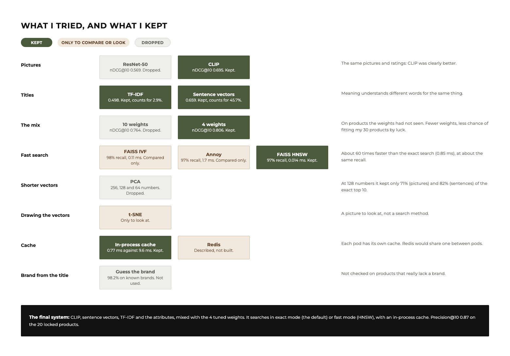

*Each idea I tested, what I found, and whether I kept it. Kept ideas are olive, ideas I only used to compare or to look at are tan, and dropped ideas are grey.*

I did not pick a method by guessing. Each idea was tested, against my own ratings for quality and against the exact search for speed, and I kept or dropped it based on the numbers. The table is the whole story in one place, and the sub-sections below explain each experiment. nDCG@10 and Precision@10 are explained in [Results at a glance](#results-at-a-glance). **Recall@10**, used for the speed tests, is how many of the exact top 10 a fast method also finds.

| # | What I tried | What I found | Why I decided so | Details |
|---|---|---|---|---|
| 1 | **Pictures:** ResNet-50 against CLIP | CLIP scored nDCG@10 0.695 and ResNet 0.569 | **Kept CLIP, dropped ResNet.** It was clearly better on the same pictures and ratings. | [Pictures](#1-pictures), [05](notebooks/05_image_similarity.ipynb), [06](notebooks/06_clip_whole_catalogue.ipynb) |
| 2 | **Titles:** sentence vectors against TF-IDF | meaning scored 0.659 and words 0.498 | **Kept both.** Meaning counts most, because it sees that different words can mean the same thing. | [Titles](#2-titles-sentence-vectors), [07](notebooks/07_sentence_vectors_on_titles.ipynb) |
| 3 | **The mix:** a hybrid with 4 weights against 10 | 4 weights scored 0.806 and 10 weights 0.764, on products the weights had not seen | **Kept 4 weights.** Fewer weights means less chance that the weights just memorise my 30 products. | [The mix](#3-the-mix-hybrid-search), [08](notebooks/08_hybrid_search.ipynb) |
| 4 | **Fast search:** FAISS HNSW, IVF and Annoy against the exact search | HNSW was about 60 times faster and found 97% of the exact top 10 | **Kept HNSW.** IVF and Annoy were only for comparison. | [Fast search](#4-fast-search), [09](notebooks/09_fast_vector_search.ipynb) |
| 5 | **Shorter vectors:** PCA to 256, 128 and 64 numbers | at 128 numbers it kept only 71% (pictures) and 82% (sentences) of the exact top 10 | **Dropped.** It lost too much recall for a small saving. | [Shorter vectors](#5-shorter-vectors-pca), [10](notebooks/10_shorter_vectors_pca.ipynb) |
| 6 | **Drawing the vectors:** t-SNE | a picture to look at, not a search method | **Used only to look.** | [Drawing the vectors](#6-drawing-the-vectors-t-sne), [11](notebooks/11_tsne_picture_vectors.ipynb) |
| 7 | **The final search:** exact mode and fast mode | the same quality, and fast is about 15 times faster | **Both kept.** Exact is the default. | [The final search](#7-the-final-search), [12](notebooks/12_final_search.ipynb) |
| 8 | **A cache** for repeated questions | a hit takes 0.77 ms against 9.6 ms for a new search | **Kept** (in-process). Redis is described, not built. | [The cache](#8-the-cache), [13](notebooks/13_caching.ipynb) |
| 9 | **The final test** on 20 locked products | Precision@10 0.87 for both modes | **The result I report.** | [The final test](#9-the-final-test), [14](notebooks/14_final_test.ipynb) |
| 10 | **Brand guessed from the title** | right 98.2% on products that have a brand, not checked on products that lack one | **Built, but not used.** | [Preprocessing, step 7](#preprocessing-cleaning-the-data), [02, section 9](notebooks/02_preprocessing.ipynb) |

Every experiment was recorded in MLflow, so the runs can be compared side by side. The screenshots below come from it.

### 1. Pictures

**What I did.**
1. **Checked a sample first.** Before downloading in bulk, I checked 100 pictures (kept locally, never committed). 99 of 100 downloaded, and the one failure is a link that no longer exists (error 404). The downloads are polite: one request at a time, at most 4 per second, https only, one allowed host, a time limit and a size limit, and no redirects followed. Details: [`results/image_sample_report.md`](results/image_sample_report.md).
2. **Small test, two models.** I turned the pictures of the 708 development products (the 30 test products and the results I had already rated) into vectors with two ready-made models, used as they are with no training: ResNet-50 and CLIP. For each of the 30 test products, I found the 10 closest pictures.
3. **Whole catalogue.** I downloaded the first picture of almost every product (29,107 pictures, 763 MB), turned them all into CLIP vectors (512 numbers each, in under 8 minutes), and searched the whole catalogue. 134 links no longer exist. None of the 20 locked products were downloaded.
4. **Shared pictures.** 231 pictures are used by two or more products. I looked at all of them: 229 are normal product photos of the same item listed more than once, 2 are not product photos (a shop logo and a sewing-pattern drawing, left out), and I found no size charts.
5. **One copy per item.** Results that use the same picture, or a nearly identical one, count as the same item, and I show only one. Every method gets the same rule, so the comparison stays fair.
6. **Rating.** For each test product, CLIP found 10 results. 44 of the 300 already had my rating, and I rated the other 256 without seeing which method found them.

**What I found.** On the small test (708 pictures):

| Method | nDCG@10 | Precision@10 |
|---|---|---|
| CLIP (pictures) | 0.695 | 0.74 |
| Text and attributes (my baseline) | 0.681 | 0.74 |
| ResNet (pictures) | 0.569 | 0.63 |
| Title only | 0.545 | 0.55 |
| Attributes only | 0.445 | 0.62 |

On the whole catalogue:

| Method | nDCG@10 | Precision@10 |
|---|---|---|
| CLIP, whole catalogue (pictures) | 0.757 | 0.85 |
| Text and attributes (my baseline) | 0.644 | 0.74 |
| CLIP, first 708 pictures only | 0.648 | 0.74 |
| Title only | 0.507 | 0.54 |
| Attributes only | 0.427 | 0.62 |

- CLIP is clearly better than ResNet, and ResNet is worse than my text method.
- Over the whole catalogue, CLIP beats title only and attributes only, and the gap is real. It is ahead of my text baseline too, but with only 30 products I can't be sure it is really better.
- CLIP did better on the whole catalogue than on only 708 pictures. The small test helped it, because those pictures had already been picked by the text methods.

**Decision.** I kept CLIP and dropped ResNet. Pictures and text each find good matches on their own, which is why I then mixed them (see [The mix](#3-the-mix-hybrid-search)).

**Limits.** 30 test products and one rater. Precision@10 is how many of the top 10 I rated 1 or 2.

*References: A. Radford et al., "[Learning Transferable Visual Models From Natural Language Supervision](https://proceedings.mlr.press/v139/radford21a.html)," ICML 2021 (model: [`clip-vit-base-patch32`](https://huggingface.co/openai/clip-vit-base-patch32)); K. He et al., "[Deep Residual Learning for Image Recognition](https://doi.org/10.1109/CVPR.2016.90)," CVPR 2016. Notebooks: [05 Image similarity, sections 1 to 3](notebooks/05_image_similarity.ipynb) and [06 CLIP over the whole catalogue, sections 1 to 6](notebooks/06_clip_whole_catalogue.ipynb). Numbers: [`dev_image_evaluation_report.md`](results/dev_image_evaluation_report.md) and [`dev_full_image_evaluation_report.md`](results/dev_full_image_evaluation_report.md).*


<details>
<summary>Reproduce it</summary>

The pictures and vectors stay on my computer and are not in Git.

```bash
pip install -e ".[dev,experiments,images]"
python experiments/download_dev_images.py       # about 700 pictures, one request at a time
python experiments/extract_image_features.py    # ResNet and CLIP vectors
python experiments/run_image_search.py          # finds results, writes the rating page for new ones
python experiments/download_images.py           # about 29,000 pictures, one request at a time
python experiments/extract_all_image_features.py   # CLIP vectors for all pictures
python experiments/run_full_image_search.py     # finds results, writes the rating page
```

Open the rating page, rate the cards, press **Download my ratings (CSV)**, save the file in `evaluation/judgments/`, and then score everything together with `python experiments/run_image_evaluation.py` and `python experiments/run_full_image_evaluation.py`.

</details>

### 2. Titles (sentence vectors)

TF-IDF only matches words. Here I tried a model that understands the meaning of a title, so that "kurta" and "kurti" count as similar.

**What I did.** I took a ready-made sentence model, `all-MiniLM-L6-v2` from Hugging Face (about 90 MB, Apache-2.0 licence), which turns a sentence into 384 numbers. Its authors trained it on over a billion sentence pairs, such as questions with answers, so that pairs which belong together get close vectors. I used it as it is, with no training. All 29,529 titles became vectors in 31.5 seconds, with no failures. For each of the 30 test products, the model found the 10 closest titles (the 20 locked products can never be returned). 153 of the 300 results already had my rating, and I rated the other 147 without seeing which method found them.

**What I found.**

| Method | nDCG@10 | Precision@10 |
|---|---|---|
| CLIP, whole catalogue (pictures) | 0.751 | 0.85 |
| Sentence vectors (titles) | 0.662 | 0.76 |
| Title (TF-IDF) and attributes (my baseline) | 0.637 | 0.74 |
| TF-IDF, title only | 0.500 | 0.55 |
| Attributes only | 0.422 | 0.62 |

- Sentence vectors are clearly better than TF-IDF on titles. Understanding meaning helps more than matching words.
- Sentence vectors and my baseline score about the same, and CLIP is still the highest, but with only 30 products I can't say which of those gaps is real.

**Decision.** I kept sentence vectors, and in the final mix they count for the most (45.7%). TF-IDF stays, with a small weight.

**Limits.** 30 test products and one rater. The model was trained on questions, answers and captions, not on shopping titles, so it may miss brand names and size words.

*References: N. Reimers and I. Gurevych, "[Sentence-BERT](https://doi.org/10.18653/v1/D19-1410)," EMNLP-IJCNLP 2019; W. Wang et al., "[MiniLM](https://papers.nips.cc/paper/2020/hash/3f5ee243547dee91fbd053c1c4a845aa-Abstract.html)," NeurIPS 2020 (model: [`all-MiniLM-L6-v2`](https://huggingface.co/sentence-transformers/all-MiniLM-L6-v2)). Notebook: [07 Sentence vectors on titles, sections 1 to 5](notebooks/07_sentence_vectors_on_titles.ipynb). Numbers: [`dev_text_vector_evaluation_report.md`](results/dev_text_vector_evaluation_report.md).*


<details>
<summary>Reproduce it</summary>

```bash
pip install -e ".[dev,experiments,images,text]"
python experiments/extract_text_features.py     # downloads the model once, makes the title vectors
python experiments/run_text_vector_search.py    # finds results, writes the rating page
python experiments/run_text_vector_evaluation.py   # after rating, scores everything together
```

</details>

### 3. The mix (hybrid search)

So far I tested each part on its own. Here I mix them into one **hybrid search** and choose how much each part counts (its weight) from my ratings. How the weights are found, with coordinate ascent and 5-fold cross-validation, is explained in [Features in detail](#how-much-each-part-counts).

**What I did.**
1. **Ten parts,** each scoring a pair from 0 to 1: the TF-IDF title, the sentence-vector title, the CLIP picture, category, brand, audience, price, colour, weight and rating. The weighted sum is the final score. If a value is missing, that part is skipped and the other weights are scaled up. The sentence and picture scores are cosine similarities shifted so that 0 means "as similar as two random products".
2. **Two mixes.** One with 10 weights (one for each part), and one with 4 weights (TF-IDF title, sentence title, picture, and all attributes together).
3. **First try.** The tuned weights did not beat my untuned baseline on unseen products (0.614 for 10 weights and 0.635 for 4 weights, against 0.637). The hybrid had found 107 new results that were not in my ratings yet, which made the tuning unfair.
4. **Rating the new results.** I rated those 107 results myself on a blind page (shuffled for each product, no method names), and tuned again. The 20 locked products were never used.

**What I found.**

| Method | nDCG@10 | Precision@10 |
|---|---|---|
| Hybrid, 4 weights | 0.806 | 0.87 |
| Hybrid, 10 weights | 0.764 | 0.82 |
| CLIP (pictures) | 0.750 | 0.85 |
| Sentence vectors (titles) | 0.659 | 0.76 |
| Title (TF-IDF) and attributes (my baseline) | 0.637 | 0.74 |
| TF-IDF, title only | 0.498 | 0.55 |
| Attributes only | 0.420 | 0.62 |

- The 4-weight hybrid is clearly better than my baseline, the sentence vectors, TF-IDF and the attributes alone. It is ahead of CLIP, but with only 30 products I can't be sure it is really better.
- The mix with 4 weights did better than the one with 10, because fewer weights means less chance that the weights just memorise my 30 products.
- **Which parts matter.** When I remove one part at a time from the 10-weight mix (an ablation), the sentence vectors and the picture cost the most (about 0.165 of nDCG@10 each), and category is the most useful attribute. The final 4-weight mix is: sentence title 46%, picture 29%, attributes together 23%, TF-IDF title 3%.

**Decision.** I kept the 4-weight hybrid.

**Limits.** 30 test products and one rater. I tuned the weights on these 30 products, so I tested them once on my 20 locked products at the end (see [The final test](#9-the-final-test)).

*References: D. Metzler and W. B. Croft, "[Linear feature-based models for information retrieval](https://doi.org/10.1007/s10791-006-9019-z)," Information Retrieval, 2007; S. Bruch, S. Gai and A. Ingber, "[An Analysis of Fusion Functions for Hybrid Retrieval](https://doi.org/10.1145/3596512)," ACM Transactions on Information Systems, 2023. Notebook: [08 Hybrid search, sections 2 to 9](notebooks/08_hybrid_search.ipynb). Numbers: [`dev_hybrid_evaluation_report.md`](results/dev_hybrid_evaluation_report.md) and [`hybrid_tuning.json`](results/hybrid_tuning.json).*


<details>
<summary>Reproduce it</summary>

```bash
pip install -e ".[dev,experiments,images,text]"
python experiments/tune_hybrid_weights.py     # coordinate ascent and 5-fold cross-validation
python experiments/run_hybrid_search.py       # finds results that have no rating, writes the rating page
```

Rate the cards, save the CSV as `evaluation/judgments/dev_grades_hybrid.csv`, then run `python experiments/tune_hybrid_weights.py` again and `python experiments/run_hybrid_evaluation.py`.

</details>

### 4. Fast search

To find similar products I compare one product with all the others. That is fine for 29,500 products, but a bigger catalogue needs a faster way. Here I time the exact search first, then compare fast **approximate nearest-neighbour** indexes with it.

**What I did.**
1. **One rule for every method.** 1,000 random products, picked with seed 2020, never a locked product and never one of my 30 development products. Each product is searched 5 times and the fastest run is kept. The time is the median of the 1,000. Recall@10 is the average over the same 1,000 products, and it does not use my ratings.
2. **The exact search** is the baseline: about 0.85 ms for the sentence vectors and 1.5 ms for the picture vectors, among about 29,500 products.
3. **The fast methods:** FAISS Flat (exact), FAISS HNSW (a graph search), FAISS IVF (a search over groups) and Annoy (random trees, from Spotify). All settings are in [`results/ann_benchmark.json`](results/ann_benchmark.json).
4. **Inside the hybrid.** A fast index picks 200 candidates from the combined sentence and picture vectors, and the hybrid with 4 weights picks the final 10.

**What I found.** For each fast method I show its fastest setting that still finds at least 95% of the exact top 10.

| Method (sentence vectors, 384 numbers) | Time per query | Memory | Recall@10 |
|---|---|---|---|
| Exact search (brute force) | 0.85 ms | 45.3 MB | 100% |
| FAISS HNSW | 0.014 ms | 49.6 MB | 97% |
| FAISS IVF | 0.11 ms | 45.8 MB | 98% |
| Annoy | 1.7 ms | 67.1 MB | 97% |

| Method (picture vectors, 512 numbers) | Time per query | Memory | Recall@10 |
|---|---|---|---|
| Exact search (brute force) | 1.5 ms | 60.1 MB | 100% |
| FAISS HNSW | 0.018 ms | 64.4 MB | 97% |
| FAISS IVF | 0.12 ms | 60.7 MB | 99% |
| Annoy | 1.4 ms | 104.9 MB | 97% |

| Early test: the hybrid with a fast index | nDCG@10 | Top 10 shared with the exact hybrid |
|---|---|---|
| Exact hybrid (scores all products, 6.3 ms) | 0.808 | 100% |
| HNSW picks 200 candidates, then the hybrid (0.07 ms for the candidates) | 0.784 | 94% |
| Exact search picks 200 candidates, then the hybrid | 0.807 | 97% |

- The exact search is already fast at my size: about 1 ms for one product among 29,500, with 45 to 60 MB of memory.
- **HNSW** is about 60 times faster than the exact search and still finds 97% of the exact top 10. It needs about 10% more memory and 6 to 7 seconds to build. **IVF** is about 8 times faster with almost no extra memory. **Annoy** was not faster than the exact search at this size and needs more memory.
- In the early test, the fast index cost a little quality: nDCG@10 went from 0.808 to 0.784 with HNSW, because of the candidates it misses (exact candidates lose almost nothing, 0.807). The final fast mode uses a different design, two indexes with 100 candidates each, and it loses almost nothing (see [The final search](#7-the-final-search)).

**Decision.** I kept HNSW, because it gave the best speed for the recall.

**Limits.** I tested only about 29,500 products. At this size the exact search is already fast, so a fast index will matter more for a much larger catalogue, which I did not test. The timings are from one laptop, one thread, one query at a time.

*References: Y. A. Malkov and D. A. Yashunin, "[Efficient and Robust Approximate Nearest Neighbor Search Using Hierarchical Navigable Small World Graphs](https://doi.org/10.1109/TPAMI.2018.2889473)," IEEE Transactions on Pattern Analysis and Machine Intelligence, vol. 42, no. 4, pp. 824-836, 2020; J. Johnson, M. Douze and H. Jégou, "[Billion-Scale Similarity Search with GPUs](https://doi.org/10.1109/TBDATA.2019.2921572)," IEEE Transactions on Big Data, vol. 7, no. 3, pp. 535-547, 2021; [Annoy](https://github.com/spotify/annoy) from Spotify. Notebook: [09 Fast vector search, sections 1 to 4](notebooks/09_fast_vector_search.ipynb). Numbers: [`ann_exact_baseline.json`](results/ann_exact_baseline.json), [`ann_benchmark.json`](results/ann_benchmark.json) and [`ann_hybrid_check.json`](results/ann_hybrid_check.json).*


<details>
<summary>Reproduce it</summary>

```bash
pip install -e ".[dev,experiments,images,text,ann,notebooks]"
python experiments/ann_exact_baseline.py     # times the exact search, saves its answers
python experiments/ann_benchmark.py          # FAISS Flat, HNSW, IVF and Annoy
python experiments/ann_hybrid_check.py       # the fast index inside the hybrid
python experiments/log_ann_benchmark.py      # records the runs in MLflow
```

</details>

### 5. Shorter vectors (PCA)

HNSW already finds 97% of the exact top 10. Here I tested one more idea: make the vectors **shorter** with PCA (it keeps the directions in which the products differ most), so that they take less memory and the search has less to compute.

**What I did.** I trained PCA on all the vectors and kept 256, 128 or 64 numbers instead of 512 (pictures) or 384 (sentences). I ran the exact search, HNSW, IVF and Annoy on the shorter vectors, with the same rule as in the fast-search test (the same 1,000 random products, seed 2020, the fastest of 5 runs, the median time, one thread). Recall@10 is measured against the exact top 10 on the **full** vectors, so it shows what PCA and the index lose together. A query must first be turned into its short version, and I timed that too.

**What I found.**

| Picture vectors | Time per query | Memory | Recall@10 |
|---|---|---|---|
| Exact search, 512 numbers (no PCA) | 1.5 ms | 60.1 MB | 100% |
| HNSW, 512 numbers (no PCA) | 0.018 ms | 64.4 MB | 97% |
| HNSW + PCA, 256 numbers | 0.013 ms | 34.3 MB | 76% |
| HNSW + PCA, 128 numbers | 0.010 ms | 19.3 MB | 71% |
| HNSW + PCA, 64 numbers | 0.008 ms | 11.8 MB | 62% |

| Sentence vectors | Time per query | Memory | Recall@10 |
|---|---|---|---|
| Exact search, 384 numbers (no PCA) | 0.85 ms | 45.3 MB | 100% |
| HNSW, 384 numbers (no PCA) | 0.014 ms | 49.6 MB | 97% |
| HNSW + PCA, 256 numbers | 0.015 ms | 38.2 MB | 86% |
| HNSW + PCA, 128 numbers | 0.011 ms | 23.1 MB | 82% |
| HNSW + PCA, 64 numbers | 0.009 ms | 15.6 MB | 72% |

- PCA makes the vectors and the index smaller: with 128 numbers the picture index goes from 64 MB to 19 MB.
- The recall drops a lot. With 128 numbers, the picture vectors find 71% of the exact top 10 and the sentence vectors 82%, against 97% for HNSW on the full vectors.
- The loss comes from PCA itself. For a given length, the exact search, HNSW, IVF and Annoy all end up within about one point of each other, so a better index does not win it back.
- The speed-up is small and not real. Turning a query into its short version takes about 0.009 ms, which is about as much as the HNSW search itself (0.010 to 0.018 ms), so the total is about the same as HNSW on the full vectors or higher.

**Decision.** I dropped PCA. The search keeps the full vectors with HNSW, which finds 97% of the exact top 10 in 0.014 to 0.018 ms. At my size, memory is not a problem (about 50 to 65 MB per index).

**Limits.** I tested only about 29,500 products. For millions of products the memory saving could matter, and a milder cut (more than 256 numbers) could be worth testing. I did not test that. I trained PCA on all the vectors, including the test products, which is fine for a comparison of methods, but a real system would train it on a separate sample. The timings are from one laptop, one thread, one query at a time.

*References: I. T. Jolliffe and J. Cadima, "[Principal component analysis: a review and recent developments](https://doi.org/10.1098/rsta.2015.0202)," Philosophical Transactions of the Royal Society A, 2016. Notebook: [10 Shorter vectors with PCA, sections 1 to 5](notebooks/10_shorter_vectors_pca.ipynb). Numbers: [`ann_pca.json`](results/ann_pca.json).*


<details>
<summary>Reproduce it</summary>

```bash
python experiments/ann_pca.py                # PCA, then every method on the shorter vectors
python experiments/log_ann_pca.py            # records the runs in MLflow
```

</details>

### 6. Drawing the vectors (t-SNE)

The picture vectors are long lists of numbers, which nobody can look at. t-SNE squeezes each one into two numbers, so that every product becomes a dot on a flat picture and similar products land close together. It is only for looking: it does not change any search.


**What I found.**
- Products of the same category sit together: men's T-shirts, kurtas, sarees and caps and hats each form their own area. The picture vectors capture the kind of product, which is why a search over them works.
- The three pictures (the full vectors and two PCA cuts) look almost the same. The big groups stay together in the same places, even with 64 numbers. So PCA keeps the overall shape.
- What PCA loses is the fine detail. Inside one big group there are many similar products, and which ones are the closest 10 changes a little when the vectors are cut. That is probably why the recall dropped in the PCA test.

**Decision.** t-SNE is only for looking, so it is not part of the search.

**Limits.** The picture is a rough view: distances in it are not exact, and it shows 3,000 products out of about 29,500. It does not replace the recall numbers.

*References: L. van der Maaten and G. Hinton, "[Visualizing Data using t-SNE](https://www.jmlr.org/papers/v9/vandermaaten08a.html)," Journal of Machine Learning Research, 2008. Notebook: [11 t-SNE, section 1](notebooks/11_tsne_picture_vectors.ipynb).*

### 7. The final search

The tuned hybrid is in the real search (`HybridEngine` in [`hybrid.py`](src/product_similarity/hybrid.py)). It uses the 4-weight mix: sentence vectors 46%, picture vectors 29%, the seven attributes 23% together, and the TF-IDF title 3%.

**What I did.** Two modes, one hybrid. Both score every shortlisted product with all ten parts, with the same weights and the same rescaling when a part is missing. They differ only in how the two vector parts are searched.
- **Exact mode** (the default) compares the sentence and picture vectors with every product.
- **Fast mode** uses an HNSW index for the sentence vectors and one for the picture vectors. Each returns the 100 nearest products, and only those are scored. A product without a picture is found through its sentence vector.
- **A switch.** The mode can be chosen for each search, and `PS_SEARCH_MODE` sets the default. The API and the page have a `mode` option.
- **One copy of each item.** Both modes skip the same item shown twice (the same picture, for example another size), the same rule that my ratings use.
- **Checked against the notebooks.** The exact mode gives the same top 10, in the same order, for all 30 development products ([`final_search_check.json`](results/final_search_check.json)).
- **The truth is my ratings, for both modes.** I rated the 26 new results that the two modes brought up ([`final_search_ratings.json`](results/final_search_ratings.json)).

**What I found.**

| 30 development products | nDCG@10 | Precision@10 | Time per search |
|---|---|---|---|
| Exact mode | 0.8105 | 0.8767 | 8.5 ms |
| Fast mode (HNSW, 100 from each index) | 0.8095 | 0.8767 | 0.58 ms |

- By my ratings, the two modes are almost the same. Of the 300 results of each mode, I rated 221 with a 2, 42 with a 1 and 37 with a 0 for the exact mode, and 220, 43 and 37 for the fast mode. On 27 of the 30 products the two modes score the same.
- The fast mode is much faster: 0.58 ms against 8.5 ms, about 15 times.

**Decision.** The exact mode is the default, and the fast mode is a switch. I built the page and the API option to choose between them and to see the time of each search (see [The page](#the-page)).

**The two indexes.** Fast mode keeps two HNSW indexes in memory:
1. One HNSW index for the sentence vectors, built on the title meaning (384 numbers per product).
2. One HNSW index for the picture vectors, built on the CLIP pictures (512 numbers per product).

| Index | Memory |
|---|---|
| Index for sentence vectors | about 49.6 MB |
| Index for picture vectors | about 64.4 MB |
| Together | about 114 MB |

**Limits.** HNSW needs a little more memory, because the two indexes (114 MB) are kept on top of the vectors (166 MB), and building them takes about 13 seconds, once. If a picture vector or a sentence vector is missing, the search works the same in both modes (that part is skipped), which I checked in a small test, not on the 30 products. The fast mode makes its shortlist from the title meaning and the picture only, so a product that matches the query only through its attributes may not be on it. I did not test a much bigger catalogue. My weights were tuned on these same 30 products, so the scores are optimistic, and the final test on the locked products is next.

*Notebook: [12 The final search, sections 1 to 5](notebooks/12_final_search.ipynb). Numbers: [`final_search_ratings.json`](results/final_search_ratings.json), [`fast_vs_exact_check.json`](results/fast_vs_exact_check.json).*


<details>
<summary>Reproduce it</summary>

```bash
python experiments/check_final_search.py       # the real search against the notebooks
python experiments/run_final_search_rating.py  # finds results without a rating, writes the rating page
python experiments/rating_comparison.py        # both modes scored with my ratings only
python experiments/check_fast_vs_exact.py      # exact mode against fast mode: time (and the places that differ)
python experiments/log_final_search.py         # records the runs in MLflow
```

</details>

### 8. The cache

A search takes about 10 ms, and the same question often comes again. So the service keeps the answers of recent questions and gives them back without searching.

**What I did.** An **in-process cache**: it lives in the memory of the service. It keeps 1,024 answers by default (`PS_CACHE_SIZE`, and 0 turns it off), and when it is full it drops the answer that was used least recently. It is safe when many requests arrive at once.
- **The question** is the product, the number of results, the mode and the weights. Another product, number, mode or weights is another question, and an old ID and the product that was kept share one entry. Only answers of up to 100 results are cached.
- **What the API shows.** The plain endpoint has an `X-Cache` header (`hit` or `miss`). The details endpoint has a `cached` field. `GET /cache` reports the entries, the hits, the misses and the hit rate.

**What I found.**

| One request | Time |
|---|---|
| Not remembered (miss) | 9.6 ms |
| Remembered (hit) | 0.77 ms |

A remembered answer is about 12 times faster, and it is the same answer. In a simulation where a few products are asked for often, the cache answers about half of the requests, and the average time drops from 10.3 ms to 5.5 ms.

**Decision.** I kept the in-process cache. It is simple and needs nothing else to run.

**Limits.** The cache is lost when the service restarts. With several copies of the service (Kubernetes), each copy has its own cache, so fewer requests are answered from memory. A shared cache such as Redis would fix this. I describe it as the upgrade, and I did not build it.

*Notebook: [13 Caching, sections 1 to 4](notebooks/13_caching.ipynb). Numbers: [`cache_benchmark.json`](results/cache_benchmark.json), made by `experiments/measure_cache.py`.*


<details>
<summary>Reproduce it</summary>

```bash
python experiments/measure_cache.py   # miss against hit, and the traffic simulation
python experiments/log_cache.py       # records the runs in MLflow
```

</details>

### 9. The final test

Since the start, 20 of my 50 test products have been locked: I never rated their results or used them in tuning. All the weights and settings were chosen with the other 30. This is the one test of the finished search on products it has never seen, and I changed nothing after seeing the result.

**What I did.** I put the top 10 of both modes (exact, and fast with HNSW) into one blind page of 204 results, shuffled, with no method names ([`run_final_test_rating.py`](experiments/run_final_test_rating.py)). I rated every result 0, 1 or 2 ([`final_grades.csv`](evaluation/judgments/final_grades.csv)), and scored each mode from its own top 10.

**What I found.**

| 20 locked products | nDCG@10 | Precision@10 | Time per search |
|---|---|---|---|
| Exact mode | 0.9659 | 0.87 | 7.0 ms |
| Fast mode (HNSW) | 0.9657 | 0.87 | 0.42 ms |

On products it had never seen, both modes work: Precision@10 is 0.87 for both, close to 0.877 on the development products. The fast mode gives the same quality and is about 17 times faster.

**Limits.** The nDCG@10 here (0.97) cannot be compared with 0.81 on the development products, because the rated results come only from this one system. Precision@10 is the number to compare. It is only 20 products, rated by me, and the test was used once.

*Notebook: [14 The final test, sections 1 to 3](notebooks/14_final_test.ipynb) (section 3 explains how to read the nDCG@10 here). Numbers: [`final_test_scores.json`](results/final_test_scores.json).*


<details>
<summary>Reproduce it</summary>

```bash
python experiments/run_final_test_rating.py   # the blind rating page (used once)
python experiments/score_final_test.py        # scores both modes with my ratings
python experiments/log_final_test.py          # records the runs in MLflow
```

</details>

## Notebooks and results

This section is a map for anyone who wants to check my work. There is one row for each of the 15 notebooks. A row says what the notebook does, what it found, and which files in `results/` hold its raw numbers. So for any number in this README, you can find the notebook that shows it and the file it comes from.

How to read the table:
- Each notebook ends with a conclusion in plain words. The logic lives in the Python package, and the notebooks only call it and show results.
- A dash means that notebook has no results file of its own.
- Every experiment was also recorded in MLflow. The MLflow databases stay on my computer (they are not in Git), so the screenshots in [What I tried, and what I kept](#what-i-tried-and-what-i-kept) show the runs.

| Notebook | What it does and what it found | Results files |
|---|---|---|
| [01 Data exploration](notebooks/01_data_exploration.ipynb) | Checks the 30,000 products and charts each attribute (24 figures recomputed). Name, category and image are almost always there, weight is mostly a placeholder, a third of the products share a title, and 471 rows are repeats | – |
| [02 Preprocessing](notebooks/02_preprocessing.ipynb) | Cleans the data step by step with before-and-after charts. One record per product, every ID still valid, missing categories filled from the same shelf (about 97% right in a hide-and-guess check). Guessing brands from titles is built but switched off | – |
| [03 Baseline examples](notebooks/03_baseline_examples.ipynb) | Runs the first `find_similar_products` on five real queries and explains each score. About 6 ms per search. Two weaknesses: near-copies in the results, and products with little data scoring too high | – |
| [04 Evaluation of the baseline](notebooks/04_evaluation_baseline.ipynb) | Scores three text methods against my ratings. Title plus attributes beats either alone, and both gaps are big enough to trust | [`dev_scoreboard.csv`](results/dev_scoreboard.csv), [`dev_evaluation_report.md`](results/dev_evaluation_report.md) |
| [05 Image similarity](notebooks/05_image_similarity.ipynb) | ResNet and CLIP on the 708 development pictures. CLIP scores nDCG@10 0.695 and ResNet 0.569 | [`dev_image_scoreboard.csv`](results/dev_image_scoreboard.csv), [`dev_image_evaluation_report.md`](results/dev_image_evaluation_report.md) |
| [06 CLIP over the whole catalogue](notebooks/06_clip_whole_catalogue.ipynb) | Every picture turned into a CLIP vector. CLIP scores highest (0.757), clearly above title only and attributes only | [`dev_full_image_scoreboard.csv`](results/dev_full_image_scoreboard.csv), [`dev_full_image_evaluation_report.md`](results/dev_full_image_evaluation_report.md) |
| [07 Sentence vectors on titles](notebooks/07_sentence_vectors_on_titles.ipynb) | Sentence vectors (0.662) are clearly better than TF-IDF on titles (0.500) | [`dev_text_vector_scoreboard.csv`](results/dev_text_vector_scoreboard.csv), [`dev_text_vector_evaluation_report.md`](results/dev_text_vector_evaluation_report.md) |
| [08 Hybrid search](notebooks/08_hybrid_search.ipynb) | Mixes title, picture and attributes, tunes the weights, and checks them with 5-fold cross-validation. The 4-weight hybrid scores highest (0.806) | [`dev_hybrid_scoreboard.csv`](results/dev_hybrid_scoreboard.csv), [`hybrid_tuning.json`](results/hybrid_tuning.json), [`hybrid_tuning_first_round.json`](results/hybrid_tuning_first_round.json), [`coordinate_ascent_trace.json`](results/coordinate_ascent_trace.json) |
| [09 Fast vector search](notebooks/09_fast_vector_search.ipynb) | Compares exact search, FAISS HNSW, IVF and Annoy on time, memory and recall@10. HNSW is about 60 times faster and finds 97% of the exact top 10 | [`ann_exact_baseline.json`](results/ann_exact_baseline.json), [`ann_benchmark.json`](results/ann_benchmark.json), [`ann_hybrid_check.json`](results/ann_hybrid_check.json) |
| [10 Shorter vectors with PCA](notebooks/10_shorter_vectors_pca.ipynb) | Cuts the vectors to 256, 128 and 64 numbers. The index gets 2 to 4 times smaller, but recall drops to 71% (pictures) and 82% (sentences) at 128 numbers | [`ann_pca.json`](results/ann_pca.json) |
| [11 t-SNE of the picture vectors](notebooks/11_tsne_picture_vectors.ipynb) | Draws 3,000 picture vectors as dots. Categories form separate groups, and they stay the same after PCA. A picture to look at only | – |
| [12 The final search](notebooks/12_final_search.ipynb) | Exact mode and fast mode with my ratings as the truth. nDCG@10 0.8105 against 0.8095, and fast mode is about 15 times faster | [`final_search_check.json`](results/final_search_check.json), [`final_search_ratings.json`](results/final_search_ratings.json), [`fast_vs_exact_check.json`](results/fast_vs_exact_check.json) |
| [13 Caching](notebooks/13_caching.ipynb) | A cache hit takes 0.77 ms against 9.6 ms for a search (about 12 times faster) | [`cache_benchmark.json`](results/cache_benchmark.json) |
| [14 The final test](notebooks/14_final_test.ipynb) | The one test on the 20 locked products. Precision@10 is 0.87 in both modes, and fast mode is about 17 times faster | [`final_test_scores.json`](results/final_test_scores.json), [`final_test_coverage.json`](results/final_test_coverage.json) |
| [15 A stronger API](notebooks/15_stronger_api.ipynb) | Shows real requests to the real service: every error with its code, the `mode` and `weights` options, and how the cache treats them. Bad input gets a 422, an unknown product a 404 | – |

## The service and Docker

### What the service is

The brief asks for a microservice, so the search runs as a small web service. A **service** is a program that stays running and waits for questions. You send it a product ID over HTTP, and it sends back the most similar products. I wrote it with **FastAPI**, a Python library for web services. It checks the input for me and gives every error the same shape, and it writes an interactive help page at `/docs` by itself.

The service builds the search engine once when it starts (about 2 seconds, and about 13 more for the fast indexes in the Docker image). After that, each request takes a few milliseconds. A real call and its answer are in [Example](#example).

| Endpoint | What it returns |
|---|---|
| `GET /` | The page (see "The page") |
| `GET /find_similar_products?product_id=...&num_similar=...` | The list of the most similar product IDs (the required endpoint). The headers `X-Cache` (`hit` or `miss`) and `X-Search-Mode` (the mode that ran) |
| `GET /find_similar_products/details?...` | The same search with the question, readable product details, the scores, `mode`, `weights`, `cached` and `response_time_ms` |
| `GET /weights` | The modes, the limits, the names of the weights and the tuned weights (simple and advanced), for a page that sets them |
| `GET /cache` | The cache statistics: `enabled`, `max_entries`, `entries`, `hits`, `misses` and `hit_rate` |
| `GET /live` | The process is running |
| `GET /ready` | The data is loaded; it also says which search runs, the modes, and whether the fast mode is ready |
| `GET /metrics` | The service's own numbers (requests, times, cache hits, errors) as text, for Prometheus (see "Monitoring") |

### What Docker is, and why I used it

**Docker** packs a program together with everything it needs to run (Python, the libraries, the data files) into one **image**. Anyone can start that image as a **container** with one command, and it behaves the same on my laptop, on a colleague's computer, in the CI pipeline and in Kubernetes.

Without Docker, someone who wants to run my service must install the right Python version and the right library versions first, and a different version of numpy or FAISS can give a different result or an error. With Docker, those versions are fixed inside the image, so what I tested is what runs. Kubernetes runs containers, so the image is also what I deploy (see "Kubernetes").

```bash
docker build -t product-similarity .
docker run -p 8000:8000 product-similarity
```

The first command builds the image from the [`Dockerfile`](Dockerfile). The second starts a container and connects port 8000 of the container to port 8000 of your computer, so the service is at `http://localhost:8000`.

### How the image is built

| Choice in the [`Dockerfile`](Dockerfile) | Why |
|---|---|
| Base image `python:3.10-slim` | The brief's sample uses Python 3.10, and the slim version is much smaller than the full one |
| Install `requirements.txt` first, then copy the code | Docker keeps each step as a layer. The libraries rarely change, so a code change rebuilds only the last layers and the build is fast |
| Only the serving packages, all pinned to one version | The image stays small and the same on every build. It has FastAPI, numpy, scipy, scikit-learn, FAISS and `prometheus-client`. It has no PyTorch, `transformers`, MLflow, Annoy or notebooks, because those are used offline to build the vectors and run the experiments |
| A [`.dockerignore`](.dockerignore) file | Keeps the notebooks, experiments, results, images and tests out of the image |
| Run as a user that is not root (`appuser`) | If someone breaks into the service, they do not have full rights inside the container |
| Environment variables `PS_REQUIRE_VECTORS=1` and `PS_PREBUILD_FAST=1` | The service stops with an error when the vectors are missing, and the fast indexes are built at start so the first fast search is not slow (details below) |
| Keeps the sample's port 8000, `ENV NAME` and `uvicorn` command | Stays close to the brief's sample |

I could not run Docker on my own computer, so the image is built and tested in the CI pipeline on every push (see "Tests and CI/CD").

### The vectors in the image

The final search needs the picture vectors (CLIP) and the sentence vectors (MiniLM). They are computed once, offline, and the full-size files are too big for GitHub (56 MB and 43 MB, and git ignores them). So the service ships a **half-size copy**: every number is stored in 2 bytes instead of 4 (float16), in two files that are each under 50 MB (28.0 MB and 21.5 MB) in [`artifacts/vectors/`](artifacts/vectors/). The image copies them in, and the service reads them back as normal numbers when it starts.

- **It does not change my results.** For the 30 development products, the top 10 is identical with the half-size vectors in the exact mode and in the fast mode (30 of 30), and nDCG@10 and precision@10 are the same (0.8105 and 0.8767 for the exact mode). On 1,000 random products, 987 of the exact mode's lists are identical, and 99.96% of the products in the top 10s are the same (fast mode: 948 identical lists, 99.2% the same products). The rounding error of one number is at most 0.00024. The record is [`results/vector_files_check.json`](results/vector_files_check.json).
- **A damaged file is noticed.** `manifest.json` holds the SHA-256 of each file, and the service checks it when it starts.
- **No silent fallback in the container.** The image sets `PS_REQUIRE_VECTORS=1`: if the vectors are missing or do not match the products, the service stops with an error instead of quietly using the old baseline search. Without that setting (on a laptop), the service falls back to the baseline with a warning.
- **`/ready` says which search is running**, for example `{"status": "ready", "products": 29529, "search": "hybrid (exact)"}`.

```bash
python experiments/export_vectors.py       # makes the half-size files from the full-size ones
python experiments/check_vector_files.py   # checks that the results do not change
```

### Parameters and errors

| Parameter | Meaning | Rule |
|---|---|---|
| `product_id` | The product to start from (required) | 32 lowercase hexadecimal characters |
| `num_similar` | How many similar products to return (required) | A whole number from 1 to 1,000 (`PS_MAX_RESULTS`) |
| `mode` | `exact` or `fast` (optional) | The default is `exact` |
| `weights` | How much each part counts (optional) | `name:value` pairs, each value from 0 to 1, for example `image:0.6,title:0.4`. If it is left out, the tuned weights are used |

- **Weights, two ways.** The simple way has 4 names (`title`, `text_vectors`, `image`, `attributes`, where `attributes` is the seven attributes together). The advanced way has the 10 parts. They cannot be mixed. What you send is what is used, and a part you leave out gets 0. The weights do not have to add up to 1. At least one must be above 0.
- **The fast mode with weights.** Its shortlist comes from the sentence and picture vectors, so if both of their weights are 0 the exact mode runs instead, and the answer says so (`mode_note`).
- **Every error has the same shape:** `{"error": "<code>", "message": "<a sentence>"}`.

| Status | `error` | When |
|---|---|---|
| 422 | `invalid_input` | `product_id` or `num_similar` is missing or not valid |
| 422 | `invalid_mode` | the mode is not `exact` or `fast` |
| 422 | `invalid_weights` | a weight is unknown, repeated, not from 0 to 1, all zero, or simple and advanced are mixed |
| 422 | `mode_not_available` / `option_not_available` | the service cannot do it (no FAISS, or the baseline search) |
| 404 | `product_not_found` | no product has that ID |
| 503 | `not_ready` | the data is not loaded yet |
| 500 | `internal_error` | something unexpected; the details go to the log only |

The cache question is the product, the number of results, the mode and the weights, so an answer for one set of weights is never given for another. The settings are environment variables: `PS_SEARCH_MODE`, `PS_MAX_RESULTS`, `PS_CACHE_SIZE`, `PS_PREBUILD_FAST` (the Docker image builds the fast indexes at start) and `PS_REQUIRE_VECTORS`.

## Example

Here is the service answering real requests. I started it on my computer (`localhost:8000`, see [Getting started](#getting-started)) and copied what it returned. Times change from machine to machine. The product is a saree blouse fabric, and its ID is `26d41bdc1495de290bc8e6062d927729`.

### 1. The required call

You send a product ID and how many results you want. You get back a plain list of product IDs, best match first.

```bash
curl "http://localhost:8000/find_similar_products?product_id=26d41bdc1495de290bc8e6062d927729&num_similar=3"
```

```json
["d8f9a3fe8b80227a37b8c5529931f383", "2d249ce6637640fe9ef8a5cf20cbc9dc", "706ee970954ce7332dee5defe042b254"]
```

### 2. The same search with details

`/find_similar_products/details` returns the same results with the question asked, readable product details, the score of each result, and the response time. The page uses this endpoint.

```bash
curl "http://localhost:8000/find_similar_products/details?product_id=26d41bdc1495de290bc8e6062d927729&num_similar=3"
```

```json
{
  "question": {
    "product_id": "26d41bdc1495de290bc8e6062d927729",
    "num_similar": 3
  },
  "query": {
    "id": "26d41bdc1495de290bc8e6062d927729",
    "title": "LA' Facon Cotton Kalamkari Handblock Saree Blouse Fabric 100 cms Black Base Dancers (Cotton)",
    "brand": "LA' Facon",
    "category": "WomensKurtasKurtis",
    "audience": "women",
    "price": 200.0,
    "rating": 5.0,
    "image_url": "https://images-na.ssl-images-amazon.com/images/I/51Wj2WownyL.jpg"
  },
  "results": [
    {
      "id": "d8f9a3fe8b80227a37b8c5529931f383",
      "title": "Kalamkari Print Cotton Fabric for Women's Clothes Like Kurti, Blouse, Dress, Patiala, Palazzo and Chudidar",
      "brand": "Generic",
      "category": "WomensKurtasKurtis",
      "audience": "women",
      "price": 600.0,
      "rating": 5.0,
      "image_url": "https://images-na.ssl-images-amazon.com/images/I/516COs2TCIL.jpg",
      "score": 0.480195
    },
    {
      "id": "2d249ce6637640fe9ef8a5cf20cbc9dc",
      "title": "Cotton Kalamkari Handblock Saree Blouse/Kurti Fabric 100 cms Purple Colour - Budda Print",
      "brand": "LA' Facon",
      "category": "WomensEthnicUnstitchedFabric",
      "audience": "women",
      "price": 200.0,
      "rating": 3.0,
      "image_url": "https://images-na.ssl-images-amazon.com/images/I/41NZcbBhbuL.jpg",
      "score": 0.465029
    },
    {
      "id": "706ee970954ce7332dee5defe042b254",
      "title": "Worldoftextile Women's Cotton Sanganeri Hand Block Jaipuri Dabu Floral Print Salwar Suit, 5m(Multicolour)",
      "brand": "Worldoftextile",
      "category": "WomensEthnicUnstitchedFabric",
      "audience": "women",
      "price": null,
      "rating": 5.0,
      "image_url": "https://images-na.ssl-images-amazon.com/images/I/61qgXhqar9L.jpg",
      "score": 0.384028
    }
  ],
  "response_time_ms": 9.42
}
```

The query is a saree blouse fabric that the dataset files under the kurta category, so the first result is a kurta. Category-based matching carries over that label.

### 3. The options: mode and weights

`mode` chooses how the search runs, and `weights` chooses how much each part counts. Both are optional. Without them, the service runs the exact mode with my tuned weights.

```bash
# the fast mode (HNSW indexes): the list can differ a little, because it is approximate
curl -i "http://localhost:8000/find_similar_products?product_id=26d41bdc1495de290bc8e6062d927729&num_similar=3&mode=fast"

# only the picture and the title words count: 60% and 40%
curl "http://localhost:8000/find_similar_products/details?product_id=26d41bdc1495de290bc8e6062d927729&num_similar=2&weights=image:0.6,title:0.4"
```

The first call returns the header `x-search-mode: fast`. Its list shares two products with the exact mode (`2d249ce6…` and `706ee970…`), and the third is a different product (`feb5cc86…`). The second call shows the weights it used, with every other part at 0:

```json
"weights": {"title": 0.4, "text_vectors": 0.0, "image": 0.6, "category": 0.0, "brand": 0.0,
            "audience": 0.0, "price": 0.0, "colour": 0.0, "weight": 0.0, "rating": 0.0}
```

### 4. The cache

If the same question comes again, the service gives back the answer it kept (see [The cache](#8-the-cache)). Ask the same question twice with `-i` to see the headers:

```bash
curl -i "http://localhost:8000/find_similar_products?product_id=26d41bdc1495de290bc8e6062d927729&num_similar=5"
```

- The first time, the header is `x-cache: miss` (a new search).
- The second time, the header is `x-cache: hit` (the kept answer), and the list is the same.

The details endpoint shows the same with a field and a time. For `num_similar=4` on this product, the first request had `"cached": false` and `"response_time_ms": 18.22`, and the second had `"cached": true` and `"response_time_ms": 0.05`.

`GET /cache` reports the totals:

```json
{"enabled": true, "max_entries": 1024, "entries": 8, "hits": 6, "misses": 8, "hit_rate": 0.4286}
```

A different product, number of results, mode or weights is a different question, so it gets its own entry.

### 5. When the input is wrong

Every error has the same shape: a code and one sentence. The full list is in [Parameters and errors](#parameters-and-errors).

```bash
curl "http://localhost:8000/find_similar_products?product_id=abc&num_similar=3"
```

```json
{"error": "invalid_input", "message": "product_id must be 32 lowercase hexadecimal characters", "problems": ["product_id must be 32 lowercase hexadecimal characters"]}
```

An ID that is valid but not in the dataset gives a 404 with `"error": "product_not_found"`, and an unknown mode gives a 422 with `"error": "invalid_mode"`.

## The page

The service has a small page at `/`, which is `http://localhost:8000/` when I run it on my laptop. It is a front end on top of the API: you try the search without typing `curl`, and you see the products, their pictures, and how long each search took.

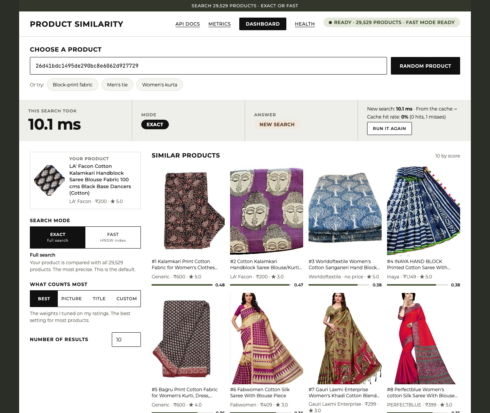

### What you can do on it

1. **Choose a product.** Paste a product ID, press **Random product**, or pick one of the examples (block-print fabric, men's tie, women's kurta). The ID must be a product in the dataset. If it is wrong, the page tells you why in a red message under the box. An ID that is not 32 lowercase letters and digits is stopped on the page, and nothing is sent. An ID with the right shape that no product has gets a 404 from the service, and the page shows its message.
2. **Choose the mode.** **Exact** compares your product with all 29,529 products and is the default. **Fast** uses the HNSW indexes (see [Fast search](#4-fast-search)) and is quicker, but approximate.
3. **Choose what counts most.** **Best** uses my tuned weights. **Picture** counts only the picture, and **Title** counts only the title words. **Custom** gives a slider for each part, and each slider shows its share of the score. The sliders start at my tuned weights, so changing one changes only that part (see [Features in detail](#how-much-each-part-counts)). **Use best weights** puts them back.
4. **Choose how many results.** Any number up to 1,000.

The similar products appear straight away, with their pictures, titles, brands, prices, ratings and a score bar.

### What it shows about the search

| On the page | What it tells you |
|---|---|
| **This search took** | The time of this search in milliseconds |
| **Mode** | Exact or fast |
| **Answer** | A new search, or an answer kept in the cache (see [The cache](#8-the-cache)) |
| **New search / From the cache** | The time of a new search and of a cached answer, so you can compare them |
| **Cache hit rate** | How many of the requests were answered from the cache |
| **Run it again** | Asks the same question again, so you can watch it turn from a new search into a cached answer |
| The green badge | The service is ready, how many products it holds, and whether the fast mode is ready |

The header links to the API docs (`/docs`), the metrics (`/metrics`), the health check (`/ready`) and the Grafana dashboard (`http://localhost:3000`, which works while Grafana is running, see [Monitoring](#monitoring)).

### How it is built

- **One file.** The page is [`src/product_similarity/web/index.html`](src/product_similarity/web/index.html), with plain HTML, CSS and JavaScript. It has no build step and uses no framework.
- **The same service serves it.** The app sends the file at `/`, so it also runs in Docker and in Kubernetes with nothing extra.
- **It uses the API, not a copy of it.** It calls `/find_similar_products/details` for each search, and `/cache`, `/ready` and `/weights` for the rest, so what it shows is what the API returns.
- **Safe text.** Product titles come from the dataset, so the page puts them in with `textContent`. It never inserts them as HTML.
- **Tested.** 8 tests in [`tests/unit/test_page.py`](tests/unit/test_page.py) check that the page is served and what it contains, and CI runs them on every push.

### Limits

- The product pictures load from the image links in the dataset, so they need an internet connection, and a link that no longer exists shows the words "No photo". The font also loads from Google Fonts, and the page still works without it.
- The Dashboard link works only while Grafana is running.
- The page has a layout for narrow screens, but I did not test it on other browsers.

## Kubernetes

### What Kubernetes is, and why I used it

Docker packs the service into one image (see [The service and Docker](#the-service-and-docker)). **Kubernetes** runs that image for you, in several copies, and looks after them. Each copy is called a **pod**. You tell Kubernetes what you want ("2 pods of this image") in files, and it keeps it that way:
- if a pod breaks, it starts a new one;
- it sends requests only to pods that are ready;
- when I release a new version, it replaces the pods one at a time, so the service never goes down.

One container on one machine has none of this. If it stops, the service is down until someone starts it again. That is why a service that must stay available runs on Kubernetes.

The files are in [`k8s/`](k8s/).

| File | What it says |
|---|---|
| [`deployment.yaml`](k8s/deployment.yaml) | Run 2 pods of the image, with the health checks, the memory and CPU limits, a non-root user, and the rolling-update rule |
| [`service.yaml`](k8s/service.yaml) | One fixed address (port 80) in front of the pods. It sends each request to a pod that is ready. It is reachable inside the cluster only |
| [`pdb.yaml`](k8s/pdb.yaml) | While a machine is being updated or emptied, keep at least 1 pod running |

### Two pods, both serving

Both pods answer requests at the same time. If one stops, the other keeps answering, so each is the other's backup. I did not make one pod wait idle, because that would use the memory of a whole pod for nothing. Kubernetes also prefers to put the two pods on different machines, so one broken machine does not take both down.

### The health checks (probes)

A probe is a question that Kubernetes asks each pod every few seconds. There are three, and they use the two endpoints the API already has (see [The service and Docker](#what-the-service-is)).

| Probe | Endpoint | Question | If the answer is no |
|---|---|---|---|
| Startup | `/ready` | Have you finished loading (about 15 seconds)? | The other two probes wait, for up to 200 seconds |
| Readiness | `/ready` | Can you answer searches now? | The pod gets no requests, but keeps running |
| Liveness | `/live` | Are you stuck? | Kubernetes restarts the pod |

### How a new version is released (rolling update)

The deployment strategy is a **rolling update** (`maxSurge: 1`, `maxUnavailable: 0`). When I release a new version, Kubernetes:
1. starts a third pod with the new version;
2. waits until that pod is ready;
3. only then stops one old pod, and repeats for the other one.

So there is never a moment with fewer than 2 ready pods, and users do not notice the release. If the new version never becomes ready, the rollout stops and the old pods keep serving. The other common choice, stopping all old pods and then starting the new ones, would leave the service down for the 15 seconds the new pods need to load.

### Memory, CPU and safety

- **Memory and CPU.** Each pod asks for 1,280 MB and 0.25 CPU, and may use at most 2 GB and 1 CPU. I measured about 1.06 GB with the vectors and both fast indexes loaded. A pod that goes over its memory limit is restarted, which protects the other pod.
- **Safety.** The pod runs as a user that is not root, it cannot gain more rights, and all extra Linux capabilities are dropped.
- **Settings.** The pods run the exact mode by default (`PS_SEARCH_MODE=exact`) and keep 1,024 cached answers (`PS_CACHE_SIZE=1024`).

### The cache is per pod

The cache lives inside the process (see [The cache](#8-the-cache)), so each pod has its own. The same question can be a miss on one pod and a hit on the other, and a new pod starts with an empty cache. A cache shared by all pods (for example Redis) would fix that. I described it and did not build it.

### What CI tests

The `kubernetes` job in [`ci.yml`](.github/workflows/ci.yml) starts a temporary cluster (kind) on the GitHub machine, loads the image, applies the files, and checks that:
- both pods become ready;
- a search through the Service works;
- when one pod is deleted, 20 requests in a row still return 200;
- during a rolling update no request fails (84 requests, 0 failures in the run I checked).

The cluster is deleted when the job ends. See [Tests and CI/CD](#tests-and-cicd).

### What I did not do

- I do not deploy to a real cluster, because I have no cluster to deploy to.
- I do not push the image to a registry (an online store for images, such as Docker Hub), so `deployment.yaml` names a local image, `product-similarity:latest`.
- For a real deployment I would push the image to a registry, put its name in `deployment.yaml`, and run `kubectl apply -f k8s/`. When I run the service on my own computer, I run it with `uvicorn` (see [Getting started](#getting-started)).

## Monitoring

### What monitoring is, and why I added it

Once a service is running, I need to see how it is doing without reading its log: how many searches it answers, how long they take, how often the cache helps, and whether errors appear. That is **monitoring**. It uses three tools, each with one job:

| Tool | Its job |
|---|---|
| **The service** (`/metrics`) | Counts what it does and shows the counts as plain text |
| **Prometheus** | Reads `/metrics` of every pod every 5 seconds and stores the numbers over time. It also checks the two alert rules |
| **Grafana** | Draws the stored numbers as a dashboard |

The files are in [`monitoring/`](monitoring/).


*The screenshot is from a run on my laptop with 2,052 test searches. The memory panel is empty because only Linux shows memory.*

### What the service counts

The code is in [`metrics.py`](src/product_similarity/metrics.py). Every number starts with `ps_`.

| Number | What it counts |
|---|---|
| `ps_http_requests_total` | Requests answered, by endpoint and status code |
| `ps_http_request_seconds` | How long a request took, by endpoint |
| `ps_searches_total` | Searches, by mode (exact or fast) and by cache (hit or miss) |
| `ps_search_seconds` | The time of a search that was really run, not answered from the cache |
| `ps_errors_total` | Errors, by error code |
| `ps_cache_entries` | How many answers the cache holds |
| `ps_ready` | 1 when the data is loaded, otherwise 0 |

### The dashboard

The dashboard ([`dashboard.json`](monitoring/dashboard.json)) has eight panels. Grafana reads it from a file, so nobody has to click it together.

1. **Searches per second, by status code:** how busy the service is, and whether some requests fail.
2. **Search time (p50 and p95):** the typical time and the slow end. p95 means that 95 of 100 searches are faster than this number.
3. **Cache hit rate:** how many searches the cache answered.
4. **Exact and fast searches per second:** which mode is used.
5. **Errors per second, by code:** which errors happen.
6. **Pods that are up:** how many pods Prometheus can reach.
7. **Answers kept in the cache** (limit 1,024).
8. **Memory of each pod** (Linux only).

### The alerts

Two rules in [`alerts.yml`](monitoring/alerts.yml) turn a warning light on in Prometheus:

| Alert | When it fires | Why this rule |
|---|---|---|
| `HighErrorRate` (critical) | More than 5 in 100 requests end in a server error (5xx) for 5 minutes | A wrong input from a caller (422 or 404) is not the service's fault, so those are not counted |
| `SlowSearch` (warning) | The slowest 5 in 100 searches take longer than 100 ms for 5 minutes | A normal search takes about 10 ms |

### How to run it

**On my laptop** (no Docker needed): install Prometheus and Grafana with `brew install prometheus grafana`, start the service, then:

```bash
bash monitoring/run_local.sh               # starts Prometheus (9090) and Grafana (3000)
python monitoring/send_traffic.py          # sends some searches, so the panels fill
```

Open Grafana at `http://localhost:3000` (no login needed) and Prometheus at `http://localhost:9090`. The numbers are kept in a temporary folder that is deleted when you stop the script.

**In Kubernetes:** one command applies both tools, and Prometheus finds the pods by itself:

```bash
kubectl apply -k monitoring/
```

### What CI tests

The `kubernetes` job ([`ci.yml`](.github/workflows/ci.yml)) checks the monitoring files, deploys Prometheus and Grafana on the temporary cluster, sends traffic, and checks that Prometheus reads both pods and that Grafana shows the dashboard. The docker job checks that `/metrics` reports the numbers that its own requests caused. See [Tests and CI/CD](#tests-and-cicd).

### Limits

- The alerts show in Prometheus. I did not set up a place to send them to (such as an email or a chat message), because there is nobody to receive them.
- I run the dashboard on my laptop and on the temporary cluster in CI. I did not run it on a real cluster.
- The memory panel works only on Linux, so it is empty on my Mac.

## Tests and CI/CD

### Tests

There are **283 tests**: 274 unit tests and 9 integration tests. They run with one command:

```bash
pytest
```

| Group | What it checks |
|---|---|
| Unit tests (`tests/unit/`) | Small pieces on their own: loading and cleaning the data, scoring and ranking, the hybrid search and the weights, the fast vector search, the cache, the API and its errors, the page, the metrics, the Kubernetes files, the vector files, the rating tools, MLflow logging and the image and text code |
| Integration tests (`tests/integration/`) | The real dataset and the real API, end to end |

The code style is checked with `ruff` (`ruff check .` and `ruff format --check .`). The `Makefile` has the shortcuts `make lint` and `make test`.

### CI/CD with GitHub Actions

**CI** (continuous integration) means that every time I push, a computer at GitHub builds the project and runs all the checks, so a mistake shows up in minutes. The file is [`.github/workflows/ci.yml`](.github/workflows/ci.yml). It runs on every push and every pull request, in four jobs.

| Job | What it checks | Stops the pipeline? |
|---|---|---|
| **test** | Installs the project (with FAISS, so the fast-mode tests run), checks the code style with ruff, and runs all 283 tests | Yes |
| **docker** | Builds the image, starts the container, and tests the running service (see below) | Yes, except the Trivy scan, which is a warning |
| **security** | Runs `pip-audit` on the packages of the service, looking for known vulnerabilities | No, a warning only |
| **kubernetes** | Checks the Kubernetes files, then deploys them on a temporary cluster and tests them (see below) | Yes |

The docker and kubernetes jobs start only if the test job passes, so a broken change does not waste their time.

**What the docker job checks.** It starts the container and waits until it is ready, then checks that:
- it runs the final search (`/ready` says `hybrid`);
- the same question asked three times gives `X-Cache: miss`, then `hit`, then `cached: true` on the details endpoint, with an identical answer, and `/cache` reports 2 hits and 1 miss;
- the fast mode and the weights work (picture-only, title-only and a mix give three different lists);
- eight kinds of bad input give a 422, and an unknown ID gives a 404;
- `/metrics` reports the numbers that these steps caused;
- the page is served at `/`, and the container does not run as root;
- the image has no known serious vulnerabilities (a scan with Trivy, a warning only).

**What the kubernetes job checks.** It checks the files against the official Kubernetes schemas, builds the image, starts a temporary cluster (kind) and deploys the two pods and the Service. Then it checks that both pods are ready and that a search through the Service works. It deletes one pod and checks that 20 requests still return 200, and it runs a rolling update while sending requests to check that none fails. It runs the same API checks as the docker job against one pod. Last, it checks the monitoring files, deploys Prometheus and Grafana, sends traffic, and checks that Prometheus reads both pods and that Grafana shows the dashboard. See [Kubernetes](#kubernetes) and [Monitoring](#monitoring).

### Why Docker and Kubernetes are tested here

I do not have Docker on my own computer, so CI is where the image is built and run for real. This is also why the pipeline tests so much of the running service: the checks are the proof that the image and the Kubernetes files work.

### What CI/CD does not do

The pipeline is mostly CI. It builds the image and tests it, but it does not **deploy** (the "CD" part): it does not push the image to a registry and does not update a real cluster, because I have no cluster to deploy to (see [Kubernetes](#kubernetes)). I merge into `main` through a pull request after the checks pass.

## Getting started

You need Python 3.9 or newer. I tested a fresh clone of the repository on Python 3.9, CI uses Python 3.10, and the Docker image uses Python 3.10. Everything below runs from the folder of the repository.

### 1. Run the service

```bash
git clone https://github.com/aqib-prog/sap-product-similarity.git
cd sap-product-similarity
python3 -m venv .venv && source .venv/bin/activate
pip install --upgrade pip
pip install -r requirements.txt
PYTHONPATH=src uvicorn app:app --port 8000
```

Wait a few seconds until the log says "Application startup complete", then open [http://localhost:8000](http://localhost:8000) for the page, or try the API:

```bash
curl "http://localhost:8000/find_similar_products?product_id=26d41bdc1495de290bc8e6062d927729&num_similar=5"
```

The response is a JSON list of product IDs (more examples are in [Example](#example)). The dataset and the half-size vectors are in the repository, so nothing else needs to be downloaded.

- **The first fast search is slow** (about 13 seconds on my laptop), because the fast indexes are built then. To build them at start instead, run with `PS_PREBUILD_FAST=1`, as the Docker image does.
- **The service is ready when `/ready` says so.** The page shows the same in its green badge.

The settings are environment variables:

| Variable | What it does | Default |
|---|---|---|
| `PS_SEARCH_MODE` | The mode when a request does not say one (`exact` or `fast`) | `exact` |
| `PS_MAX_RESULTS` | The most results one request may ask for | 1,000 |
| `PS_CACHE_SIZE` | How many answers the cache keeps (0 turns it off) | 1,024 |
| `PS_PREBUILD_FAST` | Build the fast indexes at start (`1`) | off |
| `PS_REQUIRE_VECTORS` | Stop with an error if the vectors are missing (`1`) | off (the Docker image sets it) |

### 2. Run it with Docker

```bash
docker build -t product-similarity .
docker run -p 8000:8000 product-similarity
```

The service is then at the same address. See [The service and Docker](#the-service-and-docker) for what is in the image.

### 3. Run the tests

```bash
pip install -e ".[dev]" faiss-cpu==1.13.0
pytest
```

On a fresh clone this gives 281 passed and 1 skipped. The skipped test needs MLflow (`pip install -e ".[experiments]"`). `make lint` checks the code style, and `make test` runs the tests.

### 4. Open the notebooks

```bash
pip install -e ".[dev,notebooks]"
jupyter lab notebooks/
```

The notebooks read the results that are in the repository. To run an experiment again, add the extras it needs: `experiments` (MLflow), `images` (ResNet and CLIP), `text` (the sentence model) and `ann` (FAISS and Annoy). The commands for each experiment are under "Reproduce it" in [What I tried, and what I kept](#what-i-tried-and-what-i-kept). The product pictures, the full-size vectors and the MLflow databases are not in Git, so the experiments that need them create them on your computer first.

### 5. See the monitoring

Start the service, then follow [Monitoring](#how-to-run-it) to open Prometheus and Grafana, and [Kubernetes](#kubernetes) to deploy to a cluster.

## Limits and improvements

### Limits

**How I measured**
- One person (me) rated the results, so the labels reflect one judgment.
- Only 30 development products were used to compare methods, so a small gap between two methods may be chance. I call only the large gaps real, and I say "ahead, but I can't be sure" for small ones such as CLIP against the hybrid.
- The hybrid weights were tuned on the same 30 products that I report on, so the development scores are a little optimistic. The cross-validation scores come from products the weights had not seen, and the 20 locked products gave the honest final test (see [The final test](#9-the-final-test)).
- The final test used only 20 products, rated by me, and I used it once. Its nDCG@10 (0.97) cannot be compared with the development one (0.81), because the rated results come only from this one system. Precision@10 (0.87) is the number to compare.

**The data and the models**
- The attribute weights are fixed starting ratios. Only the four group weights were tuned (see [Features in detail](#how-much-each-part-counts)).
- The sentence model was not trained on shopping titles, so it may be weaker on brand names and size words.
- Many products share a title (34%), and the dataset has little information on weight, colour and rating, so those parts carry little influence (see [Data exploration](#data-exploration-eda)).
- Guessing a missing brand from the title is built and tested, but not used (see [Preprocessing](#preprocessing-cleaning-the-data)).

**The service**
- I tested about 29,500 products. At this size the exact search is already fast, so the fast mode and shorter vectors would matter more for a much larger catalogue, which I did not test. The timings are from one laptop, one thread, one query at a time.
- The fast mode makes its shortlist from the title meaning and the picture only, so a product that matches only through its attributes may not be on it.
- The cache is lost when the service restarts, and each pod has its own.
- I do not deploy to a real cluster or push the image to a registry. The pipeline shows that the files work on a temporary cluster.
- The alerts show in Prometheus, but I did not set up where to send them.
- The product pictures on the page load from the dataset's links, so a dead link shows "No photo".

### Improvements

What I would do next, and why. I described these and did not build them.

| Improvement | Why |
|---|---|
| **A shared cache (Redis)** | One cache for all pods, kept when a pod restarts, so a question asked on one pod is a hit on the other (see [The cache](#8-the-cache)) |
| **Deploy to a real cluster** | Push the image to a registry, put its name in `deployment.yaml`, and run `kubectl apply -f k8s/`, then `kubectl apply -k monitoring/` (see [Kubernetes](#kubernetes)) |
| **Send the alerts somewhere** | An email or chat message when `HighErrorRate` or `SlowSearch` fires, so someone is told (see [Monitoring](#the-alerts)) |
| **More raters and more rated products** | Less dependence on one person's judgment, and gaps that are big enough to trust |
| **Tune each attribute on its own** | With more ratings, the seven attribute weights could be tuned too, without the weights just memorising a few products |
| **A title model made for shopping text** | Better handling of brand names and size words |
| **Test a much bigger catalogue** | See whether the fast mode and a milder PCA cut pay off at millions of products (see [Fast search](#4-fast-search) and [Shorter vectors](#5-shorter-vectors-pca)) |

## Project layout

```text
app.py                      Entry point for uvicorn
Dockerfile                  Builds the service image (serving packages and the vectors, non-root user)
requirements.txt            Pinned packages used by the service and the Docker image
pyproject.toml              Package settings and the optional extras (dev, notebooks, experiments, images, text, ann)
Makefile                    Shortcuts: make install, lint, format, test
src/product_similarity/     Python package
  data.py                   Reads the archive, checks its hash, keeps one record per product
  validation.py             Reports data problems without changing the data
  preprocessing.py          Cleaning and derived fields
  scoring.py                Per-attribute similarity scores and the weighted mix
  ranking.py                Fixed ordering of results
  service.py                The public find_similar_products function
  api.py                    Web routes (FastAPI)
  settings.py               File locations, overridable with environment variables
  judging.py                Chooses the test products and builds the blind rating sheet
  review_page.py            The browser page used to rate results
  evaluation.py             nDCG, precision and confidence ranges
  tracking.py               Optional MLflow logging (the service never uses it)
  images.py                 Safe image download, quality checks and sample selection
  image_features.py         Turns pictures into vectors with ResNet and CLIP (offline only)
  dedupe.py                 Shows one copy of each item in a result list
  text_features.py          Turns titles into vectors with a sentence model (offline only)
  tuning.py                 Coordinate ascent, cross-validation and part importance for the weights
  vector_search.py          Exact (brute-force) vector search and recall, the reference for fast indexes
  hybrid_eval.py            Scores a set of hybrid weights against my ratings quickly
  hybrid.py                 The final search: the tuned hybrid, with an exact and a fast (HNSW) mode
  cache.py                  The in-process cache for repeated questions
  weights.py                Reads and checks the weights a user sets for one search
  vector_files.py           Saves and reads the half-size vector files that ship with the service
  metrics.py                The numbers on /metrics (requests, times, cache hits, errors) for Prometheus
  web/index.html            The page served at / (one HTML file)
experiments/                Scripts that I run by hand (nothing here is used by the service)
  run_evaluation.py         Scores the text methods against my ratings and records the runs
  check_images.py           Downloads and checks the 100-image sample
  image_grids.py            Makes contact sheets of the sample images (kept local)
  download_dev_images.py    Downloads the pictures of the development products
  extract_image_features.py Turns those pictures into ResNet and CLIP vectors
  run_image_search.py       Finds similar pictures and writes the rating page for new results
  run_image_evaluation.py   Scores text and image methods together and records the runs
  download_images.py        Downloads the first picture of every product (not the locked ones)
  extract_all_image_features.py  Turns all pictures into CLIP vectors
  run_full_image_search.py  CLIP search over the whole catalogue, writes the rating page
  run_full_image_evaluation.py  Scores text and CLIP search together and records the runs
  extract_text_features.py  Turns all titles into sentence vectors
  run_text_vector_search.py Finds similar titles and writes the rating page for new results
  run_text_vector_evaluation.py  Scores TF-IDF, sentence vectors and CLIP together and records the runs
  hybrid_setup.py           Shared set-up for the hybrid scripts (ratings, vectors, scorer)
  tune_hybrid_weights.py    Tunes the hybrid weights and checks them with 5-fold cross-validation
  run_hybrid_search.py      Finds hybrid results without a rating and writes the rating page
  run_hybrid_evaluation.py  Scores the hybrid next to the single methods and records the runs
  log_hybrid_tuning.py      Records the tuning runs in MLflow
  ann_data.py               Shared set-up for the fast-search scripts (vectors and test products)
  ann_exact_baseline.py     Times the exact search and saves its answers
  ann_benchmark.py          Compares FAISS Flat, HNSW, IVF and Annoy with the exact search
  ann_hybrid_check.py       Uses a fast index to pick candidates for the hybrid
  log_ann_benchmark.py      Records the fast-search runs in MLflow
  ann_pca.py                Cuts the vectors with PCA and runs every method on them
  log_ann_pca.py            Records the PCA runs in MLflow
  export_vectors.py         Makes the half-size vector files in artifacts/vectors/
  check_vector_files.py     Checks that the half-size vectors do not change the results
  check_final_search.py     Checks that the real search gives the same results as the notebooks
  measure_cache.py          Measures a cache hit against a miss, and a traffic simulation
  run_final_test_rating.py  Makes the blind rating page for the 20 locked products (used once)
  score_final_test.py       Scores both modes on the 20 locked products with my ratings
  log_final_test.py         Records the final test in MLflow
  log_cache.py              Records the cache measurements in MLflow
  run_final_search_rating.py Finds results without a rating for the final search and writes the rating page
  check_fast_vs_exact.py    Compares the exact and the fast mode (misses, time, memory)
  log_final_search.py       Records the final-search runs in MLflow
evaluation/                 Test products, rating rules, rating pages and my ratings
  queries.json              The 50 test products (30 development, 20 locked)
  rubric.md                 The rules for rating 0, 1 or 2
  judgments/                Rating sheets, rating pages and my ratings (CSV)
  *.png                     Screenshots of the rating page and MLflow
results/                    Exported scores, reports and image check numbers
tests/                      282 tests
  unit/                     Fast tests for each module
  integration/              Tests on the real dataset and the real API
notebooks/                  Fifteen analysis notebooks (they import logic from the package)
data/archive.zip            Dataset supplied with the exercise
screenshots/                The page, from a local run
k8s/                        Kubernetes files: deployment (2 pods, probes, rolling update), service, pod budget
monitoring/                 Prometheus and Grafana files, alert rules, a script to run them locally, a traffic script
  screenshots/              The Grafana dashboard from a local run
.github/workflows/ci.yml    Continuous integration (lint, tests, Docker and Kubernetes checks)
```

Not in Git: the downloaded pictures, the saved picture vectors and the local MLflow databases. They stay on my computer.

## License

Apache-2.0, see [LICENSE](LICENSE).
