# Product Similarity Search

A multimodal product similarity engine for the Amazon Fashion 2020 dataset (30,000 products). Given a product's `uniq_id`, it returns the most similar products using structured attributes, product titles and product images.

The project is built for the SAP technical exercise. The original task description is in the [assignment repository](https://github.com/punitmishra/sap-cxii-tech-ex-01).

> **Status: work in progress.** I am building this one step at a time. This page describes what is done and tested today, what I found, and what comes next.

## Status

| Area | State |
|---|---|
| Data loading and validation (reads the archive in place, integrity check) | Done, tested |
| Exploratory data analysis notebook (6 explained charts, 24 reproduced figures) | Done |
| Preprocessing pipeline (cleaning, repeated products, derived fields) | Done, tested |
| Baseline similarity function `find_similar_products` (title and attributes, untuned weights) | Done, tested |
| Evaluation: 50 test products, blind rating page, scoring, MLflow tracking | Done: the 30 development products for tuning, and the 20 locked products for the final test (notebook 14) |
| Image sample check (100 images) | Done: 99 of 100 downloaded |
| Picture download for the whole catalogue | Done: 29,107 pictures (134 broken links) |
| Fast vector search (FAISS HNSW and IVF, Annoy) | Done: HNSW is about 60 times faster than the exact search with 97% recall@10; the exact search is already fast at this size |
| Shorter vectors with PCA | Done: at 128 numbers PCA keeps only 71% (pictures) and 82% (sentences) of the exact top 10, so it is not used |
| The final search (exact and fast mode) | [12](notebooks/12_final_search.ipynb) | [`final_search_check.json`](results/final_search_check.json), [`fast_vs_exact_check.json`](results/fast_vs_exact_check.json), [`dev_final_search_coverage.json`](results/dev_final_search_coverage.json), [`dev_final_search_fast_coverage.json`](results/dev_final_search_fast_coverage.json) | `final-search` |
| The cache (hit against miss, traffic) | [13](notebooks/13_caching.ipynb) | [`cache_benchmark.json`](results/cache_benchmark.json) | `caching` |
| The final test (20 locked products) | [14](notebooks/14_final_test.ipynb) | [`final_test_scores.json`](results/final_test_scores.json), [`final_test_coverage.json`](results/final_test_coverage.json), my ratings in [`final_grades.csv`](evaluation/judgments/final_grades.csv) | `final-test` |
| The half-size vectors in the Docker image | (no notebook; see "The vectors in the image") | [`vector_files_check.json`](results/vector_files_check.json) | none |
| Final search: the tuned hybrid in the real search, with an exact and a fast mode | Done and checked on the 30 development products: same results as the notebooks; the fast mode only speeds up the sentence and picture parts, gives nearly the same quality (nDCG@10 0.810 against 0.811) and is about 15 times faster; the final test on the locked products is in notebook 14 |
| In-process cache for repeated questions | Done: a request in the cache takes 0.77 ms against 9.6 ms for a new search (about 12 times faster) |
| Final test on the 20 locked products (both modes, rated once) | Done: precision@10 0.87 for both modes (0.877 on the development products), and the fast mode is about 17 times faster |
| Hybrid search (weights tuned by coordinate ascent, 5-fold cross-validation) | Done: the 4-weight hybrid scores highest (nDCG@10 0.806); the final test on the locked products is in notebook 14 |
| Sentence vectors on titles | Done: clearly better than TF-IDF on titles, about the same as my baseline; combining everything is next |
| Image similarity with CLIP vectors | Done on the whole catalogue: CLIP scores highest on the 30 development products; combining it with text is next |
| FastAPI service | Done, tested |
| API: input checks, error codes, `mode` and `weights` options | Done: clear 422, 404 and 503 errors, and an exact or fast mode and your own weights for each search |
| Docker image | Done: built and tested in CI. It runs the final search with the vectors inside the image (half-size numbers, two files under 50 MB), and it stops with an error if they are missing |
| CI: lint, tests, Docker build and smoke test on every push | Done, passing |
| Vector search benchmarks (FAISS Flat and HNSW, Annoy) | Planned |
| Kubernetes files (2 pods, a Service, probes, a rolling update) | Done: deployed and tested in a temporary cluster in CI on every push |
| Monitoring (`/metrics`, Prometheus, Grafana, two alert rules) | Done: checked in CI, and a dashboard screenshot from a local run |

## What I did so far

I work in small steps. After each step I check the result, and I write down what I found. I build on a `dev` branch and merge into `main` with a pull request.

1. **Looked at the data.** I read all 30,000 products and checked the columns, missing values, repeated products and prices. ([notebook 01](notebooks/01_data_exploration.ipynb))
2. **Cleaned the data.** One record per product, with every ID still valid. ([notebook 02](notebooks/02_preprocessing.ipynb))
3. **Built a first similarity search.** It compares titles and attributes and returns product IDs, with a FastAPI service and a Docker image on top. ([notebook 03](notebooks/03_baseline_examples.ipynb))
4. **Made a fair way to measure it.** There is no answer key, so I made one from my own ratings, and I record every run in MLflow. ([notebook 04](notebooks/04_evaluation_baseline.ipynb))
5. **Checked the pictures.** I tested 100 sample images before any bulk download.
6. **Tried pictures for similarity.** I turned pictures into vectors with ResNet and CLIP and scored them with the same ratings. ([notebook 05](notebooks/05_image_similarity.ipynb))
7. **Tested pictures on the whole catalogue.** I downloaded about 29,000 pictures, turned them into CLIP vectors, rated the new results and scored them next to the text methods. ([notebook 06](notebooks/06_clip_whole_catalogue.ipynb))
8. **Tried a sentence model on the titles.** I turned all titles into vectors with a ready-made sentence model and scored it with my ratings next to TF-IDF and CLIP. ([notebook 07](notebooks/07_sentence_vectors_on_titles.ipynb))
9. **Mixed everything into one hybrid search.** I combined the title (TF-IDF and sentence vectors), the CLIP picture and the attributes into one score, tuned the weights with coordinate ascent and checked them with 5-fold cross-validation. ([notebook 08](notebooks/08_hybrid_search.ipynb))
10. **Made the search faster.** I timed the exact search, compared FAISS HNSW and IVF and Annoy with it, and used the fast index inside the hybrid. ([notebook 09](notebooks/09_fast_vector_search.ipynb))
11. **Tested shorter vectors.** I cut the vectors with PCA, ran every search method on them and compared time, memory and recall. ([notebook 10](notebooks/10_shorter_vectors_pca.ipynb))
12. **Drew the vectors.** I squeezed the picture vectors into two numbers with t-SNE to look at them, before and after PCA. ([notebook 11](notebooks/11_tsne_picture_vectors.ipynb))
13. **Put the tuned hybrid into the real search.** The search now has an exact mode and a fast mode (HNSW picks the candidates). I checked that it gives the same results as my notebooks, and I compared the two modes with my ratings, with time and memory. ([notebook 12](notebooks/12_final_search.ipynb))
14. **Added a cache.** The service keeps the answers of the last 1,024 questions in its memory, says whether an answer came from the cache, and I measured a hit against a miss and a simulation of traffic. ([notebook 13](notebooks/13_caching.ipynb))
15. **Ran the final test.** I rated the results of the final search on the 20 products that had been locked from the start, and scored both modes. ([notebook 14](notebooks/14_final_test.ipynb))
16. **Made the API stronger.** Clear input checks and error codes, a `mode` option (exact or fast), a `weights` option (the simple way with 4 names, or the advanced way with 10), and `GET /weights` for the page. ([notebook 15](notebooks/15_stronger_api.ipynb))
17. **Automated the checks (CI/CD).** Every push runs the linter, the tests and a Docker smoke test.
18. **Ran it on Kubernetes.** The image runs as 2 pods behind one Service, with liveness and readiness probes and a rolling update. CI starts a temporary cluster on every push and tests it. (See "Kubernetes".)
19. **Added monitoring.** The service reports its own numbers on `/metrics`. Prometheus collects them, Grafana draws them, and two alert rules judge them. (See "Monitoring".)

The sections below explain each step: what I did, why, and what I found.

## Getting started

Requires Python 3.9 or newer (CI runs Python 3.10).

```bash
python3 -m venv .venv && source .venv/bin/activate
pip install -e ".[dev,notebooks]"
make test
make lint
```

Optional extras: `experiments` (MLflow) and `images` (ResNet and CLIP). Neither is needed to run the service or the tests.

To open the notebooks:

```bash
jupyter lab notebooks/
```

## Run the service

```bash
PYTHONPATH=src uvicorn app:app --port 8000
```

```bash
curl "http://localhost:8000/find_similar_products?product_id=26d41bdc1495de290bc8e6062d927729&num_similar=5"
```

The response is a JSON list of product IDs. An unknown ID returns 404, invalid input returns 422, and `/live` and `/ready` report service health. `/find_similar_products/details` returns the same search with titles, prices, scores and timing.

## The data

### What is in it

`data/archive.zip` holds one line-delimited JSON file with 30,000 products. It is read directly from the archive and never modified or extracted. When it loads, the code first checks the file's SHA-256 fingerprint, so I know it is exactly the file SAP supplied. A few fields that are stored as text but are really numbers (price, rating, review counts) are converted while reading. Everything else is left as it came, and cleaning happens later.

### What I found

The exploration notebook reproduces these findings:

- Product IDs are unique, and 471 rows are recrawls of the same ASIN.
- Only about 21% of products have a real weight (the rest carry the placeholder `999999999`), and about 20% have a colour value.
- Price is strongly right-skewed (median 590, mean 862 INR).
- Ratings are unreliable on their own: 6,611 products have a rating but no reviews.
- About a third of products share an exact title with another product.
- 99.99% of products have image URLs.

### Why it matters

Several attributes are often missing, so a similarity search cannot rely on one field. This is why the first search skips missing attributes instead of guessing them (see below).

## Cleaning the data

The cleaning pipeline works step by step, with before-and-after charts in [notebook 02](notebooks/02_preprocessing.ipynb):

- **Repeated products.** The 471 repeated rows are merged: I keep the newest crawl, and the lowest ID if they tie. All 30,000 original IDs still resolve to a product, so asking about an old ID still works.
- **Titles and brands.** Broken text characters are repaired, and brand spellings are tidied into one form. Guessing a missing brand from the title is built but switched off, because I could not show that it helps.
- **Weight.** The placeholder value is treated as missing, not as a real weight.
- **Categories.** A missing category is filled from products on the same shelf. In a hide-and-guess check, about 97% matched.
- **Other fields.** Audience (men, women, kids) is derived from the title and category, colours are extracted from the text, and price and review fields are cleaned.

## How the first similarity search works

`find_similar_products(product_id, num_similar)` scores one product against all the others and returns the best matches. Each comparison gives a score between 0 and 1, and the scores are mixed with weights.

### Titles

Titles are turned into sparse vectors with TF-IDF, and two titles are compared with cosine similarity. Words that are rare across the catalogue count more than common ones.

### Attributes

Each attribute is compared directly:

- **Category, brand, audience:** same or different.
- **Price and weight:** closeness on a log scale, so a 10 times difference scores 0.
- **Rating:** closeness in stars, reaching 0 at 4 stars apart.
- **Colour:** how much the two colour lists overlap (Jaccard).

### Mixing the scores

| Part | Weight |
|---|---|
| Title | 0.35 |
| Category | 0.20 |
| Brand | 0.10 |
| Audience | 0.10 |
| Price | 0.10 |
| Colour | 0.05 |
| Weight | 0.05 |
| Rating | 0.05 |
| Image | 0 (off until picture vectors are added) |

These starting weights are **not tuned**. They are a placeholder until experiments choose better ones.

### Missing data

If either product lacks an attribute, that attribute is skipped and the remaining weights are rescaled so they still add up to 1. Missing data is never filled in with a guess.

### A fixed order

Scores are rounded to 6 decimals, and ties are broken by product ID, so the same question always gives the same list.

## The service and Docker

The service is a small FastAPI app. The engine is built once at startup (about 2 seconds, and about 13 more for the fast indexes in the Docker image), and then each request takes a few milliseconds. `num_similar` must be at least 1.

| Endpoint | What it returns |
|---|---|
| `GET /find_similar_products?product_id=...&num_similar=...` | The list of the most similar product IDs (the required endpoint). The headers `X-Cache` (`hit` or `miss`) and `X-Search-Mode` (the mode that ran) |
| `GET /find_similar_products/details?...` | The same search with the question, readable product details, the scores, `mode`, `weights`, `cached` and `response_time_ms` |
| `GET /weights` | The modes, the limits, the names of the weights and the tuned weights (simple and advanced), for a page that sets them |
| `GET /cache` | The cache statistics: `enabled`, `max_entries`, `entries`, `hits`, `misses` and `hit_rate` |
| `GET /live` | The process is running |
| `GET /ready` | The data is loaded; it also says which search runs, the modes, and whether the fast mode is ready |
| `GET /metrics` | The service's own numbers (requests, times, cache hits, errors) as text, for Prometheus (see "Monitoring") |

```bash
docker build -t product-similarity .
docker run -p 8000:8000 product-similarity
```

The Docker image is built on `python:3.10-slim`, installs only the pinned serving packages from `requirements.txt` (no MLflow, no notebooks, no image models; FAISS is included, for the fast mode), and runs as a non-root user.

### The vectors in the image

The final search needs the picture vectors (CLIP) and the sentence vectors (MiniLM). They are computed once, offline, and the full-size files are too big for GitHub (56 MB and 43 MB, and git ignores them). So the service ships a **half-size copy**: every number is stored in 2 bytes instead of 4 (float16), in two files that are each under 50 MB (28.0 MB and 21.5 MB) in [`artifacts/vectors/`](artifacts/vectors/). The image copies them in, and the service reads them back as normal numbers when it starts.

- **It does not change my results.** For the 30 development products, the top 10 is identical with the half-size vectors in the exact mode and in the fast mode (30 of 30), and nDCG@10 and precision@10 are the same (0.8105 and 0.8767 for the exact mode). On 1,000 random products, 987 of the exact mode's lists are identical, and 99.96% of the products in the top 10s are the same (fast mode: 948 identical lists, 99.2% the same products). The rounding error of one number is at most 0.00024. The record is [`results/vector_files_check.json`](results/vector_files_check.json).
- **A damaged file is noticed.** `manifest.json` holds the SHA-256 of each file, and the service checks it when it starts.
- **No silent fallback in the container.** The image sets `PS_REQUIRE_VECTORS=1`: if the vectors are missing or do not match the products, the service stops with an error instead of quietly using the old baseline search. Without that setting (on a laptop), the service falls back to the baseline with a warning.
- **`/ready` says which search is running**, for example `{"status": "ready", "products": 29529, "search": "hybrid (exact)"}`.

```bash
python experiments/export_vectors.py       # makes the half-size files from the full-size ones
python experiments/check_vector_files.py   # checks that the results do not change
```

### Parameters and errors

| Parameter | Meaning | Rule |
|---|---|---|
| `product_id` | The product to start from (required) | 32 lowercase hexadecimal characters |
| `num_similar` | How many similar products to return (required) | A whole number from 1 to 1,000 (`PS_MAX_RESULTS`) |
| `mode` | `exact` or `fast` (optional) | The default is `exact` |
| `weights` | How much each part counts (optional) | `name:value` pairs, each value from 0 to 1, for example `image:0.6,title:0.4`. If it is left out, the tuned weights are used |

- **Weights, two ways.** The simple way has 4 names (`title`, `text_vectors`, `image`, `attributes`, where `attributes` is the seven attributes together). The advanced way has the 10 parts. They cannot be mixed. What you send is what is used, and a part you leave out gets 0. The weights do not have to add up to 1. At least one must be above 0.
- **The fast mode with weights.** Its shortlist comes from the sentence and picture vectors, so if both of their weights are 0 the exact mode runs instead, and the answer says so (`mode_note`).
- **Every error has the same shape:** `{"error": "<code>", "message": "<a sentence>"}`.

| Status | `error` | When |
|---|---|---|
| 422 | `invalid_input` | `product_id` or `num_similar` is missing or not valid |
| 422 | `invalid_mode` | the mode is not `exact` or `fast` |
| 422 | `invalid_weights` | a weight is unknown, repeated, not from 0 to 1, all zero, or simple and advanced are mixed |
| 422 | `mode_not_available` / `option_not_available` | the service cannot do it (no FAISS, or the baseline search) |
| 404 | `product_not_found` | no product has that ID |
| 503 | `not_ready` | the data is not loaded yet |
| 500 | `internal_error` | something unexpected; the details go to the log only |

The cache question is the product, the number of results, the mode and the weights, so an answer for one set of weights is never given for another. The settings are environment variables: `PS_SEARCH_MODE`, `PS_MAX_RESULTS`, `PS_CACHE_SIZE`, `PS_PREBUILD_FAST` (the Docker image builds the fast indexes at start) and `PS_REQUIRE_VECTORS`.

## Example

The required endpoint returns a plain JSON list of product IDs:

```bash
curl "http://localhost:8000/find_similar_products?product_id=26d41bdc1495de290bc8e6062d927729&num_similar=3"
```

```json
["d8f9a3fe8b80227a37b8c5529931f383", "2d249ce6637640fe9ef8a5cf20cbc9dc", "706ee970954ce7332dee5defe042b254"]
```

For display, `/find_similar_products/details` returns the same results with the question asked, readable product details, scores and the response time:

```bash
curl "http://localhost:8000/find_similar_products/details?product_id=26d41bdc1495de290bc8e6062d927729&num_similar=3"
```

```json
{
  "question": {
    "product_id": "26d41bdc1495de290bc8e6062d927729",
    "num_similar": 3
  },
  "query": {
    "id": "26d41bdc1495de290bc8e6062d927729",
    "title": "LA' Facon Cotton Kalamkari Handblock Saree Blouse Fabric 100 cms Black Base Dancers (Cotton)",
    "brand": "LA' Facon",
    "category": "WomensKurtasKurtis",
    "audience": "women",
    "price": 200.0,
    "rating": 5.0,
    "image_url": "https://images-na.ssl-images-amazon.com/images/I/51Wj2WownyL.jpg"
  },
  "results": [
    {
      "id": "d8f9a3fe8b80227a37b8c5529931f383",
      "title": "Kalamkari Print Cotton Fabric for Women's Clothes Like Kurti, Blouse, Dress, Patiala, Palazzo and Chudidar",
      "brand": "Generic",
      "category": "WomensKurtasKurtis",
      "audience": "women",
      "price": 600.0,
      "rating": 5.0,
      "image_url": "https://images-na.ssl-images-amazon.com/images/I/516COs2TCIL.jpg",
      "score": 0.480195
    },
    {
      "id": "2d249ce6637640fe9ef8a5cf20cbc9dc",
      "title": "Cotton Kalamkari Handblock Saree Blouse/Kurti Fabric 100 cms Purple Colour - Budda Print",
      "brand": "LA' Facon",
      "category": "WomensEthnicUnstitchedFabric",
      "audience": "women",
      "price": 200.0,
      "rating": 3.0,
      "image_url": "https://images-na.ssl-images-amazon.com/images/I/41NZcbBhbuL.jpg",
      "score": 0.465029
    },
    {
      "id": "706ee970954ce7332dee5defe042b254",
      "title": "Worldoftextile Women's Cotton Sanganeri Hand Block Jaipuri Dabu Floral Print Salwar Suit, 5m(Multicolour)",
      "brand": "Worldoftextile",
      "category": "WomensEthnicUnstitchedFabric",
      "audience": "women",
      "price": null,
      "rating": 5.0,
      "image_url": "https://images-na.ssl-images-amazon.com/images/I/61qgXhqar9L.jpg",
      "score": 0.384028
    }
  ],
  "response_time_ms": 9.42
}
```


The query is a saree blouse fabric that the dataset files under the kurta category, so every result is a kurta. Category-based matching carries over that label. The response time varies by machine.

With Docker:

```bash
docker build -t product-similarity .
docker run -p 8000:8000 product-similarity
```

## Analysis notebooks

| Notebook | What it does | Main findings |
|---|---|---|
| `01_data_exploration` | Loads the 30,000 products, checks the file is the original, and charts each attribute. It recomputes 24 figures to confirm them | Name, category and image are almost always present, and brand and price mostly. Weight is mostly a placeholder, colour is a list of options, and ratings often have no reviews. About a third of products share a title, and 471 rows are repeats |
| `02_preprocessing` | Cleans the data step by step with before-and-after charts: repeated products, weight, brands, categories, colours, audience, reviews and price | One record per product, with every ID still valid. Missing categories are filled from the products on the same shelf (about 97% matched in a hide-and-guess check). Guessing brands from titles is built but switched off |
| `03_baseline_examples` | Runs the first `find_similar_products` on five real queries, explains each score, times it, and compares it with simpler methods | Results come back in about 6 ms. Title similarity (TF-IDF) and attribute similarity give very different lists. Two weaknesses are noted: near-copies in the results, and products with little data scoring too high |
| `04_evaluation_baseline` | Scores the three methods against the ratings with nDCG@10 and precision@10, with 95% ranges | The title plus attributes beats either alone, and both gaps are larger than luck. Title only versus attributes only cannot be told apart with 30 products |
| `05_image_similarity` | Turns pictures into vectors with ResNet and CLIP, searches among the 708 development pictures, and scores the results with the same ratings as the text methods | CLIP ties the text baseline (nDCG@10 0.695 against 0.681), and ResNet is clearly lower (0.569). Image search only looked at pictures the text methods had already picked, so the full test comes next |
| `06_clip_whole_catalogue` | Downloads the first picture of almost every product, turns them all into CLIP vectors, searches the whole catalogue, and scores the results with all my ratings next to the text methods | CLIP over the whole catalogue scores highest (nDCG@10 0.757). It is clearly better than title only and attributes only, and ahead of the text baseline (0.644) by a gap too small to be sure about with 30 products |
| `07_sentence_vectors_on_titles` | Turns every title into a vector with a ready-made sentence model, searches, and scores the results with all my ratings next to TF-IDF, attributes and CLIP | Sentence vectors (nDCG@10 0.662) are clearly better than TF-IDF on titles (0.500) and about the same as my baseline (0.637). CLIP is still highest (0.751), but its gap over sentence vectors could be luck |
| `08_hybrid_search` | Mixes the title (TF-IDF and sentence vectors), CLIP and the attributes into one score, tunes the weights with coordinate ascent, checks them with 5-fold cross-validation, and scores the result next to every single method | The 4-weight hybrid scores highest (nDCG@10 0.806, against 0.750 for CLIP and 0.637 for the baseline). Sentence vectors and pictures carry most of the weight. The gap over CLIP alone could be luck with 30 products |
| `09_fast_vector_search` | Times the exact search, compares FAISS HNSW and IVF and Annoy with it (time, memory, recall@10) and uses a fast index inside the hybrid | HNSW is about 60 times faster than the exact search and finds 97% of the exact top 10. The exact search is already about 1 ms at this size, so the gain matters for a bigger catalogue |
| `10_shorter_vectors_pca` | Cuts the vectors with PCA to 256, 128 and 64 numbers, runs the exact search, HNSW, IVF and Annoy on them (time, memory, recall@10), and times the extra projection step | PCA makes the index 2 to 4 times smaller, but recall drops to 71% (pictures) and 82% (sentences) at 128 numbers, and the speed-up disappears once the query projection is counted. I keep the full vectors with HNSW |
| `11_tsne_picture_vectors` | Squeezes 3,000 picture vectors into two numbers with t-SNE, with the full vectors and after PCA, and colours the biggest categories | The categories form separate groups, and the groups stay the same after PCA. It is only a picture for looking |
| `12_final_search` | Checks that the real search gives the same results as the notebooks, then compares its exact mode and fast mode (the same hybrid; the fast mode only speeds up the sentence and picture parts with HNSW indexes) with my ratings as the truth (nDCG@10, precision@10), the results I rated 2, 1 and 0 in each mode, product by product, and the time | Same top 10 for all 30 products (nDCG@10 0.8105). The fast mode gives nearly the same quality (0.8095, same precision@10) and is about 15 times faster (0.58 ms against 8.5 ms). I keep the exact mode as the default and the fast mode as a switch |
| `13_caching` | Explains the in-process cache, measures a request that is in the cache against one that is not (200 products), and simulates traffic where a few products are asked for often, for several cache sizes | A hit takes 0.77 ms against 9.6 ms for a search (about 12 times faster). With an assumed popular-products traffic, a cache of 1,000 answers answers about half of the requests and halves the average time (10.3 ms to 5.5 ms) |
| `14_final_test` | The one test of the finished search on the 20 locked products: both modes pooled into one blind page (204 results), rated by me, scored with nDCG@10 and precision@10, and timed | Precision@10 is 0.87 for both modes (0.877 on the development products). The fast mode has the same quality and is about 17 times faster (0.42 ms against 7.0 ms) |
| `15_stronger_api` | Shows real requests to the real service: every error with its code, the `mode` option, the `weights` option (simple and advanced), and how the cache treats another mode or other weights | Bad input gets a 422 with a sentence, an unknown product a 404. Different weights give different lists. The cache never gives the answer of one set of weights for another |

Each notebook ends with a conclusion in plain words. The logic lives in the Python package, and the notebooks only call it and show results.

## How the results were evaluated

The data has no answer key saying which products are similar, so I made one. A method is judged by how well its top 10 results match my ratings.

1. **Test products.** 50 products chosen with a fixed seed from seven groups (common and rare categories, sparse and complete data, repeated titles, low and high prices). 30 are for development, and 20 are **locked** and rated only once at the end.
2. **Blind pooling.** For each development product, the top 10 results of three methods (baseline, title only, attributes only) were mixed into one shuffled list. The page never says which method found a result.
3. **Rating.** Each result gets 0 (not a match), 1 (acceptable) or 2 (strong match), judged as a shopper looking for a substitute. The rules and worked examples are in [`evaluation/rubric.md`](evaluation/rubric.md). The 729 results were rated in a browser page that shows the picture, title, brand, category and price:

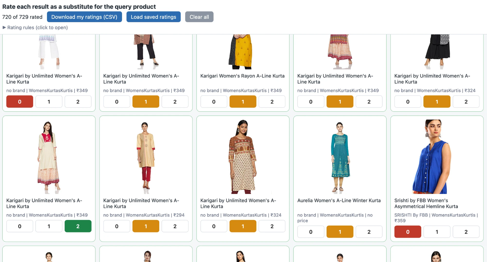

4. **Scoring.** Each method's top 10 is scored with **nDCG@10** (strong matches near the top count most) and **precision@10**, with 95% ranges from resampling the products.
5. **Tracking.** Every run is recorded in MLflow with its settings, scores, data fingerprints and limitations, and the results are exported to [`results/`](results/).

### First results (30 development products)

| Method | nDCG@10 | 95% range | Precision@10 |
|---|---|---|---|
| **Baseline** (title and attributes) | **0.72** | 0.64 to 0.81 | 0.74 |
| Title only | 0.57 | 0.48 to 0.67 | 0.55 |
| Attributes only | 0.48 | 0.38 to 0.56 | 0.62 |

The baseline beats each part alone by more than luck. Title only and attributes only cannot be told apart with 30 products. The full table, with limitations, is in [`results/dev_evaluation_report.md`](results/dev_evaluation_report.md).

### Recorded in MLflow (text methods)

Every scoring run is saved in [MLflow](https://mlflow.org), which keeps a log of experiments so each result can be traced and compared later. For each method, a run records:

- **Settings:** the method and its weights, the number of results scored, and the number of products.
- **Scores:** nDCG@10 and precision@10, each with its 95% range.
- **Fingerprints:** short hashes of the dataset and the ratings file, plus the git commit, so the result points to the exact files and code that produced it.
- **Notes:** the limitations, saved as tags on the run, and the exported result files.

MLflow is used only for tracking. The web service does not use it, and it is not in the Docker image. This is MLflow's comparison page for the three methods:

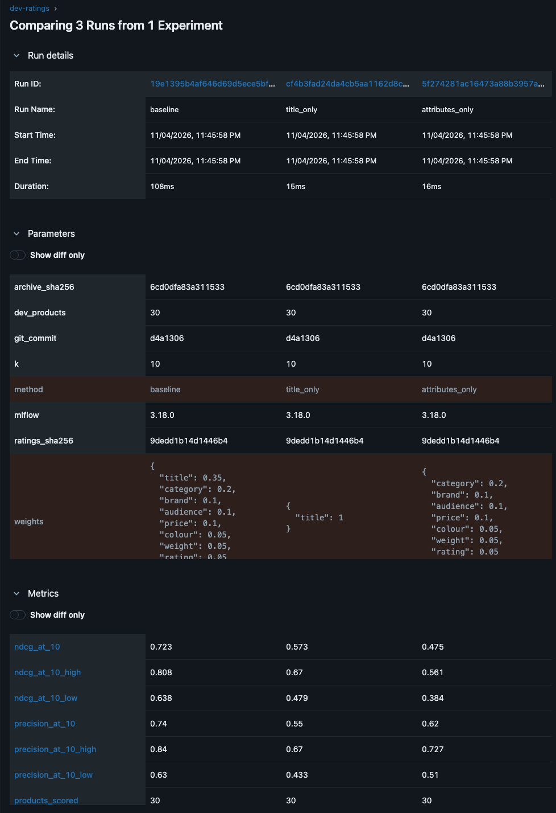

### Reproduce it

Rate again (this replaces the rating page, so keep your downloaded ratings file):

```bash
PYTHONPATH=src python -m product_similarity.judging
```

Open `evaluation/judgments/dev_review.html` in a browser, rate the cards, press **Download my ratings (CSV)**, and save the file as `evaluation/judgments/dev_grades.csv`. Then score and record the run:

```bash
pip install -e ".[experiments]"
python experiments/run_evaluation.py
```

View the recorded runs in MLflow:

```bash
mlflow ui --backend-store-uri sqlite:///mlflow.db --port 5055
```

Open http://127.0.0.1:5055, click **Model training** at the top left, and open the `dev-ratings` experiment.

### Limits

- One person rated, so the labels reflect one judgment.
- Only 30 products were rated, so small differences cannot be told apart.

## Image sample check

Before downloading images in bulk, I checked a sample of 100 (kept locally, never committed). Details are in [`results/image_sample_report.md`](results/image_sample_report.md).

- **First images are good product photos.** 99 of 100 downloaded, and the one failure is a link that no longer exists (error 404).
- **Pictures shared by several products** could have been size charts, which would make unrelated products look alike. The check on the whole catalogue (below) found almost none.
- **Polite downloading.** One request at a time, at most 4 per second, https only, one allowed host, a time limit and a size limit, and no redirects followed.
- **Full download:** done, see the section on the whole catalogue below.

## Image similarity (small test)

I turned the pictures of the 708 development products (the 30 test products and the results I had rated) into **vectors**, which are lists of numbers. Pictures that look alike get vectors that are close together. I used two ready-made models as they are, with no training: ResNet and CLIP. For each of the 30 test products, I found the 10 closest pictures, rated the new results myself, and scored everything with the same ratings.

| Method | nDCG@10 | Precision@10 |
|---|---|---|
| CLIP (pictures) | 0.695 | 0.74 |
| Text and attributes (my baseline) | 0.681 | 0.74 |
| ResNet (pictures) | 0.569 | 0.63 |
| Title only | 0.545 | 0.55 |
| Attributes only | 0.445 | 0.62 |

- CLIP is as good as my best text method. The gap is too small to call a winner.
- CLIP is clearly better than ResNet, and ResNet is worse than my text method.
- Pictures alone find good matches, so combining text and picture vectors is worth trying next.
- **Limits:** image search only looked at 708 pictures that the text methods had already picked, which helps it. There were 30 test products and one rater. The full table is in [`results/dev_image_evaluation_report.md`](results/dev_image_evaluation_report.md).

The runs are saved in MLflow. This is its comparison page for the two image methods:

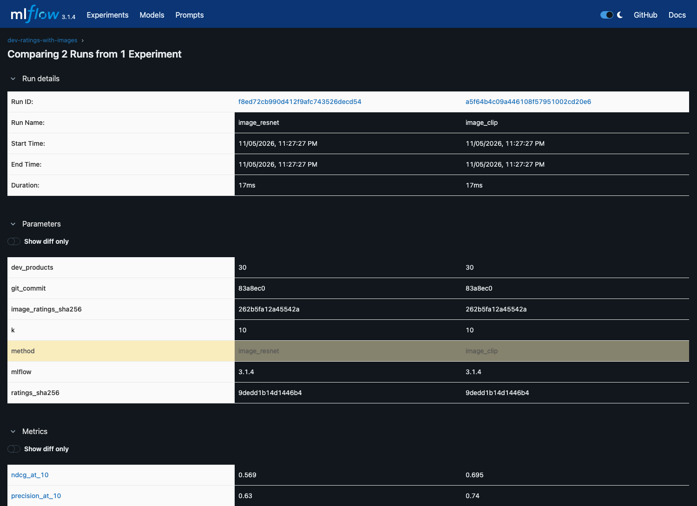

### Reproduce it

The pictures and vectors stay on my computer and are not in Git.

```bash
pip install -e ".[dev,experiments,images]"
python experiments/download_dev_images.py      # about 700 pictures, one request at a time
python experiments/extract_image_features.py   # ResNet and CLIP vectors
python experiments/run_image_search.py         # finds results, writes the rating page for new ones
```

Open `evaluation/judgments/dev_review_images.html`, rate the cards, press **Download my ratings (CSV)**, and save the file as `evaluation/judgments/dev_grades_images.csv`. Then score everything together:

```bash
python experiments/run_image_evaluation.py
```

## Image similarity over the whole catalogue

In the small test I only looked at 708 products. Here I downloaded the first picture of almost every product, turned them all into CLIP vectors, and searched the whole catalogue.

- **Download.** 29,107 pictures (763 MB), one request at a time and at most 4 per second. 134 links no longer exist (error 404). None of the 20 locked products were downloaded. The pictures stay on my computer.
- **Shared pictures.** 231 pictures are used by two or more products. I looked at all of them. 229 are normal product photos of the same item listed more than once, for example in other sizes or colours. 2 are not product photos (a shop logo and a sewing-pattern drawing), so I left them out. I found no size charts.
- **One copy per item.** Results that use the same picture, or a nearly identical one, count as the same item, and I show only one of them. Copies of the searched product are not shown. Every method gets the same rule, so the comparison stays fair.
- **Vectors.** CLIP turned all 29,107 pictures into 512 numbers each in under 8 minutes.
- **Rating.** For each of the 30 test products, CLIP found the 10 closest items. 44 of the 300 results already had my rating, and I rated the other 256 without seeing which method found them.

### Conclusion

**What I wanted to know:** do product pictures help me find similar products? This time I searched the whole catalogue.

**What I did.** I took about 29,000 product pictures and turned each one into a list of numbers with CLIP. Pictures that look alike get numbers that are close together. For my 30 test products I found the 10 most similar items. I rated the new results myself, without knowing which method found them. I used one set of my ratings to check every method, so the comparison is fair, and I show only one copy of each item.

| Method | nDCG@10 | Precision@10 |
|---|---|---|
| CLIP, whole catalogue (pictures) | 0.757 | 0.85 |
| Text and attributes (my baseline) | 0.644 | 0.74 |
| CLIP, first 708 pictures only | 0.648 | 0.74 |
| Title only | 0.507 | 0.54 |
| Attributes only | 0.427 | 0.62 |

Precision@10 is how many of the top 10 I rated 1 or 2.

**What I found**

- CLIP beats title only and attributes only. The gap is real.
- CLIP is ahead of my text baseline too, but with only 30 products I can't be sure it is really better.
- When CLIP searched the whole catalogue, it did better than when it searched only 708 pictures.
- Pictures and text both find good matches on their own, so I want to try using them together.

**What I can't say yet**

- I tested only 30 products, and I was the only person rating.
- I haven't touched my 20 final test products.

**What I do next.** I will mix text, CLIP and attributes into one hybrid search, then make it fast with an index.

The five runs are saved in MLflow. This is its comparison page:

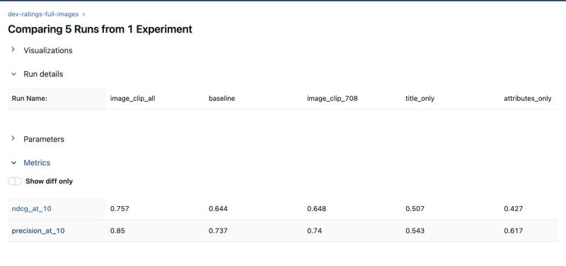

The full table is in [`results/dev_full_image_evaluation_report.md`](results/dev_full_image_evaluation_report.md), and the walk-through is in [notebook 06](notebooks/06_clip_whole_catalogue.ipynb).

### Reproduce it

```bash
pip install -e ".[dev,experiments,images]"
python experiments/download_images.py             # about 29,000 pictures, one request at a time
python experiments/extract_all_image_features.py  # CLIP vectors for all pictures
python experiments/run_full_image_search.py       # finds results, writes the rating page
```

Open `evaluation/judgments/dev_review_full_images.html`, rate the cards, press **Download my ratings (CSV)**, and save the file as `evaluation/judgments/dev_grades_full_images.csv`. Then score everything together:

```bash
python experiments/run_full_image_evaluation.py
```

## Sentence vectors on titles

TF-IDF only matches words. Here I tried a model that understands the meaning of a title, so that "kurta" and "kurti" count as similar.

- **Model.** `all-MiniLM-L6-v2` from Hugging Face. It is small (about 90 MB), free to use (Apache-2.0 licence) and turns a sentence into 384 numbers. Its authors trained it on over a billion sentence pairs, such as questions with answers, so that pairs which belong together get close vectors. It is meant for search and finding similar sentences, and it cuts text longer than 256 word pieces. My titles are much shorter. It was not trained on shopping titles, so it may be weaker on brand names and size words. I used it as it is, with no training.
- **Vectors.** All 29,529 titles became vectors in 31.5 seconds, with no failures.
- **Search.** For each of the 30 test products the model found the 10 closest titles. The 20 locked products can never be returned. 153 of the 300 results already had my rating, and I rated the other 147 without seeing which method found them.

### Conclusion

**What I wanted to know:** does a model that understands the meaning of titles find better matches than TF-IDF, which only matches words?

**What I did.** I took a ready-made sentence model, `all-MiniLM-L6-v2`, and turned all 29,529 product titles into lists of numbers. Titles with similar meaning get numbers that are close together. I used the model as it is, with no training. For my 30 test products I found the 10 closest titles. I rated the new results myself, without knowing which method found them. I used one set of my ratings to check every method, so the comparison is fair, and I show only one copy of each item.

| Method | nDCG@10 | Precision@10 |
|---|---|---|
| CLIP, whole catalogue (pictures) | 0.751 | 0.85 |
| Sentence vectors (titles) | 0.662 | 0.76 |
| Title (TF-IDF) and attributes (my baseline) | 0.637 | 0.74 |
| TF-IDF, title only | 0.500 | 0.55 |
| Attributes only | 0.422 | 0.62 |

Precision@10 is how many of the top 10 I rated 1 or 2.

**What I found**

- Sentence vectors are clearly better than TF-IDF on titles. Understanding meaning helps more than matching words.
- Sentence vectors and my baseline score about the same. With only 30 products I can't say which is better.
- CLIP is still the highest, but its gap over sentence vectors is small enough to be luck.
- Pictures and titles each find good matches on their own, so I want to try using them together.

**What I can't say yet**

- I tested only 30 products, and I was the only person rating.
- The model was trained on questions, answers and captions, not on shopping titles, so it may miss brand names and size words.
- I haven't touched my 20 final test products.

**What I do next.** I will mix text, CLIP and attributes into one hybrid search, and tune the weights using my ratings.

The five runs are saved in MLflow. This is its comparison page:

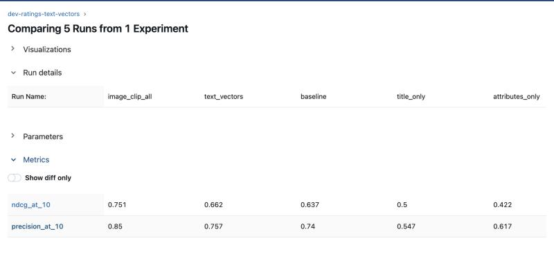

The full table is in [`results/dev_text_vector_evaluation_report.md`](results/dev_text_vector_evaluation_report.md), and the walk-through is in [notebook 07](notebooks/07_sentence_vectors_on_titles.ipynb).

### Reproduce it

```bash
pip install -e ".[dev,experiments,images,text]"
python experiments/extract_text_features.py     # downloads the model once, makes the title vectors
python experiments/run_text_vector_search.py    # finds results, writes the rating page
```

Open `evaluation/judgments/dev_review_text_vectors.html`, rate the cards, press **Download my ratings (CSV)**, and save the file as `evaluation/judgments/dev_grades_text_vectors.csv`. Then score everything together:

```bash
python experiments/run_text_vector_evaluation.py
```

## Hybrid search

So far I tested each part on its own. Here I mix them into one **hybrid search** and choose how much each part counts (its weight) from my ratings.

- **The parts.** The TF-IDF title, the sentence-vector title, the CLIP picture, category, brand, audience, price, colour, weight and rating. Each gives a score from 0 to 1 for a pair of products, and a weighted sum of the scores is the final score (a weighted linear combination, as used for hybrid retrieval by Bruch et al., 2023). If a value is missing, that part is skipped and the other weights are scaled up. The sentence and picture scores are cosine similarities shifted so that 0 means "as similar as two random products".
- **Choosing the weights: coordinate ascent.** It changes one weight at a time, keeps the value with the best nDCG@10 on my ratings, and repeats until a full round changes nothing (Metzler and Croft, 2007). I started it from five starting points and kept the best result.
- **Checking for luck: 5-fold cross-validation.** I tuned on 24 of my 30 development products and scored the 6 left out, five times. So every hybrid score below comes from products the weights had not seen (an out-of-fold score).
- **Two mixes.** One with 10 weights (one for each part), and one with 4 weights (TF-IDF title, sentence title, picture, and all attributes together).
- **First try.** The tuned weights did not beat my untuned baseline on unseen products (0.614 for 10 weights and 0.635 for 4 weights, against 0.637). The hybrid had found 107 new results that were not in my ratings yet, which made the tuning unfair.
- **Rating the new results.** I rated the 107 results myself on a blind page (shuffled for each product, no method names), and tuned again. The 20 locked products were never used.

### Results

| Method | nDCG@10 | Precision@10 |
|---|---|---|
| Hybrid, 4 weights | 0.806 | 0.87 |
| Hybrid, 10 weights | 0.764 | 0.82 |
| CLIP (pictures) | 0.750 | 0.85 |
| Sentence vectors (titles) | 0.659 | 0.76 |
| Title (TF-IDF) and attributes (my baseline) | 0.637 | 0.74 |
| TF-IDF, title only | 0.498 | 0.55 |
| Attributes only | 0.420 | 0.62 |

**Final weights of the 4-weight mix:** sentence title 46%, picture 29%, attributes together 23%, TF-IDF title 3%. When I remove one part at a time from the 10-weight mix (an ablation), the sentence vectors and the picture cost the most (about 0.165 of nDCG@10 each), and category is the most useful attribute.

### Conclusion

**What I wanted to know:** if I mix all the parts into one search, is it better than each part on its own?

**What I did.** I took ten parts: the TF-IDF title, the sentence title, the CLIP picture, category, brand, audience, price, colour, weight and rating. Each part scores a pair of products. I added the scores with weights (a weighted linear combination), and a weight says how much a part counts.

To choose the weights, I used **coordinate ascent**. I change one weight at a time, keep the change if nDCG@10 goes up, and repeat until nothing improves. I started from several starting points and kept the best.

To make sure the weights are not just lucky for my 30 products, I used **5-fold cross-validation**. I tuned the weights on 24 products and tested them on the 6 I had left out, five times. All the hybrid scores below come from products the weights had not seen.

I tried two mixes: one with 10 weights, and one with only 4 weights (TF-IDF title, sentence title, picture, and all attributes together).

My first try did not beat my baseline, because the hybrid found 107 new results that were not in my ratings yet. I rated those myself, without knowing which mix found them, and tuned again. I used one set of my ratings to check every method, so the comparison is fair, and I show only one copy of each item.

| Method | nDCG@10 | Precision@10 |
|---|---|---|
| Hybrid, 4 weights | 0.806 | 0.87 |
| Hybrid, 10 weights | 0.764 | 0.82 |
| CLIP (pictures) | 0.750 | 0.85 |
| Sentence vectors (titles) | 0.659 | 0.76 |
| Title (TF-IDF) and attributes (my baseline) | 0.637 | 0.74 |
| TF-IDF, title only | 0.498 | 0.55 |
| Attributes only | 0.420 | 0.62 |

Precision@10 is how many of the top 10 I rated 1 or 2.

**What I found**

- The 4-weight hybrid is clearly better than my baseline, the sentence vectors, TF-IDF and the attributes alone.
- It is ahead of CLIP, but with only 30 products I can't be sure it is really better.
- The mix with 4 weights did better than the one with 10, because fewer weights means less chance of fitting my 30 products by luck.
- Sentence vectors and pictures matter most. If I remove either one, the score drops by about 0.165. Category is the most useful attribute.

**What I can't say yet**

- I tested only 30 products, and I was the only person rating.
- I tuned the weights on these 30 products, so I tested them once on my 20 final products at the end (notebook 14).

**What I do next.** I will make the search fast with an index (FAISS, HNSW, Annoy) and test making the vectors smaller with PCA.

### Recorded in MLflow

The check for luck from the first try (untuned, 10 weights, 4 weights, on all 30 products and on unseen products):

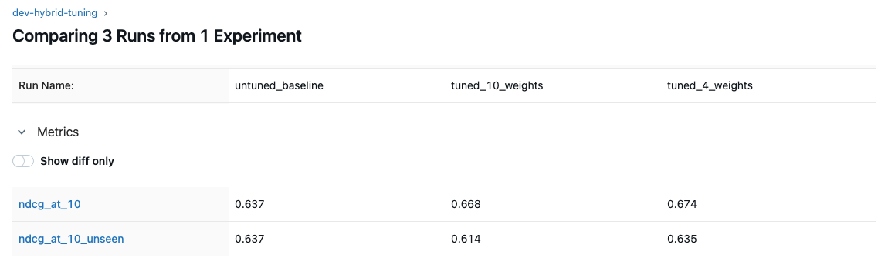

All seven methods side by side:

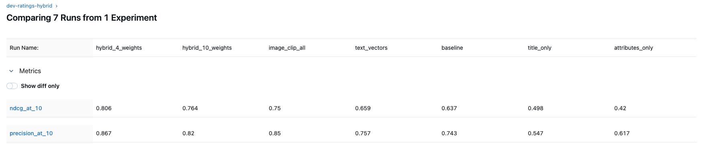

The full table is in [`results/dev_hybrid_evaluation_report.md`](results/dev_hybrid_evaluation_report.md), the weights and the cross-validation folds are in [`results/hybrid_tuning.json`](results/hybrid_tuning.json), and the walk-through is in [notebook 08](notebooks/08_hybrid_search.ipynb).

References: Metzler and Croft, [Linear feature-based models for information retrieval](https://link.springer.com/content/pdf/10.1007/s10791-006-9019-z.pdf) (2007); Bruch, Gai and Ingber, [An Analysis of Fusion Functions for Hybrid Retrieval](https://arxiv.org/abs/2210.11934) (2023).

### Reproduce it

```bash
pip install -e ".[dev,experiments,images,text]"
python experiments/tune_hybrid_weights.py     # coordinate ascent and 5-fold cross-validation
python experiments/run_hybrid_search.py       # finds results that have no rating, writes the rating page
```

Open `evaluation/judgments/dev_review_hybrid.html`, rate the cards, press **Download my ratings (CSV)**, and save the file as `evaluation/judgments/dev_grades_hybrid.csv`. Then tune again and score everything together:

```bash
python experiments/tune_hybrid_weights.py
python experiments/run_hybrid_evaluation.py
```

## Fast vector search

To find similar products I compare one product with all the others. That is fine for 29,500 products, but a bigger catalogue needs a faster way. Here I time the exact search first, then compare fast **approximate nearest-neighbour** indexes with it.

- **One rule for every method.** 1,000 random products, picked with seed 2020, never a locked product and never one of my 30 development products. Each product is searched 5 times and the fastest run is kept. The time is the median of the 1,000. Recall@10 is the average over the same 1,000 products. One thread, one query at a time.
- **Recall@10.** How many of the exact top 10 a fast method also finds. The exact top 10 comes from the brute-force search by cosine similarity. A different member of a tie is not counted as a miss. Recall@10 does not use my ratings. My ratings are used for nDCG@10.
- **The baseline.** The exact search takes about 0.85 ms for the sentence vectors and 1.5 ms for the picture vectors, among about 29,500 products. The record is [`results/ann_exact_baseline.json`](results/ann_exact_baseline.json).
- **The fast methods** (all settings are in [`results/ann_benchmark.json`](results/ann_benchmark.json)): FAISS Flat (exact), FAISS HNSW (a graph search, Malkov and Yashunin, 2018), FAISS IVF (a search over groups) and Annoy (random trees, from Spotify).
- **Inside the hybrid.** A fast index picks 200 candidates from the combined sentence and picture vectors, and the hybrid with 4 weights picks the final 10. The record is [`results/ann_hybrid_check.json`](results/ann_hybrid_check.json).

### Conclusion

**What I wanted to know:** can I make the similarity search faster without losing much quality, and does it matter at my size?

**What I did.** I used one rule for every method. I took 1,000 random products, picked with seed 2020 and never a locked product. For each product I ran the search 5 times and kept the fastest run, and I report the median time of the 1,000. Recall@10 is the average over the same 1,000 products. I counted how many of the exact top 10 each fast method found. The exact top 10 comes from the brute-force search, which compares a product with all the others by cosine similarity. I tried FAISS HNSW, FAISS IVF and Annoy on the picture vectors (CLIP) and on the sentence vectors. I recorded every setting in MLflow, one run for each. Then I used the fast index inside my hybrid search: the index picks 200 candidates, and the hybrid with 4 weights picks the final 10.

| Method (sentence vectors, 384 numbers) | Time per query | Memory | Recall@10 |
|---|---|---|---|
| Exact search (brute force) | 0.85 ms | 45.3 MB | 100% |
| FAISS HNSW | 0.014 ms | 49.6 MB | 97% |
| FAISS IVF | 0.11 ms | 45.8 MB | 98% |
| Annoy | 1.7 ms | 67.1 MB | 97% |

| Method (picture vectors, 512 numbers) | Time per query | Memory | Recall@10 |
|---|---|---|---|
| Exact search (brute force) | 1.5 ms | 60.1 MB | 100% |
| FAISS HNSW | 0.018 ms | 64.4 MB | 97% |
| FAISS IVF | 0.12 ms | 60.7 MB | 99% |
| Annoy | 1.4 ms | 104.9 MB | 97% |

For each fast method I show its fastest setting that still finds at least 95% of the exact top 10.

| Hybrid with the fast index | nDCG@10 | Top 10 shared with the exact hybrid |
|---|---|---|
| Exact hybrid (scores all products, 6.3 ms) | 0.808 | 100% |
| HNSW picks 200 candidates, then the hybrid (0.07 ms for the candidates) | 0.784 | 94% |
| Exact search picks 200 candidates, then the hybrid | 0.807 | 97% |

**What I found**

- The exact search is already fast at my size: about 1 ms for one product among 29,500, with 45 to 60 MB of memory.
- HNSW is about 60 times faster than the exact search and still finds 97% of the exact top 10. It needs about 10% more memory and 6 to 7 seconds to build. IVF is about 8 times faster with almost no extra memory. Annoy was not faster than the exact search at this size and needs more memory.
- Inside the hybrid, the fast index costs a little quality: nDCG@10 goes from 0.808 to 0.784 with HNSW. The cost comes from the candidates it misses, because exact candidates lose almost nothing (0.807).
- I chose HNSW (Malkov and Yashunin, 2018) because it gave the best speed for the recall.

**What I can't say yet**

- I tested only about 29,500 products. At this size the exact search is already fast, so the gain from a fast index will matter more for a much larger catalogue. I did not test that.
- The timings are from one laptop, one thread, one query at a time. I did not time the final reranking of the 200 candidates with the hybrid.

**What I do next.** I test whether shortening the vectors with PCA helps the memory and the speed (next section).

### Recorded in MLflow

Every setting of every method is one run in the experiment `ann-benchmark` (50 runs). The ten runs tagged `headline` are the exact search and the fastest setting of each method that finds at least 95% of the exact top 10:

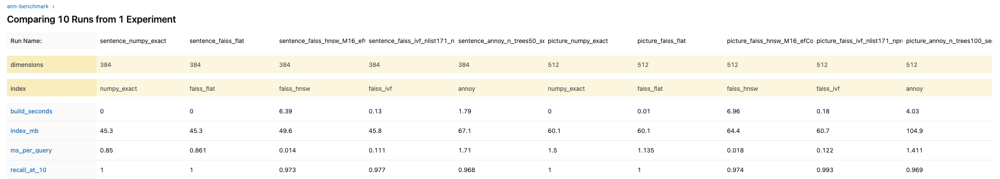

The fast index inside the hybrid is the experiment `ann-hybrid-check`:

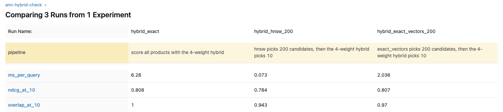

The walk-through, with every table and chart, is in [notebook 09](notebooks/09_fast_vector_search.ipynb).


References: Malkov and Yashunin, [Efficient and robust approximate nearest neighbor search using Hierarchical Navigable Small World graphs](https://arxiv.org/abs/1603.09320) (HNSW); Johnson, Douze and Jégou, [Billion-scale similarity search with GPUs](https://arxiv.org/abs/1702.08734) (FAISS); [Annoy](https://github.com/spotify/annoy) from Spotify.

### Reproduce it

```bash
pip install -e ".[dev,experiments,images,text,ann,notebooks]"
python experiments/ann_exact_baseline.py     # times the exact search, saves its answers
python experiments/ann_benchmark.py          # FAISS Flat, HNSW, IVF and Annoy
python experiments/ann_hybrid_check.py       # the fast index inside the hybrid
python experiments/log_ann_benchmark.py      # records the runs in MLflow
```

## Shorter vectors (PCA)

HNSW already finds 97% of the exact top 10. Here I test one more idea: make the vectors **shorter** with PCA (it keeps the directions in which the products differ most), so that they take less memory and the search has less to compute.

- **Same rule as before.** The same 1,000 random products (seed 2020, never a locked product), 5 runs each with the fastest kept, the median time, one thread.
- **What I ran.** PCA trained on all the vectors, keeping 256, 128 or 64 numbers (instead of 512 for pictures and 384 for sentences). Then the exact search, HNSW, IVF and Annoy on the shorter vectors, with the same settings as in notebook 09. The record is [`results/ann_pca.json`](results/ann_pca.json).
- **Recall@10** is measured against the exact top 10 on the **full** vectors, so it shows what PCA and the index lose together.
- **Extra cost.** A query must first be turned into its short version. I timed that as well.

### Conclusion

**What I wanted to know:** can I make the vectors shorter with PCA, so that they take less memory and the search is faster, without losing much recall?

**What I did.** I trained PCA on all the vectors and kept 256, 128 or 64 numbers instead of 512 (pictures) or 384 (sentences). I ran the exact search, FAISS HNSW, FAISS IVF and Annoy on the shorter vectors, with the same rule as in notebook 09: the same 1,000 random products (seed 2020, never a locked product), each searched 5 times with the fastest run kept, the median time, one thread. Recall@10 is measured against the exact top 10 on the full vectors, so it shows what PCA and the index lose together. I also timed the extra step of turning a query into its short version, and I recorded every setting in MLflow (experiment `ann-pca`, 148 runs).

| Picture vectors | Time per query | Memory | Recall@10 |
|---|---|---|---|
| Exact search, 512 numbers (no PCA) | 1.5 ms | 60.1 MB | 100% |
| HNSW, 512 numbers (no PCA) | 0.018 ms | 64.4 MB | 97% |
| HNSW + PCA, 256 numbers | 0.013 ms | 34.3 MB | 76% |
| HNSW + PCA, 128 numbers | 0.010 ms | 19.3 MB | 71% |
| HNSW + PCA, 64 numbers | 0.008 ms | 11.8 MB | 62% |

| Sentence vectors | Time per query | Memory | Recall@10 |
|---|---|---|---|
| Exact search, 384 numbers (no PCA) | 0.85 ms | 45.3 MB | 100% |
| HNSW, 384 numbers (no PCA) | 0.014 ms | 49.6 MB | 97% |
| HNSW + PCA, 256 numbers | 0.015 ms | 38.2 MB | 86% |
| HNSW + PCA, 128 numbers | 0.011 ms | 23.1 MB | 82% |
| HNSW + PCA, 64 numbers | 0.009 ms | 15.6 MB | 72% |

**What I found**

- PCA makes the vectors and the index smaller: with 128 numbers the picture index goes from 64 MB to 19 MB.
- The recall drops a lot. With 128 numbers, the picture vectors find 71% of the exact top 10 and the sentence vectors 82%, against 97% for HNSW on the full vectors.
- The loss comes from PCA itself. For a given length, the exact search, HNSW, IVF and Annoy all end up within about one point of each other, so a better index does not win it back.
- The speed-up is small and not real. Turning a query into its short version takes about 0.009 ms, which is about as much as the HNSW search itself (0.010 to 0.018 ms). With that step, the total is about the same as HNSW on the full vectors or higher (the only case a little lower, 0.016 ms against 0.018 ms, is the picture vectors with 64 numbers, at 62% recall).

**Decision.** I drop PCA. The search keeps the full vectors with HNSW, which finds 97% of the exact top 10 in 0.014 to 0.018 ms. At my size, memory is not a problem (about 50 to 65 MB per index).

**What I can't say yet**

- I tested only about 29,500 products. For millions of products, the memory saving of PCA could matter, and a milder cut (more than 256 numbers) or a better trained reduction could be worth testing. I did not test that.
- I trained PCA on all the vectors, including the test products. This is fine for a comparison of methods, but a real system would train it on a separate sample.
- The timings are from one laptop, one thread, one query at a time.

**What I do next.** I will make the service stronger (checks on the input and proper error codes), and then add caching, Kubernetes and the weights page.

### Recorded in MLflow

Every setting on the shorter vectors is one run in the experiment `ann-pca` (148 runs). The ten runs tagged `headline` are the exact search and HNSW without PCA, and HNSW with 256, 128 and 64 numbers (sentence vectors on the left, picture vectors on the right):

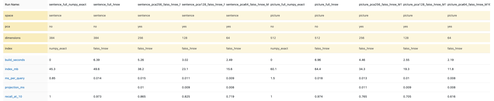

The walk-through, with every table and chart, is in [notebook 10](notebooks/10_shorter_vectors_pca.ipynb).


References: Jolliffe and Cadima, [Principal component analysis: a review and recent developments](https://doi.org/10.1098/rsta.2015.0202) (2016) (PCA).

### Reproduce it

```bash
python experiments/ann_pca.py                # PCA, then every method on the shorter vectors
python experiments/log_ann_pca.py            # records the runs in MLflow
```

## A picture of the vectors (t-SNE)

The picture vectors are long lists of numbers, which nobody can look at. t-SNE squeezes each one into two numbers, so that every product becomes a dot on a flat picture and similar products land close together (van der Maaten and Hinton, 2008). It is only for looking: it does not change any result and the search does not use it. I took 3,000 random products and drew them three times: with the full 512 numbers, and after PCA to 128 and to 64 numbers. The eight biggest categories are coloured.

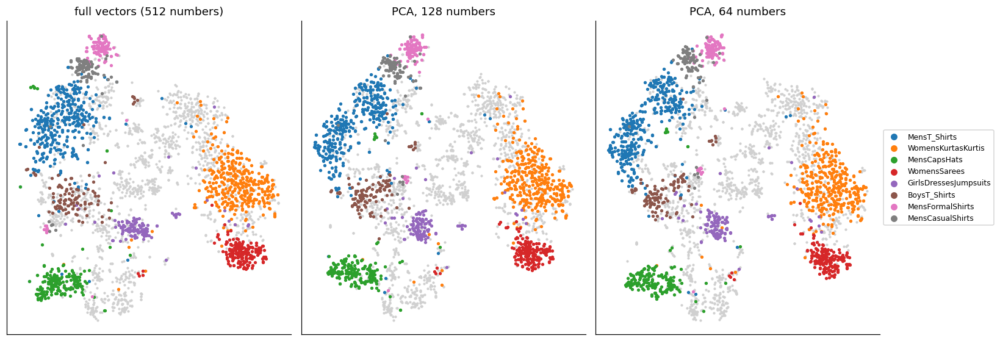

### Conclusion

**What I wanted to know:** do the picture vectors put similar products close together, and does PCA keep that?

**What I found**

- Products of the same category sit together: men's T-shirts, kurtas, sarees and caps and hats each form their own area. The picture vectors capture the kind of product, which is why a search over them works.
- The three pictures look almost the same. The big groups stay together in the same places, even with 64 numbers. So PCA keeps the overall shape.
- What PCA loses is the fine detail. Inside one big group there are many similar products, and which ones are the closest 10 changes a little when the vectors are cut. That is probably why the recall dropped in notebook 10.

**What I can't say yet.** The picture is a rough view: distances in it are not exact, and it shows 3,000 products out of about 29,500. It does not replace the recall numbers. The walk-through is in [notebook 11](notebooks/11_tsne_picture_vectors.ipynb).

References: van der Maaten and Hinton, [Visualizing data using t-SNE](https://www.jmlr.org/papers/v9/vandermaaten08a.html) (2008) (t-SNE).

## The final search: exact mode and fast mode

The tuned hybrid is now in the real search (`HybridEngine` in [`src/product_similarity/hybrid.py`](src/product_similarity/hybrid.py)). It uses the 4-weight mix from the hybrid step: sentence vectors 46%, picture vectors 29%, the seven attributes 23% together, and the TF-IDF title 3%. The vectors were computed once, offline, so the search never loads a model.

- **Two modes, one hybrid.** Both score every shortlisted product with all ten parts, with the same weights and the same rescaling when a part is missing. They differ only in how the two vector parts are searched.
- **Exact mode** (the default). Compares the sentence and picture vectors with every product.
- **Fast mode.** An HNSW index for the sentence vectors and one for the picture vectors each return the 100 nearest products, and only those are scored. A product without a picture is found through its sentence vector.
- **A switch.** The mode can be chosen for each search, and `PS_SEARCH_MODE` sets the default (`exact`, `fast`, or `baseline` when the vectors are missing). The page and the API will get a `mode` option.
- **One copy of each item.** Both modes skip the same item shown twice (the same picture, for example another size), the same rule that my ratings use.
- **Checked against the notebooks.** The exact mode gives the same top 10, in the same order, for all 30 development products ([`results/final_search_check.json`](results/final_search_check.json)).
- **The truth is my ratings, for both modes.** I rated the 26 new results that the two modes brought up. nDCG@10, precision@10 and the counts of results rated 2, 1 and 0 come from them ([`results/final_search_ratings.json`](results/final_search_ratings.json)). Time is the whole search, with the same rule as before, on the 30 development products ([`results/fast_vs_exact_check.json`](results/fast_vs_exact_check.json)).

### Conclusion

**What I did.** I put the tuned hybrid into the real search, with two modes. Both are the same hybrid, with all ten parts and the same weights. The **exact mode** compares the sentence and picture vectors with every product. The **fast mode** uses HNSW only to speed up those two parts: it takes the 100 nearest products from an index of the sentence vectors and from an index of the picture vectors, and scores only those. First I checked that the real search gives the same results as my notebooks (30 of 30 products). Then I took **my own ratings as the source of truth** for both modes (I rated the 26 new results first) and compared them on the 30 development products, with nDCG@10, precision@10 and the time of one search.

| 30 development products | nDCG@10 | Precision@10 | Time per search |
|---|---|---|---|
| Exact mode | 0.8105 | 0.8767 | 8.5 ms |
| Fast mode (HNSW, 100 from each index) | 0.8095 | 0.8767 | 0.58 ms |

**What I found**

- By my ratings, the two modes are almost the same. nDCG@10 is 0.8105 and 0.8095, and precision@10 is the same. Of the 300 results of each mode, I rated 221 with a 2, 42 with a 1 and 37 with a 0 for the exact mode, and 220, 43 and 37 for the fast mode.
- The fast mode is much faster: 0.58 ms against 8.5 ms, about 15 times. This is the advantage of HNSW.

**Decision.** The exact mode is the default. I will create a page where I can choose between the default (exact) mode and the HNSW (fast) mode, see the time of each search, and tune the weights as well.

**Limitations**

- HNSW needs a little more memory, because its two indexes (114 MB) are kept on top of the vectors (166 MB), and building them takes about 13 seconds, once.
- If a picture vector or a sentence vector is missing, the search works the same in both modes: that part is skipped and the other weights are scaled up. I checked this in a small test, not on the 30 products, because all of them have both vectors.
- I tested only 30 products, with my ratings as the truth.
- My weights were tuned on these same 30 products, so the scores are optimistic. The final test on the 20 locked products is in notebook 14.
- The fast mode makes its shortlist from the title meaning and the picture only, so a product that matches the query only through its attributes (brand, category, price) may not be on it.
- I did not test a much bigger catalogue, where the fast mode would matter most. The timings are from one laptop, one thread, one query at a time.

**What I do next.** The stronger API (input checks, error codes and the `mode` option), then Kubernetes and the CI/CD improvements, then the page with the weights and the mode switch, and the final cleanup.

### Recorded in MLflow

Each run is recorded in the experiment `final-search` (5 runs). The two runs tagged `headline` are the exact mode and the fast mode with 100 nearest products from each index:

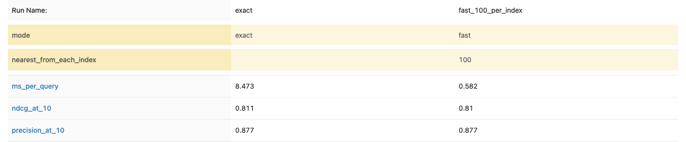

The walk-through, with every table, is in [notebook 12](notebooks/12_final_search.ipynb).

### Reproduce it

```bash
python experiments/check_final_search.py       # the real search against the notebooks
python experiments/run_final_search_rating.py  # finds results without a rating, writes the rating page
python experiments/rating_comparison.py        # both modes scored with my ratings only
python experiments/check_fast_vs_exact.py      # exact mode against fast mode: time (and the places that differ)
python experiments/log_final_search.py         # records the runs in MLflow
```

## Caching

A search takes about 10 ms, and the same question often comes again. So the service keeps the answers of recent questions and gives them back without searching.

- **An in-process cache.** It lives in the memory of the service. It keeps 1,024 answers by default (`PS_CACHE_SIZE`, and 0 turns it off), and when it is full it drops the answer that was used least recently. It is safe when many requests arrive at once.
- **The question.** The product and the number of results. Another product or another number is another question, and an old ID and the product that was kept share one entry. The mode and the weights will be added when the API gets them. Only answers of up to 100 results are cached, and a product that does not exist is never saved.
- **What the API shows.** The plain endpoint has an `X-Cache` header (`hit` or `miss`). The details endpoint has a `cached` field. `GET /cache` reports the entries, the hits, the misses and the hit rate.
- **The record** is [`results/cache_benchmark.json`](results/cache_benchmark.json), made by `experiments/measure_cache.py`.

### Conclusion

**What I did.** I added caching to the service. It remembers the answers to the last 1,024 questions, so a question that comes again is answered from memory, without searching.

| One request | Time |
|---|---|
| Not remembered (miss) | 9.6 ms |
| Remembered (hit) | 0.77 ms |

**What I found.** A remembered answer is about 12 times faster, and it is the same answer. In a simulation where a few products are asked for often, the cache answers about half of the requests, and the average time drops from 10.3 ms to 5.5 ms.

**Limitation.** The cache is lost when the service restarts. With several copies of the service (Kubernetes), each copy has its own cache, so fewer requests are answered from memory. A shared cache such as Redis would fix this. I did not build it.

**What I do next.** The stronger API, then Kubernetes and CI/CD, then the page, and the final cleanup.

### Recorded in MLflow

Each measurement is a run in the experiment `caching` (6 runs): one request that is not in the cache, one that is, and the traffic simulation for each cache size.

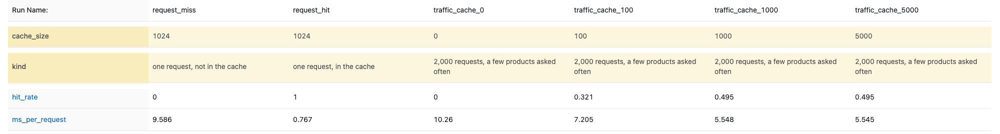

The walk-through, with every table and chart, is in [notebook 13](notebooks/13_caching.ipynb).

### Reproduce it

```bash
python experiments/measure_cache.py   # miss against hit, and the traffic simulation
python experiments/log_cache.py       # records the runs in MLflow
```

## The final test on the 20 locked products

Since the start, 20 of my 50 test products have been locked: I never rated their results or used them in tuning. All the weights and settings were chosen with the other 30. This is the one test of the finished search on products it has never seen, and I changed nothing after seeing the result.

- **The pool.** The top 10 of both modes of the final search (exact, and fast with HNSW), put into one blind page of 204 results, shuffled, with no method names ([`experiments/run_final_test_rating.py`](experiments/run_final_test_rating.py)).
- **The truth is my ratings.** I rated every result 0, 1 or 2 ([`evaluation/judgments/final_grades.csv`](evaluation/judgments/final_grades.csv)). Each mode is scored from its own top 10 with nDCG@10 and precision@10, and the whole search is timed ([`results/final_test_scores.json`](results/final_test_scores.json)).

### Conclusion

**What I did.** I tested the finished search once, on the 20 products that were locked from the start. I rated the top 10 results of both modes (exact and fast), 204 results in all, and scored each mode from my ratings.

| 20 locked products | nDCG@10 | Precision@10 | Time per search |
|---|---|---|---|
| Exact mode | 0.9659 | 0.87 | 7.0 ms |
| Fast mode (HNSW) | 0.9657 | 0.87 | 0.42 ms |

**What I found.** On products it had never seen, both modes work: precision@10 is 0.87 for both, close to 0.877 on the development products. The fast mode gives the same quality and is about 17 times faster.

**Limitation.** The nDCG@10 here (0.97) cannot be compared with 0.81 on the development products, because the rated results come only from this one system. Precision@10 is the number to compare. It is only 20 products, rated by me, and the test was used once.

**What I do next.** The stronger API, then Kubernetes and CI/CD, then the page, and the final cleanup.

### Recorded in MLflow

Each mode is a run in the experiment `final-test` (2 runs):

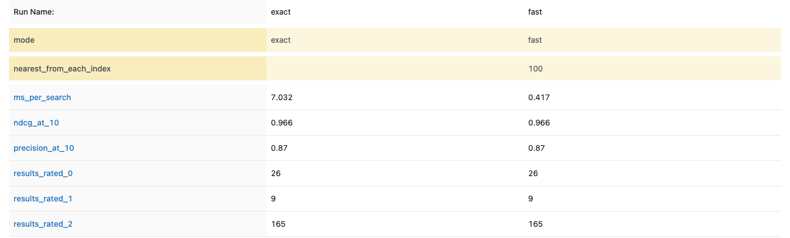

The walk-through, with the product-by-product table, is in [notebook 14](notebooks/14_final_test.ipynb).

### Reproduce it

```bash
python experiments/run_final_test_rating.py   # the blind rating page (used once)
python experiments/score_final_test.py        # scores both modes with my ratings
python experiments/log_final_test.py          # records the runs in MLflow
```

## Where the numbers come from

Every result in this page can be traced to a notebook, a results file and an MLflow experiment. The MLflow databases stay on my computer (they are not in Git), so the screenshots in `evaluation/` show the runs.

| Result | Notebook | Results files | MLflow experiment |
|---|---|---|---|
| The first text methods (TF-IDF, attributes) | [04](notebooks/04_evaluation_baseline.ipynb) | [`dev_scoreboard.csv`](results/dev_scoreboard.csv), [`dev_evaluation_report.md`](results/dev_evaluation_report.md) | `dev-ratings` |
| Pictures, small test (ResNet, CLIP) | [05](notebooks/05_image_similarity.ipynb) | [`dev_image_scoreboard.csv`](results/dev_image_scoreboard.csv), [`dev_image_evaluation_report.md`](results/dev_image_evaluation_report.md) | `dev-images`, `dev-ratings-with-images` |
| CLIP over the whole catalogue | [06](notebooks/06_clip_whole_catalogue.ipynb) | [`dev_full_image_scoreboard.csv`](results/dev_full_image_scoreboard.csv), [`dev_full_image_evaluation_report.md`](results/dev_full_image_evaluation_report.md) | `dev-ratings-full-images` |
| Sentence vectors on titles | [07](notebooks/07_sentence_vectors_on_titles.ipynb) | [`dev_text_vector_scoreboard.csv`](results/dev_text_vector_scoreboard.csv), [`dev_text_vector_evaluation_report.md`](results/dev_text_vector_evaluation_report.md) | `dev-ratings-text-vectors` |
| Hybrid search and its weights | [08](notebooks/08_hybrid_search.ipynb) | [`dev_hybrid_scoreboard.csv`](results/dev_hybrid_scoreboard.csv), [`hybrid_tuning.json`](results/hybrid_tuning.json), [`hybrid_tuning_first_round.json`](results/hybrid_tuning_first_round.json) | `dev-hybrid-tuning`, `dev-ratings-hybrid` |
| Speed of the exact and the fast search | [09](notebooks/09_fast_vector_search.ipynb) | [`ann_exact_baseline.json`](results/ann_exact_baseline.json), [`ann_benchmark.json`](results/ann_benchmark.json), [`ann_hybrid_check.json`](results/ann_hybrid_check.json) | `ann-benchmark`, `ann-hybrid-check` |
| Shorter vectors with PCA | [10](notebooks/10_shorter_vectors_pca.ipynb) | [`ann_pca.json`](results/ann_pca.json) | `ann-pca` |

## Kubernetes

Docker packs the service into one image. Kubernetes runs several copies of that image (called pods) and looks after them: it restarts a pod that breaks, it sends requests only to pods that are ready, and it replaces the pods one at a time when I change something. The files are in [`k8s/`](k8s/).

| File | What it says |
|---|---|
| [`deployment.yaml`](k8s/deployment.yaml) | Run 2 pods of the image, with the probes, the memory and CPU limits, a non-root user, and the rolling-update rule |
| [`service.yaml`](k8s/service.yaml) | One fixed address in front of the pods. It sends each request to a pod that is ready |
| [`pdb.yaml`](k8s/pdb.yaml) | While a machine is being updated or drained, keep at least 1 pod running |

- **Two pods, both serving.** Both pods answer requests at the same time. If one stops, the other keeps answering, so each is the other's backup. I did not make one pod wait idle, because that would use the memory of a whole pod for nothing.
- **The probes.** A probe is a question that Kubernetes asks each pod every few seconds. There are three, and they use the two endpoints the API already has.

| Probe | Endpoint | Question | If the answer is no |
|---|---|---|---|
| Startup | `/ready` | Have you finished loading (about 15 seconds)? | The other two probes wait, for up to 200 seconds |
| Readiness | `/ready` | Can you answer searches now? | The pod gets no traffic, but keeps running |
| Liveness | `/live` | Are you stuck? | Kubernetes restarts the pod |

- **Deployment strategy: rolling update** (`maxSurge: 1`, `maxUnavailable: 0`). Kubernetes starts a third pod with the new version, waits until it is ready, and only then stops an old pod. There is never a moment with fewer than 2 ready pods. If the new version never becomes ready, the rollout stops and the old pods keep serving.
- **Memory and CPU.** Each pod asks for 1,280 MB and 0.25 CPU, and may use at most 2 GB and 1 CPU. I measured about 1.06 GB with the vectors and both fast indexes loaded. A pod that goes over its memory limit is restarted, which protects the other pods.
- **The cache is per pod.** The cache lives inside the process (see "Caching"), so each pod has its own. The same question can be a miss on one pod and a hit on the other, and a new pod starts with an empty cache. A cache shared by all pods (for example Redis) would fix that, and I did not build it.
- **What CI tests.** The `kubernetes` job starts a temporary cluster (kind) on the GitHub machine, loads the image, applies the files, and checks that: both pods become ready; a search through the Service works; when one pod is deleted, 20 requests in a row still return 200; and during a rolling update no request fails (84 requests, 0 failures in the run I checked). The cluster is deleted when the job ends.
- **What I did not do.** I do not deploy to a real cluster, and I do not push the image to a registry (an online store for images, such as Docker Hub), because I have no cluster to deploy to. For a real deployment I would push the image to a registry, put its name in `deployment.yaml`, and run `kubectl apply -f k8s/`. When I run the service on my own computer, I run it with `uvicorn`.

## Monitoring

The service shows its own numbers (requests, time, cache hits, errors) on `/metrics`. Prometheus collects them and Grafana draws them as a dashboard. The files are in [`monitoring/`](monitoring/), and CI checks that it works.

The screenshot is from a run on my laptop with 2,052 test searches. The memory panel is empty because only Linux shows memory.

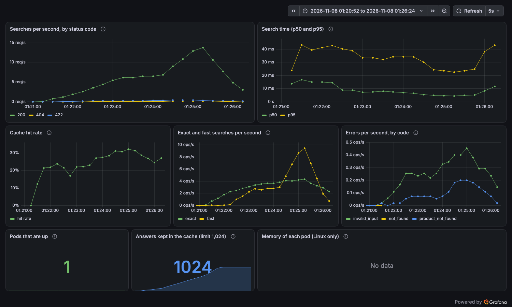

## Tests and CI/CD

### Tests

There are 275 tests. The unit tests cover loading, cleaning, scoring, ranking, the service, the API, the rating tools, the scoring maths, MLflow logging and the image code. The integration tests run on the real dataset and on the real API.

### CI/CD with GitHub Actions

On every push and pull request, GitHub Actions runs four jobs:

1. **test:** installs the project (with FAISS, so the fast-mode tests run), checks the code style with ruff, and runs all the tests.
2. **docker:** builds the image, starts the container, waits until it is ready, checks that it runs the final search (`/ready` says `hybrid`), asks the same question three times and prints the result of each (request 1: `X-Cache: miss`, request 2: `X-Cache: hit` with an identical answer, request 3 on the details endpoint: `cached: true`), checks that `/cache` reports 2 hits and 1 miss, checks that the fast mode and the weights work (for five searches it prints the mode asked and the mode that ran, the weights set and the weights used, the response time, whether it came from the cache, and the three most similar titles; it checks that picture-only, title-only and a mix give three different lists), checks that eight kinds of bad input give a 422, checks that an unknown ID returns 404, checks that `/metrics` reports the numbers that these steps caused, checks that the container does not run as root, and scans the image with Trivy (high and critical findings that have a fix; it only warns).
3. **security:** runs `pip-audit` on the packages of the service. It only warns, it never stops the pipeline.
4. **kubernetes:** checks the Kubernetes files against the official schemas, builds the image, starts a temporary cluster (kind) and deploys the two pods and the Service. It checks that both pods are ready and that a search through the Service works, deletes one pod and checks that 20 requests still return 200, and runs a rolling update while sending requests to check that none fails. Then it runs the same API checks as the docker job against one pod (the cache requests miss, hit, hit; the five settings; the eight bad inputs; the unknown product). Last, it checks the monitoring files, deploys Prometheus and Grafana, sends traffic, and checks that Prometheus reads both pods and that Grafana shows the dashboard.

The docker and kubernetes jobs only start if the test job passes. The security scans only warn. I merge into `main` through a pull request. I do not deploy to a real cluster (see "Kubernetes"); CI shows that the files work in a temporary one.

## Limits so far

- One person rated the results, so the labels reflect one judgment.
- Only 30 development products have been used, so small differences cannot be told apart.
- The hybrid weights were tuned on the same 30 products that I report on. The cross-validation scores come from products the weights had not seen, but the 20 locked products gave the honest final test (notebook 14).
- The sentence model was not trained on shopping titles, so it may be weaker on brand names and size words.
- The 20 locked final products were rated once, for the final test (notebook 14). They were never used for tuning.
- The attribute weights are untuned starting values.

## What is next

- Upgrade FastAPI to a version that brings a newer Starlette. `pip-audit` reports 7 known findings in Starlette and anyio, and the fixes exist only in newer versions. I have not upgraded yet, because it needs testing on Python 3.10 or newer.
- A page where people set each weight with sliders (with the tuned weights as the best setting), switch between the exact and the fast mode, and see the time of each search, with and without the cache.

## Project layout

```text
app.py                      Entry point for uvicorn
Dockerfile                  Builds the service image (serving packages and the vectors, non-root user)
requirements.txt            Pinned packages used by the service and the Docker image
pyproject.toml              Package settings and the optional extras (dev, notebooks, experiments, images, text, ann)
Makefile                    Shortcuts: make install, lint, format, test
src/product_similarity/     Python package
  data.py                   Reads the archive, checks its hash, keeps one record per product
  validation.py             Reports data problems without changing the data
  preprocessing.py          Cleaning and derived fields
  scoring.py                Per-attribute similarity scores and the weighted mix
  ranking.py                Fixed ordering of results
  service.py                The public find_similar_products function
  api.py                    Web routes (FastAPI)
  settings.py               File locations, overridable with environment variables
  judging.py                Chooses the test products and builds the blind rating sheet
  review_page.py            The browser page used to rate results
  evaluation.py             nDCG, precision and confidence ranges
  tracking.py               Optional MLflow logging (the service never uses it)
  images.py                 Safe image download, quality checks and sample selection
  image_features.py         Turns pictures into vectors with ResNet and CLIP (offline only)
  dedupe.py                 Shows one copy of each item in a result list
  text_features.py          Turns titles into vectors with a sentence model (offline only)
  tuning.py                 Coordinate ascent, cross-validation and part importance for the weights
  vector_search.py          Exact (brute-force) vector search and recall, the reference for fast indexes
  hybrid_eval.py            Scores a set of hybrid weights against my ratings quickly
  hybrid.py                 The final search: the tuned hybrid, with an exact and a fast (HNSW) mode
  cache.py                  The in-process cache for repeated questions
  weights.py                Reads and checks the weights a user sets for one search
  vector_files.py           Saves and reads the half-size vector files that ship with the service
  metrics.py                The numbers on /metrics (requests, times, cache hits, errors) for Prometheus
experiments/                Scripts that I run by hand (nothing here is used by the service)
  run_evaluation.py         Scores the text methods against my ratings and records the runs
  check_images.py           Downloads and checks the 100-image sample
  image_grids.py            Makes contact sheets of the sample images (kept local)
  download_dev_images.py    Downloads the pictures of the development products
  extract_image_features.py Turns those pictures into ResNet and CLIP vectors
  run_image_search.py       Finds similar pictures and writes the rating page for new results
  run_image_evaluation.py   Scores text and image methods together and records the runs
  download_images.py        Downloads the first picture of every product (not the locked ones)
  extract_all_image_features.py  Turns all pictures into CLIP vectors
  run_full_image_search.py  CLIP search over the whole catalogue, writes the rating page
  run_full_image_evaluation.py  Scores text and CLIP search together and records the runs
  extract_text_features.py  Turns all titles into sentence vectors
  run_text_vector_search.py Finds similar titles and writes the rating page for new results
  run_text_vector_evaluation.py  Scores TF-IDF, sentence vectors and CLIP together and records the runs
  hybrid_setup.py           Shared set-up for the hybrid scripts (ratings, vectors, scorer)
  tune_hybrid_weights.py    Tunes the hybrid weights and checks them with 5-fold cross-validation
  run_hybrid_search.py      Finds hybrid results without a rating and writes the rating page
  run_hybrid_evaluation.py  Scores the hybrid next to the single methods and records the runs
  log_hybrid_tuning.py      Records the tuning runs in MLflow
  ann_data.py               Shared set-up for the fast-search scripts (vectors and test products)
  ann_exact_baseline.py     Times the exact search and saves its answers
  ann_benchmark.py          Compares FAISS Flat, HNSW, IVF and Annoy with the exact search
  ann_hybrid_check.py       Uses a fast index to pick candidates for the hybrid
  log_ann_benchmark.py      Records the fast-search runs in MLflow
  ann_pca.py                Cuts the vectors with PCA and runs every method on them
  log_ann_pca.py            Records the PCA runs in MLflow
  export_vectors.py         Makes the half-size vector files in artifacts/vectors/
  check_vector_files.py     Checks that the half-size vectors do not change the results
  check_final_search.py     Checks that the real search gives the same results as the notebooks
  measure_cache.py          Measures a cache hit against a miss, and a traffic simulation
  run_final_test_rating.py  Makes the blind rating page for the 20 locked products (used once)
  score_final_test.py       Scores both modes on the 20 locked products with my ratings
  log_final_test.py         Records the final test in MLflow
  log_cache.py              Records the cache measurements in MLflow
  run_final_search_rating.py Finds results without a rating for the final search and writes the rating page
  check_fast_vs_exact.py    Compares the exact and the fast mode (misses, time, memory)
  log_final_search.py       Records the final-search runs in MLflow
evaluation/                 Test products, rating rules, rating pages and my ratings
  queries.json              The 50 test products (30 development, 20 locked)
  rubric.md                 The rules for rating 0, 1 or 2
  judgments/                Rating sheets, rating pages and my ratings (CSV)
  *.png                     Screenshots of the rating page and MLflow
results/                    Exported scores, reports and image check numbers
tests/                      275 tests
  unit/                     Fast tests for each module
  integration/              Tests on the real dataset and the real API
notebooks/                  Fifteen analysis notebooks (they import logic from the package)
data/archive.zip            Dataset supplied with the exercise
k8s/                        Kubernetes files: deployment (2 pods, probes, rolling update), service, pod budget
monitoring/                 Prometheus and Grafana files, alert rules, a script to run them locally, a traffic script
  screenshots/              The Grafana dashboard from a local run
.github/workflows/ci.yml    Continuous integration (lint, tests, Docker and Kubernetes checks)
```

Not in Git: the downloaded pictures, the saved picture vectors and the local MLflow databases. They stay on my computer.

## License

Apache-2.0, see [LICENSE](LICENSE).
